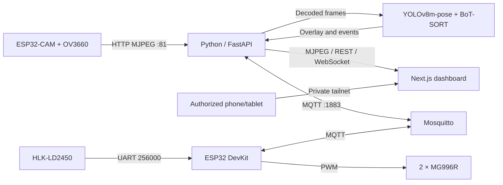

<div align="center">
  
</div>

<div align="center">
  <p align="center"><strong>Private monitoring for older adults living alone</strong></p>
  <p align="center">Pose analysis · mmWave radar · Pan/tilt camera · Private remote access</p>

  <p align="center">
    
    
    
    
    
    
    
  </p>

  <p align="center"><a href="README-en.md">English</a> • <a href="README.md">Tiếng Việt</a></p>
</div>

---

FallGuard combines a camera, mmWave radar, pan/tilt servos, and pose-estimation software in a locally hosted monitoring system. The backend processes video and radar data, evaluates possible fall events, stores event metadata, and coordinates device control. A responsive web dashboard provides live viewing, configuration, and manual/automatic camera control.

The system is designed as a **proof of concept** for monitoring an older adult who lives alone. It is not a certified medical or life-safety system.

## At a glance

| Component | Responsibility |
|---|---|
| ESP32-CAM + OV3660 | Captures images and serves an MJPEG stream over the local network. |
| ESP32 DevKit | Reads the LD2450 radar, receives MQTT commands, and drives PAN/TILT PWM. |
| Mosquitto | Relays radar data and control messages between the backend and the DevKit. |
| Python backend | Runs FastAPI, camera/AI workers, MQTT, alerts, and SQLite persistence. |
| Next.js frontend | Displays video, controls, radar/room configuration, and alerts. |
| Tailscale (optional) | Gives explicitly authorized caregivers private remote access to the hosted dashboard. |



## Repository layout

```text
Embedded system/
├── backend/
│   ├── main.py                    # FastAPI, MQTT, camera/AI workers, routes
│   ├── fall_detection.py          # Fall-state evaluation logic
│   ├── fall_detection_stable.py   # Alternative detector implementation
│   ├── servo_protocol.py          # Servo protocol payload/capability helpers
│   ├── database.py                # SQLite event metadata
│   ├── requirements.txt           # Python dependencies
│   ├── .env.example               # Environment template
│   ├── yolov8m-pose.pt            # Accuracy-priority pose model, if included
│   ├── mosquitto_local.conf       # LAN broker example
│   ├── mock_hardware.py            # MQTT hardware simulator
│   ├── test_fall_detection.py
│   ├── test_zone_config.py
│   └── test_servo_control.py
├── frontend/
│   ├── app/
│   │   ├── page.tsx               # Main monitoring dashboard
│   │   ├── CameraControlPanel.tsx # Camera mode and movement controls
│   │   ├── ServoCalibrationPanel.tsx
│   │   ├── RadarMap.tsx            # Radar map component
│   │   ├── analytics/page.tsx     # Room, zone, and radar configuration
│   │   ├── logs/page.tsx          # Dashboard event log
│   │   ├── settings/page.tsx      # Application settings
│   │   └── context/                # Shared UI state and localization
│   ├── package.json
│   └── package-lock.json
├── hardware/
│   ├── esp32_cam_stream.ino       # Flash this sketch to the ESP32-CAM
│   └── esp32_cam_radar.ino        # Flash this sketch to the ESP32 DevKit
├── snapshots/                     # Runtime snapshots, if enabled
├── README-en.md                   # English project guide
└── README.md                      # Vietnamese project guide / root readme
```

Local `.env` files, virtual environments, model exports, logs, databases, and snapshots are machine/runtime data. Do not commit credentials or private monitoring data. If model weights are absent from a clone, provide the approved model file and set `POSE_MODEL_PATH` accordingly.

## Hardware and firmware

### Firmware: which file goes to which board

| Sketch | Target board in Arduino IDE | Function |
|---|---|---|
| `hardware/esp32_cam_stream.ino` | **AI Thinker ESP32-CAM** | OV3660 capture, Wi-Fi, MJPEG stream, and camera status/tuning endpoint. |
| `hardware/esp32_cam_radar.ino` | **ESP32 Dev Module** | LD2450 UART, MQTT, two servo axes, MANUAL/AUTO logic. |

The camera board shown in the project setup uses an ESP-32S module and an OV3660 flex. The camera firmware currently selects the AI Thinker ESP32 pin profile based on the board configuration that has previously worked. The carrier-board pinout and camera sensor are separate facts; check the serial boot log after flashing. Do not flash the servo/radar sketch to the camera board or vice versa.

If Arduino IDE has a temporary copy open (such as `sketch_oct8a.ino`), editing `hardware/esp32_cam_radar.ino` will not update that copy. Open the project firmware, restore your local Wi-Fi/MQTT settings, flash it, and check the `fw=` value in the `[BOOT]` line.

### Pin map and power

| Signal | ESP32 DevKit pin |
|---|---:|
| Servo PAN | GPIO13 |
| Servo TILT | GPIO27 |
| LD2450 UART RX2 | GPIO32 |
| LD2450 UART TX2 | GPIO17 |

`esp32_cam_radar.ino` uses PAN GPIO13 and TILT GPIO27. If the physical TILT signal is connected to GPIO12, the wiring and sketch do not match: move the wire to GPIO27 or change `TILT_PIN` and reflash. GPIO12 is a boot-strapping pin on classic ESP32 boards, so verify its boot-level requirements before choosing it.

- Power MG996R servos from a suitable 5 V rail, not an ESP32 GPIO or 3.3 V pin. Connect servo-supply ground to ESP32 ground so the PWM signal has a shared reference.
- The reported 12 V/5 A adapter and XL4015 do not by themselves prove that 5 V stays stable at the servos under load. Measure at the servo rail while both axes start and move; check wiring, converter temperature, and voltage drop.
- Set safe mechanical limits before enabling AUTO. Keep the camera mount clear of hard stops.
- The LD2450 UART uses 256000 baud, 8N1. Serial Monitor remains at 115200 baud; these are separate links.

### Arduino setup

1. Install [Arduino IDE](https://www.arduino.cc/en/software).
2. In **Preferences → Additional Boards Manager URLs**, add:

   ```text
   https://espressif.github.io/arduino-esp32/package_esp32_index.json
   ```

3. Install **esp32 by Espressif Systems** from Boards Manager.
4. Install **PubSubClient** and **ESP32Servo** from Library Manager for the DevKit sketch.
5. Open the correct `.ino`, select the board from the table above, choose the correct COM port, and configure Wi-Fi/broker values where needed.
6. Flash one board at a time. Open its Serial Monitor at **115200 baud** to confirm boot and network status.

## Software requirements

| Tool | Recommended version | Used by |
|---|---|---|
| Python | 3.11 x64 | Backend and inference dependencies. |
| Node.js | 20.9 or newer | Next.js 16 frontend and npm. |
| Mosquitto | Current Windows release | MQTT broker. |
| Arduino IDE 2 | Current release | ESP32 compile and upload. |
| Git for Windows | Optional | Cloning and updating the repository. |

Download from the official sites: [Python](https://www.python.org/downloads/windows/), [Node.js](https://nodejs.org/en/download), [Mosquitto](https://mosquitto.org/download/), [Arduino IDE](https://www.arduino.cc/en/software), and [Git](https://git-scm.com/download/win). Next.js 16 requires Node.js 20.9 or newer; see the [official installation requirements](https://nextjs.org/docs/app/getting-started/installation).

## Quick start on Windows

Open PowerShell in the repository root. Use separate terminal windows for the broker, backend, and frontend so each process has its own visible logs.

### Terminal 1 — MQTT broker

Check whether Mosquitto is already running as a Windows service:

```powershell
Get-Service mosquitto -ErrorAction SilentlyContinue
```

If the service is not running, start the project broker from the `backend` directory:

```powershell
cd backend
& 'C:\Program Files\mosquitto\mosquitto.exe' -c '.\mosquitto_local.conf' -v
```

If Mosquitto is installed elsewhere, update the executable path. Run only one broker on TCP port 1883. The sample config is intended for a trusted LAN and allows anonymous access; do not expose it to the public Internet.

### Terminal 2 — Python backend

Create and activate the virtual environment, install packages, create the local configuration, then start FastAPI:

```powershell
cd backend
python -m venv venv
.\venv\Scripts\Activate.ps1
python -m pip install --upgrade pip
pip install -r requirements.txt
if (-not (Test-Path .env)) { Copy-Item .env.example .env }
notepad .env
python main.py
```

Edit `.env` before the final command. At minimum, set the broker and camera addresses for this network:

```ini
SERVO_PROTOCOL=legacy_step
MQTT_BROKER=192.168.1.10
VIDEO_SOURCE=http://192.168.1.50:81/stream
AI_FPS_LIMIT=15
POSE_MODEL_PATH=yolov8m-pose.pt
TELEGRAM_BOT_TOKEN=your_bot_token_here
TELEGRAM_CHAT_ID=your_chat_id_here
```

`MQTT_BROKER` is the computer running Mosquitto. `VIDEO_SOURCE` is the ESP32-CAM address. Firmware Wi-Fi credentials are configured in the sketches. Keep `.env` private. The backend API is at `http://localhost:8000`; interactive API documentation is at `http://localhost:8000/docs`.

Telegram alerts are optional. Leave the placeholder values if you do not want Telegram notifications. To enable them, configure **both** `TELEGRAM_BOT_TOKEN` and `TELEGRAM_CHAT_ID` as described below.

### Create a Telegram bot and obtain the two values

1. Open Telegram and start a chat with the official **[@BotFather](https://t.me/BotFather)** account.
2. Send `/newbot`. Follow the prompts to choose a display name and a unique username; the username normally ends in `bot` (for example, `FallGuardHomeBot`).
3. BotFather returns an API token. Copy it into `TELEGRAM_BOT_TOKEN`. Treat it as a password: anyone with it can control the bot. Do not post it in chat, screenshots, GitHub, or support logs.
4. Open the newly created bot using its `t.me/<bot_username>` link, press **Start**, and send `/start`. A bot cannot message a user until that user has started the conversation.
5. In PowerShell, use the token to inspect the bot's pending updates and find the destination `chat.id`:

   ```powershell
   $secureToken = Read-Host 'Paste the bot token' -AsSecureString
   $credential = [System.Net.NetworkCredential]::new('', $secureToken)
   $token = $credential.Password
   $updates = Invoke-RestMethod -Uri "https://api.telegram.org/bot$token/getUpdates"
   $updates.result | ConvertTo-Json -Depth 10
   Remove-Variable token, credential, secureToken
   ```

   Find `message.chat.id` for the `/start` message you just sent. If `result` is empty, send `/start` to the bot again and rerun the command. For a group destination, add the bot to the group, send a message there, and use the group's `chat.id` (usually a negative number).
6. Put the token and chat ID in `backend/.env`:

   ```ini
   TELEGRAM_BOT_TOKEN=<token-from-BotFather>
   TELEGRAM_CHAT_ID=<destination-chat-id>
   ```

7. Save `.env` and restart the backend so it reloads the variables. Telegram delivery is attempted when the backend confirms a fall event; check the backend log for `Telegram Alert Sent Successfully!` or an API error. The current backend applies a 60-second Telegram cooldown.

If the token is exposed, revoke/regenerate it through BotFather and update `.env` immediately. The token is embedded in Telegram Bot API request URLs by design; avoid copying those URLs into browser history, screenshots, or shared logs. The PowerShell example keeps the token out of the literal command history and does not print it.

On later runs, after dependencies and `.env` are set up:

```powershell
cd backend
.\venv\Scripts\Activate.ps1
python main.py
```

### Terminal 3 — Next.js dashboard

```powershell
cd frontend
npm ci
npm run dev
```

Open `http://localhost:3000`. `npm ci` installs the exact dependency versions in `package-lock.json`; later runs only need `npm run dev`.

For a local production build:

```powershell
cd frontend
npm run build
npm run start
```

### Recommended startup order

1. Power the devices and confirm their wiring. Use each board's serial log to find its IP.
2. Start Mosquitto.
3. Start the backend and wait for camera/model startup logs.
4. Start the frontend and open the dashboard.
5. Verify the video, radar, and MANUAL movement separately before enabling AUTO.

## Private remote access with Tailscale

The system can remain hosted on a home computer while an authorized caregiver opens the dashboard remotely from a phone, tablet, or computer. The host continues to run the backend and frontend locally; Tailscale provides a private, authenticated network path between approved devices. This avoids forwarding the dashboard to the public Internet.

### Setup

1. Install Tailscale on the Windows host running the application and on each caregiver device.
2. Sign the devices into the intended tailnet. Invite only the people who should be able to view or control the system.
3. In the Tailscale admin console, use Grants/ACLs to allow the selected users or group to reach the host on **TCP 3000** (dashboard) and **TCP 8000** (API/video). Restrict Windows Firewall inbound rules to the intended tailnet devices/interface.
4. Start the broker, backend, and frontend as described above. The current Next.js script binds to `0.0.0.0`, and Uvicorn also binds to `0.0.0.0`, so they can accept connections on the host's network interfaces.
5. Get the host's Tailscale IPv4 address:

   ```powershell
   tailscale ip -4
   ```

6. On a phone/tablet that is signed in and authorized, open:

   ```text
   http://<HOST-TAILSCALE-IP>:3000
   ```

   For example, the address may look like `http://100.x.y.z:3000`.

The frontend derives its default API hostname from the address in the browser, so opening the dashboard through the host's Tailscale IP also directs API/video requests to port 8000 on that host. If a Server URL was manually saved in the dashboard, set it to `http://<HOST-TAILSCALE-IP>:8000`.

Remote caregivers do **not** need MQTT port 1883 or the camera's raw stream/status ports 81/82. Do not use Tailscale Funnel for this private monitoring dashboard. Tailscale Serve is a separate reverse-proxy option and should only be added after planning how it will route both the frontend and API.

> **Access-control limitation:** the repository does not currently implement an application login or per-user roles. Anyone allowed through the tailnet to reach the dashboard/API can view the camera and issue controls. Grant access only to trusted people/devices and limit the permitted ports in the tailnet policy. Tailscale network access is not a substitute for application-level roles.

Tailscale assigns a stable tailnet IP to each node and supports MagicDNS when enabled. Connections within the tailnet are encrypted; access still depends on the host being online, the user's tailnet identity and policy, Windows Firewall, and the Internet connection. See Tailscale's [Grants documentation](https://tailscale.com/docs/features/access-control/grants), [IP and DNS reference](https://tailscale.com/kb/1033/ip-and-dns-addresses/), and [Serve/Funnel overview](https://tailscale.com/docs/features/tailscale-funnel).

### Privacy practices

- Keep the host in a physically secure location and use a protected Windows account.
- Tell the monitored person and caregivers what the camera captures and how long event data is kept.
- Retain only the snapshots/logs needed for the intended use; review storage periodically.
- Never commit `.env`, Wi-Fi passwords, bot tokens, private images, or local databases.
- Do not port-forward the dashboard, API, broker, or camera to the public Internet.

## Mobile-friendly dashboard

The UI includes responsive layouts for small screens. On mobile, navigation becomes a slide-in drawer, the video moves above the controls, and the analytics page stacks configuration and radar-map panels vertically. Caregivers can open the dashboard from a phone or tablet after joining the authorized tailnet.

Portrait orientation is a practical starting point; landscape can provide a larger video view. MJPEG can use substantial mobile data and battery, and responsiveness depends on the phone, Wi-Fi/mobile connection, host performance, and stream quality. Before relying on the system, check touch targets, connection status, and the manual control behavior on the intended devices.

## AI model and video pipeline

### Pose model

The backend defaults to **YOLOv8m-pose** (`yolov8m-pose.pt`) to favor person and keypoint recognition in distant or partially occluded scenes. **YOLOv8n-pose INT8** (`yolov8n-pose_int8.onnx`) remains available through `POSE_MODEL_PATH` when CPU throughput is the priority; it may miss more difficult poses. The larger model can lower AI inference FPS, while the separate RAW camera stream remains unaffected. Validate both detection and fall-event behavior at the installed camera angle and lighting. The pose model is pretrained for people/keypoints, not specifically for falls. **BoT-SORT** maintains person IDs across frames using `persist=True`.

At startup the backend selects an available acceleration path (TensorRT/OpenVINO where supported) and falls back to PyTorch when an optimized runtime is unavailable. First startup can take longer while weights or runtime artifacts are loaded/exported. Actual throughput depends on CPU/GPU, frame size, number of people, and software versions. References: [YOLOv8](https://docs.ultralytics.com/models/yolov8), [COCO Pose](https://docs.ultralytics.com/datasets/pose/coco), and [tracking mode](https://docs.ultralytics.com/modes/track).

### Camera path and frame rate

ESP32-CAM captures JPEG frames and serves multipart MJPEG on port 81. The backend reads the HTTP stream, decodes JPEG with OpenCV, passes recent frames to the AI worker, adds overlays/events, then serves an MJPEG stream to the dashboard. Small latest-frame queues prioritize freshness and may drop old frames when inference cannot keep up.

The camera firmware uses JPEG and a 20 MHz XCLK. It selects VGA when PSRAM is available and falls back to a smaller mode when it is not. The camera exposes stream `:81/stream` and status/tuning endpoints on port 82. Camera input FPS (`RAW FPS`) and AI overlay FPS are separate. `AI_FPS_LIMIT=15` is only an AI ceiling; a recent measurement on this setup showed about 10 raw FPS, so AI output cannot exceed the camera input rate. Compare `/api/v1/video/status`, `[VIDEO-INGEST]`, and `[VIDEO-AI]` to find the bottleneck. Switching the backend model does not require reflashing the firmware.

### Fall-evaluation logic

`backend/fall_detection.py` evaluates pose geometry over time for each tracked person. For a box `(x1,y1,x2,y2)`:

```text
width        = x2 - x1
height       = y2 - y1
aspect_ratio = width / max(height, epsilon)
```

Using the shoulder center `(sx, sy)` and hip center `(hx, hy)`, the torso angle is approximated by:

```text
spine_angle = degrees(atan2(abs(hy - sy), abs(hx - sx)))
```

An upright torso tends toward 90 degrees; a horizontal torso tends toward 0 degrees. The detector combines torso orientation, horizontal box shape, body-center drop normalized by body height, change over time, prior upright state, and post-impact stability. An exponential moving average (EMA) reduces frame-to-frame noise:

```text
filtered = alpha * current + (1 - alpha) * previous_filtered
```

This is a heuristic based on image observations, not a medical diagnosis. Occlusion, sitting/lying poses, camera angle, motion blur, lighting, and tracker ID changes can cause missed or false detections. Validate thresholds with representative local footage. Some multi-person cases intentionally suppress fall evaluation to reduce ambiguous alerts.

### Target tracking and servo angles

The radar path uses LD2450 coordinates `(x,y)` in millimeters. Firmware estimates azimuth and servo angles as:

```text
azimuth = atan2(x, y) * 180 / pi
PAN = 90 - azimuth

distance = sqrt(x*x + y*y)
elevation = atan2(camera_height - target_height, distance) * 180 / pi
TILT = 90 - elevation
```

Radar coordinates are smoothed with an EMA before the target angles are applied. Firmware clamps target angles and smooths PWM movement. Camera/target heights and servo center must reflect the physical installation; angle commands are not measured feedback because the servos do not report encoder position.

The vision path uses a detected person's bounding-box center, normalizes it to a 640×480 reference plane, and compares it with image center `(320,240)`. A deadband avoids updates near the center. The legacy step firmware applies a proportional adjustment approximately as follows:

```text
error_x = normalized_x - 320
error_y = normalized_y - 240
PAN  -= gain_pan  * error_x
TILT += gain_tilt * error_y
```

Radar is preferred while fresh; vision can be used as a fallback according to the current backend/firmware logic. Axis signs depend on how the camera and servos are mounted. Confirm wiring and direction before changing gains.

## Radar setup and room calibration

1. Connect LD2450 TX to ESP32 RX GPIO32 and radar RX to ESP32 TX GPIO17 if commands are needed; share ground and use the sensor's specified supply.
2. Open the DevKit Serial Monitor at 115200 baud. The firmware's UART2 link to the radar runs at 256000 baud.
3. Check `[RADAR-DIAG]`: `new_bytes` and valid frame counts should increase continuously. `health=NO_UART_DATA` means no new bytes on GPIO32; `health=INVALID_FRAME` means received bytes do not form LD2450 frames. Verify TX/RX, baud, ground, power, and radar output mode.
4. Move a target through the radar field and confirm X/Y signs and distance.
5. Configure room dimensions, radar position/rotation, and safety zones in the dashboard analytics page.
6. Test MANUAL servo movement first. Enable AUTO and check left/right, near/far, and vertical behavior before fine-tuning gains.

On the map, drag a colored zone to reposition it and edit its numeric MIN/MAX fields to resize it. Press **Save Config** to persist the room and zones; radar processing reloads the saved values within about one second. Zones must stay within the room and each minimum must be lower than its maximum. A `DANGER_ZONE` event is emitted when a target enters a danger area. The safe zone is used for the existing night-wandering rule: a moving target must remain outside it for more than five minutes between 23:00 and 05:00.

The room map applies a rotation and translation to local radar coordinates:

```text
X_room = radar_x + x*cos(theta) + y*sin(theta)
Y_room = radar_y - x*sin(theta) + y*cos(theta)
```

Keep the map origin, axis directions, and sensor mounting angle consistent. Dashboard zone fields use millimeters; the backend stores radar/room coordinates in meters.

## Communication and API

### MQTT protocol

Mosquitto uses TCP port 1883. Main topics include `embedded/servo/mode`, `embedded/servo/manual`, `embedded/servo/tracking`, `embedded/servo/status`, and `embedded/radar/data`. The DevKit and backend must use the same broker address.

The current `esp32_cam_radar.ino` firmware uses the `legacy_step` protocol: `LEFT`, `RIGHT`, `UP`, `DOWN`, and `RESET`. Manual commands change the target by a finite step. Set `SERVO_PROTOCOL=legacy_step` in `backend/.env`; the backend code's fallback default is `sequenced_hold`, so do not omit this setting for this firmware. A successful HTTP/MQTT publish confirms message delivery to the broker, not physical servo motion.

### Main backend endpoints

| Endpoint | Purpose |
|---|---|
| `GET /api/v1/video/stream` | AI-overlay MJPEG stream. |
| `GET /api/v1/video/live` | Live/raw preview stream. |
| `GET /api/v1/video/status` | Camera and AI diagnostics. |
| `GET, POST /api/v1/config/camera` | Read/update camera stream source. |
| `GET /api/v1/radar/history` | Recent radar data. |
| `GET, POST /api/v1/config/zones` | Read/update zones. |
| `GET, POST /api/v1/config/room` | Read/update room transform. |
| `GET /api/v1/servo/diag` | Servo protocol/telemetry diagnostics. |
| `POST /api/v1/camera/move` | Send a manual direction command. |
| `GET, POST /api/v1/camera/mode` | Read/change MANUAL or AUTO mode. |
| `WS /api/v1/ws/alerts` | Push events to connected dashboards. |

`http://localhost:3000/api/v1` is not the backend API and may return 404. Use `http://localhost:8000/docs` or a specific backend route.

## Frameworks and libraries

| Layer | Main technology |
|---|---|
| Frontend | Next.js 16, React 19, TypeScript, Tailwind CSS 4 |
| UI and charts | lucide-react, next-themes, Recharts |
| Backend | Python, FastAPI, Uvicorn |
| Video and AI | OpenCV, Ultralytics, PyTorch, OpenVINO; TensorRT where available |
| Messaging/network | Paho MQTT, Mosquitto, HTTP, WebSocket |
| Data | SQLite, NumPy |
| Firmware | Arduino ESP32 core, PubSubClient, ESP32Servo, Espressif camera driver |

Python packages are listed in `backend/requirements.txt`; exact frontend dependencies are in `frontend/package-lock.json`.

## Troubleshooting

| Symptom | First checks |
|---|---|
| Dashboard/API unavailable | Confirm backend is running on port 8000; open `/docs`; check the configured Server URL and firewall. |
| Port 8000 or 1883 bind error | Another process is using the port. Stop the duplicate backend/broker and keep one instance per port. |
| Servo appears offline, but MQTT is connected | Check protocol selection. The legacy firmware does not publish the same online/position telemetry as the diagnostic firmware; inspect the DevKit serial log and physical motion. |
| Joystick command does not move the servos | Check MANUAL mode, API response, broker address, MQTT topic/payload, board serial log, GPIO wiring, and the loaded firmware. |
| Servo jitters or ESP32 resets | Measure 5 V at the servo under load; inspect XL4015 current/temperature, common ground, wiring, and mechanical binding. |
| Radar bytes arrive but valid frames do not | Verify 256000-baud UART, LD2450 TX → ESP32 GPIO32, common ground, power, and LD2450 output mode. |
| Camera stream is slow | Compare raw and AI FPS, reduce viewer count, try QVGA, check PSRAM/Wi-Fi/inference time. Raising the FPS ceiling cannot make the host process faster. |
| Camera does not connect to backend | Open `http://<CAMERA-IP>:81/stream` on the same LAN and update `VIDEO_SOURCE` if its IP changed. |
| Radar map is mirrored or offset | Check millimeter units, X/Y sign convention, map origin, and room rotation. |

Useful diagnostics include boot/reset reason, `[RADAR-DIAG]`, `[SERVO-DIAG]`, MQTT connection logs, `/api/v1/video/status`, and `/api/v1/servo/diag`. Never share `.env`, Wi-Fi credentials, or alert-service tokens publicly.

## Data and operational limits

- The backend stores event metadata in SQLite. Run `main.py` from `backend` so relative paths remain predictable.
- Snapshots and debug logs can accumulate; review retention and available disk space.
- The dashboard's event list is driven by WebSocket/client state; do not assume every UI acknowledgement is a durable server-side audit record.
- Radar presence is not identity verification. Vision tracking can lose IDs or estimate incorrect keypoints.
- This proof of concept can miss events or raise false alerts. Do not use it as the sole safety mechanism for a person.

## Security and privacy

The sample Mosquitto config is intended for a trusted LAN and allows anonymous connections. Do not expose MQTT, camera ports, API, or dashboard through public router port-forwarding. Use Tailscale access policies and Windows Firewall to limit remote access to named caregivers and TCP 3000/8000. The application itself currently has no login or per-user roles. Protect host accounts, explain camera use to the monitored person, and keep private video/database/configuration files out of source control.

## References

- [Arduino ESP32 core installation](https://docs.espressif.com/projects/arduino-esp32/en/latest/installing.html)
- [ESP32 strapping pins](https://docs.espressif.com/projects/esp-idf/en/stable/esp32/api-reference/peripherals/sd_pullup_requirements.html)
- [FastAPI](https://fastapi.tiangolo.com/)
- [Next.js installation requirements](https://nextjs.org/docs/app/getting-started/installation)
- [Ultralytics YOLOv8](https://docs.ultralytics.com/models/yolov8)
- [Ultralytics tracking](https://docs.ultralytics.com/modes/track)
- [Mosquitto](https://mosquitto.org/documentation/)
- [Tailscale Grants](https://tailscale.com/docs/features/access-control/grants)
- [Tailscale IP addresses and DNS](https://tailscale.com/kb/1033/ip-and-dns-addresses/)
- [Tailscale Serve and Funnel](https://tailscale.com/docs/features/tailscale-funnel)
- [Telegram bot creation and BotFather](https://core.telegram.org/bots#how-do-i-create-a-bot)
- [Telegram Bot API — getUpdates](https://core.telegram.org/bots/api#getupdates)
