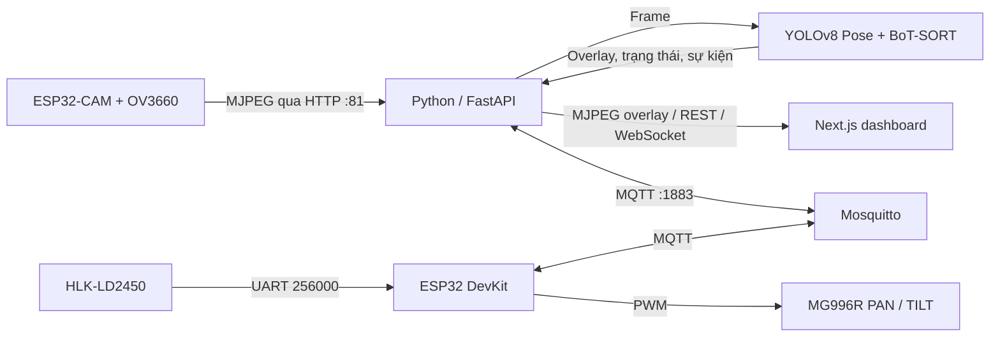

<div align="center">
  
</div>

<div align="center">
  <p><strong>Hệ thống giám sát riêng tư cho người cao tuổi sống một mình</strong></p>
  <p>Phân tích tư thế · Radar mmWave · Camera PAN/TILT · Truy cập từ xa qua Tailscale</p>
  <p>
    
    
    
    
    
    
    
  </p>
  <p><a href="README-en.md">English</a> • <a href="README.md">Tiếng Việt</a></p>
</div>

---

### Giám sát, phân tích tư thế và điều khiển camera hai trục

FallGuard kết nối camera, radar mmWave, servo và mô hình AI thành một luồng xử lý thống nhất. Backend tiếp nhận hình ảnh và dữ liệu radar, phân tích người trong khung hình, phát cảnh báo và gửi lệnh điều khiển. Dashboard hiển thị hình ảnh, trạng thái thiết bị và công cụ cấu hình.

---

## Bắt đầu nhanh

Mở **PowerShell** tại thư mục dự án. Các khối lệnh bên dưới có thể sao chép trực tiếp.

### 1. Cài môi trường Python và thư viện backend

```powershell
cd backend
python -m venv venv
.\venv\Scripts\Activate.ps1
python -m pip install --upgrade pip
pip install -r requirements.txt
```

### 2. Tạo cấu hình riêng cho máy này

```powershell
if (-not (Test-Path .env)) { Copy-Item .env.example .env }
notepad .env
```

Điền IP máy chạy MQTT broker và IP ESP32-CAM vào `.env` trước khi chạy.

### 3. Khởi động backend

```powershell
python main.py
```

### 4. Mở terminal mới để chạy dashboard

```powershell
cd frontend
npm ci
npm run dev
```

Mở `http://localhost:3000`. Trước đó, hãy bật Mosquitto và nạp đúng firmware lên từng bo theo bảng ở phần [Firmware](#firmware-đúng-file-đúng-bo).

---

## 1. Sơ đồ hệ thống



| Khối | Nhiệm vụ |
|---|---|
| ESP32-CAM | Lấy hình từ cảm biến OV3660 và phát MJPEG trong mạng nội bộ. |
| ESP32 DevKit | Đọc LD2450, nhận lệnh MQTT và phát PWM điều khiển PAN/TILT. |
| Mosquitto | Chuyển tiếp lệnh và dữ liệu radar giữa backend và ESP32 DevKit. |
| Backend | Quản lý video/AI, API, MQTT, cảnh báo và metadata SQLite. |
| Frontend | Dashboard, cấu hình phòng/vùng và điều khiển camera. |

## 2. Cấu trúc thư mục

```text
Embedded system/
├── backend/
│   ├── main.py                        # FastAPI, MQTT, camera/AI workers, REST, WebSocket
│   ├── fall_detection.py              # Logic đánh giá trạng thái té ngã
│   ├── fall_detection_stable.py       # Biến thể thuật toán riêng
│   ├── servo_protocol.py              # Payload và khả năng theo giao thức servo
│   ├── database.py                    # Lưu metadata bằng SQLite
│   ├── requirements.txt               # Thư viện Python
│   ├── .env.example                   # Mẫu cấu hình môi trường
│   ├── yolov8m-pose.pt                # Model pose ưu tiên độ chính xác (nếu có)
│   ├── mosquitto_local.conf           # Cấu hình Mosquitto cho LAN thử nghiệm
│   ├── mock_hardware.py               # Mô phỏng một phần giao tiếp MQTT
│   ├── test_fall_detection.py
│   ├── test_zone_config.py
│   └── test_servo_control.py
├── frontend/
│   ├── app/
│   │   ├── page.tsx                   # Dashboard chính
│   │   ├── CameraControlPanel.tsx     # Chọn chế độ và điều khiển camera
│   │   ├── ServoCalibrationPanel.tsx
│   │   ├── RadarMap.tsx               # Bản đồ mục tiêu radar
│   │   ├── analytics/page.tsx         # Phân tích, phòng và vùng
│   │   ├── logs/page.tsx              # Nhật ký trên dashboard
│   │   ├── settings/page.tsx          # Cài đặt ứng dụng
│   │   └── context/                   # Ngôn ngữ, cảnh báo và giao diện
│   ├── package.json
│   └── package-lock.json
├── hardware/
│   ├── esp32_cam_stream.ino           # Firmware nạp vào ESP32-CAM
│   └── esp32_cam_radar.ino            # Firmware nạp vào ESP32 DevKit
├── snapshots/                         # Ảnh sự kiện nếu được cấu hình lưu tại đây
├── README-en.md                       # Bản tiếng Anh
└── README.md                          # Bản tiếng Việt
```

>`backend/.env`, virtual environment, model đã chuyển đổi và cơ sở dữ liệu là dữ liệu theo máy hoặc phát sinh khi chạy. Không đưa secrets vào Git. Nếu file trọng số không có trong bản clone, cần cung cấp/tải model theo chính sách của dự án và đặt đúng `POSE_MODEL_PATH`.

## 3. Phần cứng

| Phần cứng | Mục đích / thông tin cần lưu ý |
|---|---|
| ESP32-CAM dùng module ESP-32S và camera flex OV3660 | Firmware chọn profile camera AI Thinker ESP32 theo cấu hình hiện tại; profile board và mã sensor là hai thông tin riêng. Kiểm tra log nhận sensor sau khi nạp. |
| ESP32 DevKit | Đọc radar và điều khiển hai servo; Arduino IDE chọn **ESP32 Dev Module**. |
| HLK-LD2450 | UART mặc định 256000 baud, 8N1; lắp cố định theo hướng đã đo đạc. |
| 2 × MG996R | Servo PAN và TILT; cần rail nguồn 5 V đủ dòng khi tải. |
| Adapter 12 V / 5 A + XL4015 | Bộ hạ áp. Đo đầu ra tại tải trước khi cắm thiết bị và kiểm tra sụt áp khi servo chuyển động. |
| Máy tính Windows | Chạy Mosquitto, backend Python và frontend Next.js. |

### Nguồn servo

- Cấp servo bằng nguồn 5 V phù hợp; nối **GND nguồn servo với GND ESP32** để PWM có cùng mốc tín hiệu.
- Không cấp dòng servo từ GPIO hoặc chân 3.3 V. Dây nguồn servo nên đủ tiết diện và ngắn; kiểm tra XL4015 không quá nhiệt.
- Nếu ESP32 reset hoặc servo rung, đo rail 5 V ngay tại servo khi khởi động/quay. Adapter ghi 5 A không bảo đảm module hạ áp và dây dẫn đưa đủ dòng đến tải.
- Đặt giới hạn cơ khí an toàn trước khi chạy AUTO; tránh để servo đẩy camera vào cữ cứng.

### Sơ đồ chân firmware

Trong `esp32_cam_radar.ino`, PAN mặc định là GPIO13, TILT GPIO27; radar LD2450 TX nối vào ESP32 RX GPIO32, còn LD2450 RX có thể nối vào ESP32 TX GPIO17. Nếu dây TILT thực tế đang ở GPIO12 thì firmware và dây **chưa khớp**: chuyển dây về GPIO27 hoặc sửa `TILT_PIN` trong sketch rồi nạp lại. GPIO12 là chân strapping trên ESP32 cổ điển, nên cần kiểm tra ảnh hưởng khởi động trước khi chọn chân này.

## 4. Firmware

Hai sketch có vai trò khác nhau. Không nạp chéo.

| Tên file | Bo cần nạp | Board trong Arduino IDE | Chức năng |
|---|---|---|---|
| `hardware/esp32_cam_stream.ino` | ESP32-CAM | **AI Thinker ESP32-CAM** | Camera OV3660, Wi-Fi, MJPEG stream và endpoint trạng thái/cấu hình camera. |
| `hardware/esp32_cam_radar.ino` | ESP32 DevKit thường | **ESP32 Dev Module** | LD2450 qua UART, MQTT, hai servo PAN/TILT và điều khiển MANUAL/AUTO. |

### Cài Arduino IDE và thư viện

1. Cài [Arduino IDE](https://www.arduino.cc/en/software).
2. Trong **Preferences → Additional Boards Manager URLs**, thêm URL Espressif:

   ```text
   https://espressif.github.io/arduino-esp32/package_esp32_index.json
   ```

3. Trong **Boards Manager**, cài `esp32` của Espressif Systems.
4. Trong **Library Manager**, cài `PubSubClient` và `ESP32Servo` cho sketch radar/servo.
5. Mở đúng `.ino`, chọn board như bảng phía trên và chọn đúng cổng COM.
6. Cấu hình Wi-Fi/broker trong sketch nếu các giá trị còn là placeholder hoặc mạng đã đổi.
7. Nạp từng bo riêng. Mở Serial Monitor ở **115200 baud** để xem log boot và IP.

Nếu Arduino IDE đang mở một bản sao tạm như `sketch_oct8a.ino`, thay đổi trong `hardware/esp32_cam_radar.ino` sẽ không tự cập nhật bản sao đó. Mở đúng firmware trong dự án, điền lại cấu hình Wi-Fi/MQTT của bạn, nạp lại và đối chiếu `fw=` ở dòng `[BOOT]`.

Radar UART 256000 baud là tốc độ riêng giữa LD2450 và ESP32; Serial Monitor vẫn để 115200.

## 5. Môi trường cần cài

| Phần mềm | Phiên bản/gợi ý | Dùng cho |
|---|---|---|
| Python | 3.11 x64 khuyến nghị; requirements có thể cần hiệu chỉnh nếu dùng bản quá mới | Backend và AI. |
| Node.js | Bản LTS | Frontend và npm. |
| Mosquitto | Bản Windows hiện hành | MQTT broker. |
| Arduino IDE 2 | Bản hiện hành | Compile và nạp hai firmware. |
| Git for Windows | Tùy chọn | Clone/cập nhật repository. |

Tải từ trang chính thức: [Python for Windows](https://www.python.org/downloads/windows/), [Node.js](https://nodejs.org/en/download), [Mosquitto](https://mosquitto.org/download/), [Arduino IDE](https://www.arduino.cc/en/software), [Git](https://git-scm.com/download/win).

## 6. Cấu hình theo mạng hiện tại

### Backend `.env`

Tại `backend`, tạo file `.env` từ mẫu nếu đây là lần cài mới. Nếu `.env` đã tồn tại, giữ lại và chỉ cập nhật giá trị cần thiết:

```powershell
cd backend
if (-not (Test-Path .env)) { Copy-Item .env.example .env }
notepad .env
```

Các giá trị quan trọng:

```ini
SERVO_PROTOCOL=legacy_step
MQTT_BROKER=192.168.1.10
VIDEO_SOURCE=http://192.168.1.50:81/stream
AI_FPS_LIMIT=15
POSE_MODEL_PATH=yolov8m-pose.pt
TELEGRAM_BOT_TOKEN=your_bot_token_here
TELEGRAM_CHAT_ID=your_chat_id_here
```

- `MQTT_BROKER`: IPv4 của máy đang chạy Mosquitto (ví dụ `192.168.1.10`).
- `VIDEO_SOURCE`: địa chỉ IP ESP32-CAM và cổng stream 81 (ví dụ `192.168.1.50`), không phải IP DevKit hay IP broker.
- `SERVO_PROTOCOL`: phải khớp giao thức của firmware hiện hành. Sketch hiện tại nhận lệnh bước `LEFT`, `RIGHT`, `UP`, `DOWN`, `RESET`, do đó dùng `legacy_step`.
- `AI_FPS_LIMIT`: trần xử lý AI, không phải cam kết FPS đầu ra.
- `POSE_MODEL_PATH`: đường dẫn đến file model pose.
- `TELEGRAM_BOT_TOKEN` và `TELEGRAM_CHAT_ID`: cấu hình tùy chọn để gửi cảnh báo té ngã qua Telegram; phải điền cả hai.

Nếu IP máy chạy Mosquitto đổi, cập nhật `MQTT_BROKER` trong `backend/.env` **và** `mqtt_server` trong `hardware/esp32_cam_radar.ino` thành cùng IP. Khởi động lại backend, nạp lại sketch đã sửa vào ESP32 DevKit và kiểm tra dòng `[BOOT] ... mqtt=<IP>:1883` trên Serial Monitor. Sửa riêng `.env` sẽ không cập nhật địa chỉ broker đã biên dịch trong firmware.

Nếu IP ESP32-CAM đổi, lấy địa chỉ mới từ dòng `[CAM-URL] VIDEO_SOURCE=...` trên Serial Monitor, rồi cập nhật **Cài đặt hệ thống → Địa chỉ IP Camera ESP32** trong dashboard; thao tác lưu sẽ cập nhật `VIDEO_SOURCE` trong `backend/.env` và đổi nguồn camera đang chạy. Cũng có thể sửa `VIDEO_SOURCE=http://<IP-camera-moi>:81/stream` trực tiếp trong `.env` rồi khởi động lại backend. Firmware camera dùng IP động nên không cần nạp lại chỉ vì IP thay đổi; chỉ nạp lại nếu đổi Wi-Fi hoặc sửa chính sketch camera.

### Tạo bot Telegram và lấy hai giá trị

1. Mở Telegram, tìm tài khoản chính thức **[@BotFather](https://t.me/BotFather)** và bắt đầu cuộc trò chuyện.
2. Gửi `/newbot`, làm theo hướng dẫn để đặt tên hiển thị và username duy nhất. Username thường kết thúc bằng `bot`, ví dụ `FallGuardHomeBot`.
3. BotFather sẽ gửi **API token**. Sao chép token này vào `TELEGRAM_BOT_TOKEN`. Hãy giữ kín như mật khẩu: người có token có thể điều khiển bot. Không gửi token vào chat, ảnh chụp màn hình, GitHub hoặc log hỗ trợ.
4. Mở bot mới bằng đường dẫn `t.me/<username_bot>`, nhấn **Start** và gửi `/start`. Bot không thể tự mở cuộc trò chuyện với người dùng trước khi người đó bắt đầu chat.
5. Dùng PowerShell để lấy `chat.id` của cuộc trò chuyện vừa bắt đầu:

   ```powershell
   $secureToken = Read-Host 'Dán token bot' -AsSecureString
   $credential = [System.Net.NetworkCredential]::new('', $secureToken)
   $token = $credential.Password
   $updates = Invoke-RestMethod -Uri "https://api.telegram.org/bot$token/getUpdates"
   $updates.result | ConvertTo-Json -Depth 10
   Remove-Variable token, credential, secureToken
   ```

   Trong kết quả, lấy giá trị `message.chat.id` của tin `/start` vừa gửi. Nếu `result` rỗng, gửi `/start` cho bot lần nữa rồi chạy lại. Nếu muốn gửi vào nhóm, thêm bot vào nhóm, gửi một tin nhắn trong nhóm và lấy `chat.id` của nhóm (thường là số âm).
6. Điền cả hai giá trị vào `backend/.env`:

   ```ini
   TELEGRAM_BOT_TOKEN=<token-tu-BotFather>
   TELEGRAM_CHAT_ID=<chat-id-nhan-canh-bao>
   ```

7. Lưu `.env` rồi khởi động lại backend để nạp cấu hình mới. Telegram được gọi khi backend xác nhận sự kiện té ngã; xem log tìm `Telegram Alert Sent Successfully!` hoặc lỗi API. Backend hiện áp dụng thời gian chờ 60 giây giữa các lần gửi Telegram.

Nếu token bị lộ, hãy thu hồi/tạo token mới qua BotFather và cập nhật `.env` ngay. Telegram Bot API dùng token trong URL của request; tránh dán URL có token vào lịch sử trình duyệt, ảnh chụp hoặc log chia sẻ. Đoạn PowerShell trên giữ token ngoài câu lệnh được lưu trong lịch sử và không in token ra màn hình.

IP thường thay đổi khi đổi router/hotspot. Chạy `ipconfig` để lấy IP máy tính; lấy IP của ESP32 từ Serial Monitor hoặc router. Khi đổi Wi-Fi, cập nhật SSID/password trong sketch của từng bo cần đổi rồi nạp lại; xử lý IP broker và IP camera theo hướng dẫn trên. Dashboard trên máy khác phải đặt Server URL về `http://<IP-máy-backend>:8000`, không dùng `localhost`.

## 7. Chạy dịch vụ trên Windows

Mỗi khối nên chạy trong một cửa sổ Terminal/PowerShell riêng để dễ theo dõi log.

### Terminal 1 — Mosquitto

Kiểm tra Windows Service trước để tránh chạy hai broker cùng cổng:

```powershell
Get-Service mosquitto -ErrorAction SilentlyContinue
```

Nếu service chưa chạy, mở terminal tại thư mục `backend`:

```powershell
cd backend
& 'C:\Program Files\mosquitto\mosquitto.exe' -c '.\mosquitto_local.conf' -v
```

Nếu cài Mosquitto ở nơi khác, thay đường dẫn executable. Chỉ giữ một broker trên TCP 1883. Cấu hình mẫu cho phép kết nối LAN không xác thực; chỉ dùng trên mạng tin cậy, không mở cổng ra Internet.

### Terminal 2 — Backend và AI

```powershell
cd backend
python -m venv venv
.\venv\Scripts\Activate.ps1
pip install -r requirements.txt
python main.py
```

Môi trường ảo chỉ cần tạo và cài thư viện lần đầu; các lần tiếp theo:

```powershell
cd backend
.\venv\Scripts\Activate.ps1
python main.py
```

Backend mặc định phục vụ API tại `http://localhost:8000`; tài liệu API tại `http://localhost:8000/docs`.

### Terminal 3 — Frontend

```powershell
cd frontend
npm ci
npm run dev
```

`npm ci` cài đúng dependency trong lockfile, thường chỉ cần ở lần cài đầu hoặc khi lockfile thay đổi. Những lần khởi chạy sau:

```powershell
cd frontend
npm run dev
```

Dashboard mặc định ở `http://localhost:3000`. Tạo bản production cục bộ bằng:

```powershell
cd frontend
npm run build
npm run start
```

### Thứ tự khởi động đề xuất

1. Kiểm tra nguồn, radar và hai bo; mở Serial Monitor nếu cần xem IP.
2. Khởi động Mosquitto.
3. Khởi động backend và đợi log tải model/khởi chạy camera worker.
4. Khởi động frontend, truy cập dashboard.
5. Kiểm tra video, dữ liệu radar và MANUAL trước; chỉ bật AUTO sau khi mỗi phần hoạt động riêng.

## 8. Mô hình AI và pipeline hình ảnh

Backend mặc định dùng **YOLOv8m-pose** (`yolov8m-pose.pt`) để ưu tiên nhận diện người và keypoint ổn định hơn trong cảnh khuất/xa; model **YOLOv8n-pose INT8** (`yolov8n-pose_int8.onnx`) có thể chọn qua `POSE_MODEL_PATH` khi cần giảm tải CPU. Model m có thể làm FPS AI thấp hơn, nhưng luồng RAW camera vẫn chạy độc lập. INT8 có thể làm giảm độ chính xác ở một số cảnh; cần kiểm chứng với góc lắp và ánh sáng thực tế. Tracker **BoT-SORT** duy trì ID đối tượng qua các frame bằng `model.track(..., persist=True, tracker="botsort.yaml")`.

Model pose pretrained cung cấp keypoint người, không phải model đã huấn luyện riêng cho té ngã. Backend ưu tiên runtime tăng tốc có sẵn (TensorRT/OpenVINO theo môi trường), rồi mới fallback PyTorch. Tốc độ thực tế tùy CPU/GPU, resolution, số người và phiên bản thư viện. Tham khảo [YOLOv8](https://docs.ultralytics.com/models/yolov8), [COCO Pose](https://docs.ultralytics.com/datasets/pose/coco) và [Tracking](https://docs.ultralytics.com/modes/track).

Luồng ảnh: ESP32-CAM gửi JPEG multipart → backend đọc HTTP và giải mã bằng OpenCV → frame mới nhất được đưa vào pipeline AI → YOLO phát hiện/track/pose → backend vẽ overlay, xử lý sự kiện và phát MJPEG cho dashboard. Hàng đợi frame nhỏ ưu tiên độ mới; khi AI chậm, frame cũ có thể bị bỏ để giảm độ trễ.

Camera firmware dùng JPEG, XCLK 20 MHz và mặc định VGA khi PSRAM khả dụng; nếu không có PSRAM sẽ fallback độ phân giải thấp hơn. ESP32-CAM có endpoint stream `:81/stream` và endpoint trạng thái/điều chỉnh `:82`. FPS camera (`RAW FPS`) khác FPS AI overlay; `AI_FPS_LIMIT=15` chỉ là trần xử lý AI. Ở lần đo trên cấu hình hiện tại, RAW stream khoảng 10 FPS nên AI không thể hiển thị nhanh hơn nguồn camera. Dùng `/api/v1/video/status`, `[VIDEO-INGEST]` và `[VIDEO-AI]` để xác định nút thắt; model INT8 không yêu cầu nạp lại firmware.

## 9. Cách thuật toán tính té ngã và bám mục tiêu

### 9.1 Đánh giá tư thế té ngã

`fall_detection.py` kết hợp hình học bounding box, keypoint vai/hông, dịch chuyển tâm người và thời gian duy trì tư thế. Từ bounding box:

```text
box_width  = x2 - x1
box_height = y2 - y1
aspect_ratio = box_width / max(box_height, epsilon)
```

Gọi tâm vai là `(sx, sy)` và tâm hông `(hx, hy)`, góc thân được ước tính:

```text
spine_angle = degrees(atan2(abs(hy - sy), abs(hx - sx)))
```

Góc gần 90° thể hiện thân tương đối thẳng đứng; gần 0° thể hiện thân nằm ngang. Bộ lọc EMA giảm dao động giữa các frame:

```text
filtered = alpha * current + (1 - alpha) * previous_filtered
```

Detector theo dõi từng ID, xác định trạng thái đứng trước đó, rồi kết hợp tư thế ngang, độ tụt tâm cơ thể chuẩn hóa theo chiều cao người, tốc độ tụt và độ ổn định sau sự kiện. `OBSERVED_HORIZONTAL` nghĩa là đã thấy người nằm ngang nhưng chưa có lịch sử đứng/chuyển động đủ để xác nhận ngã. Detector giữ giai đoạn nghi ngờ qua các frame liên tiếp, yêu cầu thay đổi tư thế thực trước khi xác nhận và chỉ chuyển sang hồi phục khi người đã đứng ổn định. Khi một người bị YOLO đổi ID trong thời gian ngắn, backend có thể chuyển lịch sử tư thế sang ID mới nếu khung người còn gần/chồng nhau và camera đứng yên.

Khi radar có tọa độ **mới** trong vùng `SAFE` và không đồng thời thuộc vùng `DANGER`, backend gắn `SAFE ZONE` lên người và bỏ qua cảnh báo ngã cho tư thế nghỉ như nằm trên giường. Dữ liệu radar cũ quá 2 giây không giữ chặn này. Ở ngoài cả hai vùng, detector vẫn đánh giá ngã bằng tư thế và lịch sử chuyển động; chế độ camera `MANUAL` tự nó không tắt chức năng phát hiện. `DANGER_ZONE` là cảnh báo xâm nhập vùng nguy hiểm riêng, không đồng nghĩa với xác nhận ngã. Khi có từ hai người với pose đủ tin cậy, cảnh báo ngã tạm `MUTED` để tránh gán nhầm; một box không có keypoint thân đủ tin cậy không được tính là người thứ hai.

Các ngưỡng trong `fall_detection.py` là heuristic theo ảnh, có thể báo nhầm khi người ngồi/nằm, bị che khuất, camera rung/nghiêng hoặc tracker đổi ID. Cần thử với video của không gian sử dụng; đây không phải hệ thống y tế/chứng nhận an toàn.

### 9.2 Tính góc servo từ radar

LD2450 gửi vị trí mục tiêu theo mm. Với tọa độ `(x, y)`:

```text
azimuth = atan2(x, y) * 180 / pi
PAN = 90 - azimuth

distance = sqrt(x*x + y*y)
elevation = atan2(camera_height - target_height, distance) * 180 / pi
TILT = 90 - elevation
```

Firmware lọc tọa độ radar bằng EMA, giới hạn góc trước khi đưa đến servo và làm mượt chuyển động. `camera_height`/`target_height` là tham số hình học phải hiệu chỉnh theo cách lắp; góc thực còn phụ thuộc tâm cơ khí và chiều lắp servo.

### 9.3 Bám người bằng hình ảnh

Backend lấy tâm bounding box, chuẩn hóa vị trí về mặt phẳng tham chiếu 640×480, so với tâm `(320,240)` và không phát lệnh trong vùng chết quanh tâm. Firmware legacy cập nhật gần dạng:

```text
error_x = x_normalized - 320
error_y = y_normalized - 240
PAN  -= gain_pan  * error_x
TILT += gain_tilt * error_y
```

Radar được ưu tiên khi mục tiêu radar còn mới; tracking hình ảnh được dùng làm fallback theo logic hiện tại. Dấu của hiệu chỉnh phụ thuộc hướng gắn camera và servo. Nếu camera quay ngược mục tiêu, xác minh góc lắp và chiều trục trước khi đổi gain.

## 10. Giao thức và endpoint

### MQTT

Mosquitto dùng cổng TCP 1883. Topic servo chính gồm `embedded/servo/mode`, `embedded/servo/manual`, `embedded/servo/tracking` và `embedded/servo/status`; radar dùng `embedded/radar/data`. Firmware DevKit và backend phải kết nối cùng một broker IP.

Firmware `esp32_cam_radar.ino` đang dùng giao thức bước: `LEFT`, `RIGHT`, `UP`, `DOWN`, `RESET`. Mỗi lệnh thay đổi góc đích một bước; thao tác giữ nút trên giao diện có thể gửi lặp tùy implementation frontend. Profile backend tương ứng là `SERVO_PROTOCOL=legacy_step`. Không chọn `sequenced_hold` cho firmware này.

### HTTP API / WebSocket

| Địa chỉ | Vai trò |
|---|---|
| `GET /api/v1/video/stream` | Luồng MJPEG có overlay AI. |
| `GET /api/v1/video/live` | Luồng xem trực tiếp/raw. |
| `GET /api/v1/video/status` | Chẩn đoán camera và AI. |
| `GET, POST /api/v1/config/camera` | Đọc/cập nhật nguồn camera. |
| `GET /api/v1/radar/history` | Dữ liệu radar gần nhất. |
| `GET, POST /api/v1/config/zones` | Đọc/lưu vùng. |
| `GET, POST /api/v1/config/room` | Đọc/lưu kích thước/vị trí phòng. |
| `GET /api/v1/servo/diag` | Tình trạng giao thức và telemetry servo. |
| `POST /api/v1/camera/move` | Gửi bước điều khiển thủ công. |
| `GET, POST /api/v1/camera/mode` | Đọc hoặc chuyển MANUAL/AUTO. |
| `WS /api/v1/ws/alerts` | Đẩy sự kiện cảnh báo tới dashboard. |

`localhost:3000/api/v1` không phải API backend và có thể trả 404. Dùng địa chỉ backend `localhost:8000/docs` hoặc endpoint cụ thể. Với giao thức bước legacy, lệnh MQTT đã gửi thành công chưa chứng minh servo đã quay; đối chiếu log ESP32, nguồn và dây tín hiệu.

## 11. Radar: nối, cấu hình và hiệu chỉnh

1. Nối LD2450 TX vào ESP32 RX GPIO32 và LD2450 RX vào ESP32 TX GPIO17 nếu cần gửi lệnh; nối chung GND và cấp đúng điện áp cho module.
2. Mở Serial Monitor DevKit ở 115200 baud; firmware đọc UART2 ở 256000 baud.
3. Tìm `[RADAR-DIAG]`: `new_bytes` và `frames` phải tăng liên tục. `health=NO_UART_DATA` nghĩa là chưa có byte mới trên GPIO32; `health=INVALID_FRAME` nghĩa là có byte nhưng không đúng khung LD2450. Kiểm tra TX/RX, baud, GND, nguồn và chế độ xuất UART của radar.
4. Quan sát tọa độ X/Y khi di chuyển mục tiêu; xác minh dấu tọa độ trùng hướng trái/phải trên bản đồ.
5. Trong dashboard, cấu hình kích thước phòng, vị trí radar, góc xoay và vùng an toàn theo sơ đồ thực tế.
6. Bật AUTO và thử mục tiêu ở vài vị trí, khoảng cách. Chỉ tinh chỉnh hệ số sau khi tọa độ, tâm servo, nguồn và hướng trục đã được xác nhận.

Trên bản đồ, kéo vùng màu để đổi vị trí; chỉnh MIN/MAX ở các ô số để đổi kích thước. Nhấn **Lưu cấu hình** để ghi phòng và zone vào cơ sở dữ liệu; backend áp dụng lại cấu hình radar trong khoảng một giây. Zone phải nằm trong biên phòng và mỗi MIN phải nhỏ hơn MAX. Cảnh báo `DANGER_ZONE` phát khi mục tiêu đi vào vùng nguy hiểm; vùng an toàn được dùng cho cảnh báo di chuyển ban đêm khi mục tiêu ở ngoài vùng và tiếp tục di chuyển trên 5 phút trong khung 23:00–05:00.

Chấm mục tiêu chỉ hiện khi `/api/v1/radar/status` báo dữ liệu radar còn mới (`online=true`, tuổi dữ liệu không quá 5 giây). Chấm đổi màu theo vị trí `SAFE`, `DANGER`, ngoài vùng hoặc ngoài biên phòng; khi radar ngừng cập nhật, bản đồ báo `STALE` và ẩn chấm cũ để tránh hiểu nhầm là vị trí hiện tại. Nếu broker vẫn có dữ liệu mà bản đồ không có chấm, kiểm tra thời gian gói tin, trạng thái MQTT và endpoint này.

Chuyển tọa độ sensor sang tọa độ phòng dùng phép xoay và tịnh tiến:

```text
X_room = radar_x + x*cos(theta) + y*sin(theta)
Y_room = radar_y - x*sin(theta) + y*cos(theta)
```

Đảm bảo đơn vị và quy ước trục thống nhất; góc phòng trong ứng dụng và hướng lắp cảm biến phải phản ánh cùng một sơ đồ.

## 12. Thư viện và framework

| Phần | Công nghệ |
|---|---|
| Frontend | Next.js 16, React 19, TypeScript, Tailwind CSS 4 |
| Thành phần giao diện | `lucide-react`, `next-themes` |
| Biểu đồ | Recharts |
| Backend | Python, FastAPI, Uvicorn |
| Video/AI | OpenCV, Ultralytics, PyTorch, OpenVINO; TensorRT nếu môi trường hỗ trợ |
| Giao tiếp | Paho MQTT, Mosquitto, HTTP, WebSocket |
| Lưu trữ | SQLite, NumPy |
| Firmware | Arduino ESP32 core, PubSubClient, ESP32Servo, camera driver của Espressif |

Python dependencies được liệt kê tại `backend/requirements.txt`; frontend dependencies khóa trong `frontend/package-lock.json`.

## 13. Xử lý sự cố thường gặp

| Triệu chứng | Bắt đầu kiểm tra từ |
|---|---|
| Không mở được dashboard/API | Backend có chạy ở `:8000` không; mở `http://localhost:8000/docs`; kiểm tra Server URL và firewall. |
| Lỗi bind cổng 8000 hoặc 1883 | Tìm tiến trình/server cũ; chỉ chạy một backend và một broker trên mỗi cổng. |
| Dashboard báo servo offline nhưng lệnh vẫn publish | Kiểm tra profile giao thức. `legacy_step` không cung cấp đầy đủ telemetry như firmware chẩn đoán; xem Serial Monitor và chuyển động thực. |
| Nút joystick không làm servo quay | Xác nhận MANUAL, backend nhận POST, MQTT connected, lệnh tới đúng topic, firmware nhận lệnh, GPIO và nguồn servo. |
| Servo giật/reset ESP32 | Đo 5 V tại servo khi có tải; kiểm tra dòng XL4015, GND chung, dây tín hiệu và va chạm cơ khí. |
| Radar log có byte nhưng không có frame | Kiểm tra UART 256000, LD2450 TX → ESP32 GPIO32, GND chung, nguồn và cấu hình output LD2450. |
| MQTT/radar/servo ngừng hoạt động sau khi IP máy tính đổi | Kiểm tra IP máy chạy Mosquitto bằng `ipconfig`; đặt cùng IP đó ở `MQTT_BROKER` trong `backend/.env` và `mqtt_server` trong `hardware/esp32_cam_radar.ino`. Khởi động lại backend, nạp lại firmware đã sửa vào ESP32 DevKit, kiểm tra `[BOOT] ... mqtt=...` và kết nối MQTT. |
| Radar có tọa độ nhưng bản đồ không hiện chấm | Mở `/api/v1/radar/status`; nếu `online=false`/`STALE`, kiểm tra gói `embedded/radar/data` mới, broker của backend và DevKit, `frames_with_target`/`published` trong `[RADAR-DIAG]`. Chấm cũ được ẩn sau khi ngừng cập nhật. |
| Camera stream lag | So sánh RAW FPS/AI FPS, giảm số viewer, thử QVGA, kiểm tra PSRAM, Wi-Fi và thời gian inference. Giới hạn FPS cao không làm tăng năng lực xử lý của máy. |
| Camera không kết nối backend sau khi IP ESP32-CAM đổi | Xem `[CAM-URL]` trên Serial Monitor; mở `http://<IP-camera-moi>:81/stream` trên cùng mạng. Cập nhật IP tại **Cài đặt hệ thống** (tự lưu `VIDEO_SOURCE` vào `backend/.env`) hoặc sửa `VIDEO_SOURCE` trong `.env` rồi khởi động lại backend. Không cần nạp lại ESP32-CAM nếu chỉ đổi IP DHCP. |
| Radar map lệch hướng | Kiểm tra đơn vị mm, dấu trục, gốc phòng và góc xoay. |
| Nằm/ngã ngoài vùng SAFE nhưng không có cảnh báo ngã | Nhãn `OBSERVED_HORIZONTAL` nghĩa là thiếu lịch sử đứng trước khi nằm; để camera thấy toàn thân đứng ổn định rồi thử lại. Nếu hiện `SAFE ZONE`, đối chiếu chấm radar và `zone_state` tại `/api/v1/radar/status` với vùng SAFE đã lưu. Nếu hiện `MUTED`, kiểm tra số người/box và keypoint trong `/api/v1/video/detections`; camera đang quay cũng tạm ngừng đánh giá chuyển động. |

Log hữu ích khi chẩn đoán gồm boot/reset reason, `[RADAR-DIAG]`, `[SERVO-DIAG]`, trạng thái MQTT, `/api/v1/video/status` và `/api/v1/servo/diag`. Không chia sẻ `.env` hoặc mật khẩu Wi-Fi/token.

## 14. Dữ liệu và giới hạn vận hành

- Backend lưu metadata sự kiện trong SQLite; chạy từ thư mục `backend` để đường dẫn dữ liệu tương đối nhất quán.
- Ảnh snapshot và log debug có thể tăng theo thời gian; cần theo dõi dung lượng lưu trữ.
- Trang logs trên frontend nhận trạng thái qua WebSocket; các thao tác trên giao diện không nhất thiết tương ứng với API lưu lịch sử bền vững.
- Radar mmWave có thể phát hiện mục tiêu nhưng không thay thế camera hay xác nhận danh tính. Tracking theo ảnh cũng có thể mất ID hoặc sai keypoint.
- Đây là dự án giám sát thử nghiệm; không dùng làm lớp bảo vệ duy nhất cho an toàn con người.

## 15. Truy cập riêng từ xa bằng Tailscale

Ứng dụng chạy trên máy chủ cục bộ, nhưng dashboard có thể mở trên điện thoại hoặc máy tính bảng ở ngoài nhà qua tailnet riêng. Backend và frontend vẫn chạy trên máy chủ gia đình; Tailscale tạo kết nối riêng giữa các thiết bị đã xác thực. Người chăm sóc không cần phơi cổng ứng dụng trực tiếp ra Internet.

### Thiết lập

1. Cài Tailscale trên máy tính chạy backend/frontend và trên điện thoại hoặc máy tính bảng của người chăm sóc.
2. Đăng nhập các thiết bị vào tailnet phù hợp; chỉ mời tài khoản/người cần được cấp quyền.
3. Trong Tailscale Admin Console, cấu hình Grants/ACL để chỉ người hoặc nhóm được chọn truy cập máy chủ và các cổng dashboard/API **TCP 3000 và TCP 8000**.
4. Trên máy chủ, khởi chạy Mosquitto, backend và frontend như các phần trên. Frontend và backend lắng nghe trên network interface; quy tắc Windows Firewall cần giới hạn inbound tới các thiết bị/địa chỉ tailnet được phép.
5. Lấy Tailscale IPv4 của máy chủ:

   ```powershell
   tailscale ip -4
   ```

6. Trên thiết bị đã được cấp quyền, mở `http://<TAILSCALE-IP-MAY-CHU>:3000`, ví dụ `http://100.x.y.z:3000`.

Frontend tự dùng hostname đang mở làm địa chỉ backend mặc định, nên khi truy cập bằng Tailscale IP, request API/video sẽ đi tới cùng máy chủ ở cổng 8000. Nếu đã nhập Server URL thủ công trong dashboard, đổi URL đó về `http://<TAILSCALE-IP-MAY-CHU>:8000`.

Người chăm sóc từ xa chỉ cần dashboard; **không cần truy cập MQTT TCP 1883 hoặc stream thô ESP32-CAM TCP 81/82**. Không bật Tailscale Funnel cho hệ thống này. Tailscale Serve chỉ nên thêm sau khi đã thiết kế reverse proxy cho cả giao diện và API.

> **Quyền truy cập hiện được kiểm soát ở lớp mạng, chưa có phân quyền trong ứng dụng.** Repository hiện không có màn hình đăng nhập hay role riêng. Người được phép truy cập dashboard/API có thể xem video và gửi lệnh điều khiển. Chỉ cấp quyền cho thiết bị/tài khoản tin cậy, bật xác thực nhiều lớp cho tài khoản Tailscale và giới hạn cổng bằng Grants/ACL.

Tailscale mã hóa kết nối giữa các thiết bị trong tailnet và hỗ trợ chính sách cấp quyền theo người/nhóm, thiết bị và cổng. IP Tailscale của node thường ổn định khi chuyển mạng; có thể dùng MagicDNS thay IP nếu đã bật. AI và dữ liệu được xử lý trên máy chủ cục bộ, nhưng truy cập từ xa vẫn phụ thuộc tài khoản tailnet, ACL/firewall và kết nối Internet.

## 16. Giao diện mobile

Dashboard có bố cục responsive cho màn hình nhỏ: menu điều hướng thành drawer, video nằm phía trên và vùng điều khiển ở bên dưới; trang phân tích xếp cấu hình và bản đồ radar theo chiều dọc. Người chăm sóc có thể truy cập bằng trình duyệt điện thoại/tablet khi thiết bị đã vào tailnet.

Khuyến nghị bắt đầu ở chế độ dọc, dùng nút điều khiển cảm ứng và xoay ngang nếu cần xem video lớn hơn. MJPEG có thể tiêu thụ nhiều pin/dữ liệu di động; trải nghiệm phụ thuộc mạng và năng lực máy chủ. Kiểm tra vùng chạm, trạng thái kết nối và điều khiển servo trước khi sử dụng thực tế.

## 17. Quyền riêng tư và vận hành

- Đặt máy chủ ở vị trí an toàn, khóa tài khoản Windows và giới hạn người đăng nhập.
- Chỉ lưu snapshot/log khi cần; định kỳ kiểm tra và xóa dữ liệu không còn cần thiết.
- Thông báo cho người được giám sát và người chăm sóc về camera, phạm vi thu hình và thời gian lưu.
- Không đưa `.env`, ảnh người dùng, database, mật khẩu Wi-Fi hoặc token cảnh báo lên GitHub.
- Không port-forward dashboard, API, broker hoặc camera ra Internet công cộng.

## Tài liệu tham khảo

- [Arduino ESP32 core - cài đặt](https://docs.espressif.com/projects/arduino-esp32/en/latest/installing.html)
- [ESP32 strapping pins](https://docs.espressif.com/projects/esp-idf/en/stable/esp32/api-reference/peripherals/sd_pullup_requirements.html)
- [FastAPI](https://fastapi.tiangolo.com/)
- [Next.js](https://nextjs.org/docs)
- [Ultralytics YOLOv8](https://docs.ultralytics.com/models/yolov8)
- [Ultralytics tracking](https://docs.ultralytics.com/modes/track)
- [Mosquitto](https://mosquitto.org/documentation/)
- [Tailscale - access control grants](https://tailscale.com/docs/features/access-control/grants)
- [Tailscale - IP và DNS của thiết bị](https://tailscale.com/kb/1033/ip-and-dns-addresses/)
- [Tailscale Serve và Funnel](https://tailscale.com/docs/features/tailscale-funnel)
- [Telegram - tạo bot và BotFather](https://core.telegram.org/bots#how-do-i-create-a-bot)
- [Telegram Bot API - getUpdates](https://core.telegram.org/bots/api#getupdates)
