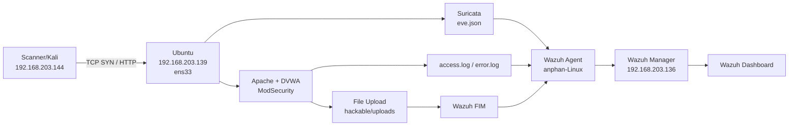

# Nhật ký thực nghiệm: Reconnaissance, DVWA, RCE, ModSecurity và Wazuh

**Ngày thực nghiệm:** 09/10/2026.  
**Người thao tác:** `anphan`.  
**Phạm vi tổng hợp:** toàn bộ kết quả, cấu hình, câu lệnh, ảnh và lỗi đã trao đổi trong phiên làm việc đến lúc Wazuh hiển thị sự kiện rule `100501`, level `8`.  
**Mục đích:** lưu lại quá trình thực hiện; giải thích kết quả; hỗ trợ tái dựng lab và viết các mục 3.4, 3.5 của báo cáo.

## Cách đọc tài liệu

- **Đã xác nhận:** có câu lệnh và kết quả được người dùng gửi, hoặc có ảnh chụp/log trực tiếp.
- **Đã mô tả:** có trong bản nội dung người dùng cung cấp, nhưng không có đầy đủ log/cấu hình gốc đi kèm.
- **Tái dựng/kiểm tra bổ sung:** câu lệnh hoặc cấu hình được viết để có thể làm lại, kiểm tra hoặc xuất thêm minh chứng; không mặc nhiên có nghĩa là đã chạy trong phiên.

Tài liệu được lập từ các ảnh và log đã gửi. Đây không phải bản sao toàn bộ cấu hình đang nằm trong các máy ảo. Các câu lệnh Linux trong tài liệu phải được chạy ở đúng VM ghi ở từng mục; việc tạo file Markdown này không thực thi những câu lệnh đó trên VM.

Các file ảnh đã được sao chép vào thư mục `minh_chung_lab_2026-10-09` nằm cạnh file này. Giữ nguyên thư mục đó khi di chuyển tài liệu để các liên kết ảnh vẫn hoạt động. Các phần phụ lục cuối tài liệu lưu cả những đầu ra gốc có liên quan đến lỗi và quá trình xử lý.

## Mục lục

1. [Sơ đồ lab, IP và tên máy](#1-sơ-đồ-lab-ip-và-tên-máy)
2. [Phiên bản, dịch vụ, đường dẫn và tài khoản](#2-phiên-bản-dịch-vụ-đường-dẫn-và-tài-khoản)
3. [Kịch bản 1: kiểm tra lưu lượng và SYN scan](#3-kịch-bản-1-kiểm-tra-lưu-lượng-và-syn-scan)
4. [Bổ sung Recon: host discovery và nhận diện dịch vụ](#4-bổ-sung-recon-host-discovery-và-nhận-diện-dịch-vụ)
5. [Chuẩn bị Apache, MariaDB và DVWA](#5-chuẩn-bị-apache-mariadb-và-dvwa)
6. [SQL Injection và các dấu vết đã thu được](#6-sql-injection-và-các-dấu-vết-đã-thu-được)
7. [File Upload và Wazuh FIM](#7-file-upload-và-wazuh-fim)
8. [Cài ModSecurity và xác nhận CRS](#8-cài-modsecurity-và-xác-nhận-crs)
9. [Command Injection/RCE và rule WAF của lab](#9-command-injectionrce-và-rule-waf-của-lab)
10. [Thu thập Apache error log về Wazuh](#10-thu-thập-apache-error-log-về-wazuh)
11. [Rule Wazuh 100501 và toàn bộ quá trình sửa lỗi](#11-rule-wazuh-100501-và-toàn-bộ-quá-trình-sửa-lỗi)
12. [Kết quả cuối cùng và giới hạn của minh chứng](#12-kết-quả-cuối-cùng-và-giới-hạn-của-minh-chứng)
13. [Mốc thời gian và đối chiếu múi giờ](#13-mốc-thời-gian-và-đối-chiếu-múi-giờ)
14. [Truy vấn Dashboard và lệnh lấy minh chứng](#14-truy-vấn-dashboard-và-lệnh-lấy-minh-chứng)
15. [Danh mục lỗi và cách đã xử lý](#15-danh-mục-lỗi-và-cách-đã-xử-lý)
16. [Nội dung có thể dùng trong báo cáo](#16-nội-dung-có-thể-dùng-trong-báo-cáo)
17. [Checklist lưu lại trạng thái lab](#17-checklist-lưu-lại-trạng-thái-lab)
18. [Danh mục ảnh minh chứng](#18-danh-mục-ảnh-minh-chứng)
19. [Tài liệu kỹ thuật chính thức](#19-tài-liệu-kỹ-thuật-chính-thức)
20. [Phụ lục đầu ra gốc](#20-phụ-lục-đầu-ra-gốc)

---

## 1. Sơ đồ lab, IP và tên máy

### 1.1. Các VM chính

**Máy Wazuh Server/Manager — `192.168.203.136`**

- Vai trò: phân tích log từ agent, áp dụng ruleset, tạo sự kiện/cảnh báo và cung cấp dữ liệu để xem trên Dashboard.
- Terminal được nhận diện bằng prompt `anphan@wazuh:~$`.
- Dịch vụ dùng để kiểm tra/khởi động: `wazuh-manager`.
- File rule tùy chỉnh: `/var/ossec/etc/rules/local_rules.xml`.
- File cấu hình manager: `/var/ossec/etc/ossec.conf`.
- IP `.136` được nêu trong sơ đồ lab và được Nmap báo đang hoạt động.
- MAC trong kết quả Nmap/ARP: `00:0C:29:82:A8:E6`.

**Máy Ubuntu mục tiêu/Web Server — `192.168.203.139`**

- Vai trò: mục tiêu Recon, máy chạy Apache/DVWA/MariaDB, cảm biến Suricata và Wazuh agent.
- Terminal có prompt `anphan@ubuntu:~$` hoặc `anphan@ubuntu:/var/www/html$`.
- Giao diện quan sát đã dùng: `ens33`.
- Wazuh agent hiển thị trên Dashboard: `anphan-Linux`.
- MAC được Nmap và tcpdump ghi nhận: `00:0C:29:A9:F3:63`.
- Dịch vụ: `suricata`, `wazuh-agent`, `apache2`, `mariadb`.
- URL ứng dụng: `http://192.168.203.139/DVWA/`.

**Máy scanner/kiểm thử — `192.168.203.144`**

- Vai trò: chạy Nmap, truy cập DVWA bằng Firefox và gửi các request kiểm thử.
- Screenshot cho thấy giao diện Kali Linux và prompt dạng Kali của tài khoản `anphan`.
- Tab VMware được đặt tên `Debian 11.x 64-bit`; signature Suricata cũng giữ chữ `Debian`. Tên tab và chuỗi signature không tự xác nhận bản phân phối đang chạy. Trong tài liệu gọi chung là **máy scanner/Kali `.144`**.
- Một phần thao tác được thực hiện ở `~/Desktop`.
- Chưa có đầu ra `ip -br addr` hoặc MAC của máy này trong dữ liệu đã gửi.

**Máy thứ tư — `192.168.203.140`**

- Được đưa vào phép thử host discovery, Nmap báo `Host is up`.
- MAC quan sát: `00:0C:29:99:07:2E`.
- Lab có tab VMware `Windows 10 x64`. Việc gán `.140` cho VM Windows là theo bối cảnh lab; chưa có ảnh `ipconfig` của VM này trong phiên.
- Lưu lượng nền có các cảnh báo `ET INFO Windows Update P2P Activity`. Không tính các cảnh báo này là kết quả dò quét từ máy `.144`.

### 1.2. Các IP hạ tầng khác đã xuất hiện

- `192.168.203.2`: xuất hiện trong DNS giữa máy `.144` và dịch vụ DNS; cũng xuất hiện trong ARP/ICMP.
- `192.168.203.254`: xuất hiện ở sự kiện DHCP gửi về `.144`.
- `192.168.203.1`: xuất hiện ở ARP của môi trường VMware.

Chưa có đầu ra `ip route` để xác nhận chính xác gateway, netmask hoặc vai trò đầy đủ của `.1`, `.2`, `.254`. Không suy ra chắc chắn gateway chỉ từ việc một IP trả lời DNS hoặc ARP.

### 1.3. Luồng mạng và telemetry



Suricata đặt trên máy mục tiêu `.139` quan sát được lưu lượng đến/đi từ máy này. Các dữ liệu hiện có không chứng minh đây là cảm biến SPAN/TAP nhìn thấy toàn bộ lưu lượng unicast giữa mọi VM. Việc tcpdump nhìn thấy một số ARP của VM khác cũng không đủ để kết luận cảm biến quan sát toàn mạng.

### 1.4. Lệnh kiểm tra lại IP nếu cần làm lại

**Tái dựng/kiểm tra bổ sung — trên từng VM Linux:**

```bash
hostname
ip -br addr
ip route
date -Is
date -u -Is
```

**Riêng Ubuntu `.139`:**

```bash
ip addr show ens33
```

Chưa có kết quả chạy các lệnh này trong phiên; chúng được ghi để bổ sung một bộ minh chứng topology hoàn chỉnh.

## 2. Phiên bản, dịch vụ, đường dẫn và tài khoản

### 2.1. Phiên bản được nhìn thấy trong đầu ra

- **Suricata:** `8.0.7 RELEASE`, xuất hiện khi chạy `suricata -T`.
- **Nmap:** `7.99`, xuất hiện trong các kết quả scan.
- **Apache:** `2.4.66 (Ubuntu)`, từ HTTP header và error log.
- **MariaDB:** `11.8.6-MariaDB-5ubuntu0.1`, từ MariaDB monitor.
- **ModSecurity for Apache:** `2.9.12`; package `2.9.12-2build1`.
- **OWASP CRS:** `3.3.8`; package `3.3.8-1`.
- **Wazuh Manager/logtest:** `4.14.7`.
- **GNU nano:** `8.7.1` trong ảnh editor.
- **Firefox:** request User-Agent có `Firefox/140.0`.
- **PHP:** đã xác nhận có các module `gd`, `mysqli`, `pdo_mysql`; chưa có phiên bản PHP từ `php -v` trong đầu ra gửi.
- **Hệ điều hành Ubuntu:** có repository codename `resolute` trong output apt. Không có output `/etc/os-release` để ghi đầy đủ release chính xác như một kết quả kiểm tra trực tiếp.
- **DVWA:** đã truy cập được và thực hiện các phép thử; commit/version cụ thể chưa được ghi lại.

**Kiểm tra bổ sung nếu cần lưu phiên bản đầy đủ:**

```bash
cat /etc/os-release
suricata --build-info
nmap --version
apache2 -v
mariadb --version
php -v
dpkg-query -W libapache2-mod-security2 modsecurity-crs
git -C /var/www/html/DVWA rev-parse HEAD
sudo /var/ossec/bin/wazuh-control info
```

Các lệnh phù hợp từng máy: Nmap trên scanner; các lệnh web/Suricata trên Ubuntu; lệnh Wazuh có thể kiểm tra trên manager/agent theo phần mềm được cài.

### 2.2. Trạng thái bốn dịch vụ trên Ubuntu

**Đã chạy trên `anphan@ubuntu`:**

```bash
sudo systemctl is-active wazuh-agent suricata apache2 mariadb
```

**Kết quả:**

```text
active
active
active
active
```

Thứ tự tương ứng là Wazuh agent, Suricata, Apache, MariaDB.

### 2.3. Các cổng/dịch vụ đã quan sát

- `22/tcp`: mở trên `.139`; bước `-sV` nhận diện OpenSSH.
- `25/tcp`: mở trên `.139`; bước `-sV` nhận diện Postfix SMTP.
- `79/tcp`: mở trên `.139`; bước `-sV` nhận diện Linux fingerd.
- `80/tcp`: đóng ở phép thử đầu trước khi dựng web; sau khi cài/chạy Apache, HTTP trả `200 OK` và socket `*:80` được xác nhận.
- `443/tcp`: đóng trong scan ban đầu. Chưa có minh chứng dựng HTTPS cho DVWA.
- `3306/tcp`: MariaDB lắng nghe tại `127.0.0.1:3306`, không phải địa chỉ lab `.139:3306` trong ảnh socket.

Sự thay đổi cổng 80 từ đóng sang mở phù hợp với việc Apache được cài/chạy ở giai đoạn sau. Không ghép các ảnh ở hai thời điểm thành một trạng thái duy nhất.

Chưa có đầu ra trực tiếp về các cổng thực tế của Wazuh Manager/Dashboard; tài liệu không gán cổng mặc định thành cổng đã xác nhận.

### 2.4. Các file cấu hình chính

**Trên Ubuntu `.139`:**

- `/etc/suricata/suricata.yaml`: cấu hình Suricata, đặc biệt `default-rule-path`, `rule-files`.
- `/etc/suricata/rules/local.rules`: rule Recon cục bộ SID `1000001`.
- `/var/lib/suricata/rules/suricata.rules`: ruleset được nạp theo `default-rule-path`.
- `/var/ossec/etc/ossec.conf`: cấu hình Wazuh agent, các nguồn log và thư mục FIM.
- `/var/www/html/DVWA/config/config.inc.php`: cấu hình DVWA kết nối MariaDB.
- `/etc/modsecurity/modsecurity.conf`: chế độ WAF, audit log và rule lab `1001001`.
- `/etc/apache2/mods-enabled/security2.conf`: cấu hình Apache nạp ModSecurity.
- `/usr/share/modsecurity-crs/owasp-crs.load`: include cấu hình CRS và các rule.
- `/etc/modsecurity/crs/crs-setup.conf`: cấu hình CRS.
- `/usr/share/modsecurity-crs/rules/REQUEST-932-APPLICATION-ATTACK-RCE.conf`: file rule nhóm RCE của CRS.

**Trên Wazuh Manager `.136`:**

- `/var/ossec/etc/rules/local_rules.xml`: rule tùy chỉnh `100501` và rule SSH ví dụ `100001`.
- `/var/ossec/etc/ossec.conf`: cấu hình manager, gồm `<rule_test>` đã bật.

### 2.5. Các log và thư mục theo dõi

**Ubuntu:**

- `/var/log/suricata/eve.json`: sự kiện `flow`, `alert`, `http`, DNS và các loại EVE khác.
- `/var/log/apache2/access.log`: request HTTP, method, URI, status, client IP.
- `/var/log/apache2/error.log`: lỗi PHP/Apache và các warning ModSecurity.
- `/var/log/apache2/modsec_audit.log`: audit transaction của ModSecurity, kiểu Serial.
- `/var/www/html/DVWA/hackable/uploads`: thư mục upload được cấu hình FIM.
- `/var/ossec/logs/ossec.log`: log hoạt động agent.

**Wazuh Manager — đường dẫn dùng khi kiểm tra bổ sung:**

- `/var/ossec/logs/ossec.log`.
- `/var/ossec/logs/alerts/alerts.json`.
- `/var/ossec/logs/archives/archives.json` nếu chức năng lưu archive JSON được bật.

Dashboard đã có data view `wazuh-archive*`, nhưng không có bản dump cấu hình bật archive/Filebeat trong phiên. Không ghi rằng đã thực hiện một bộ lệnh cấu hình archive cụ thể khi chưa có dữ liệu đó.

### 2.6. Tài khoản và mật khẩu trong phiên

- Tài khoản Linux thao tác: `anphan`. Mật khẩu sudo/Linux không được gửi trong transcript.
- Tài khoản DB của DVWA: `dvwa`@`localhost`.
- Database: `dvwa`.
- DB host cấu hình DVWA: `127.0.0.1`.
- Giá trị mật khẩu được người dùng nhập ở một bước `ALTER USER`: `Lab-DVWA-Only-2026!`.
- Sau bước đó, phép thử CLI `mariadb -u dvwa -p -h 127.0.0.1 dvwa` vẫn báo `ERROR 1045`. Vì vậy, chưa có cơ sở khẳng định đây là mật khẩu cuối cùng đang hoạt động chỉ từ output đó.
- Người dùng sau đó xác nhận vào DVWA được; các ảnh chức năng SQLi/upload/exec chứng minh ứng dụng hoạt động.
- Tài khoản đăng nhập **ứng dụng DVWA** mặc định là `admin` / `password`, theo README chính thức. Đây là tài khoản web khác với tài khoản DB `dvwa`. Phiên không cung cấp bản ghi trực tiếp thông tin login cuối cùng đã nhập. [README DVWA](https://github.com/digininja/DVWA)
- Tài khoản/mật khẩu Wazuh Dashboard chưa được gửi trong phiên.

## 3. Kịch bản 1: kiểm tra lưu lượng và SYN scan

### 3.1. Phép thử ban đầu chỉ quét ba cổng

**Máy chạy:** scanner `.144`.

```bash
sudo nmap -sS -Pn -T2 -p 22,80,443 192.168.203.139
```

**Kết quả đã gửi:**

```text
Starting Nmap 7.99 ... at 2026-10-09 03:50 -0700
Nmap scan report for 192.168.203.139
Host is up (0.0017s latency).

PORT    STATE  SERVICE
22/tcp  open   ssh
80/tcp  closed http
443/tcp closed https
MAC Address: 00:0C:29:A9:F3:63 (VMware)

Nmap done: 1 IP address (1 host up) scanned in 2.30 seconds
```

`-sS` là SYN scan; `-Pn` bỏ qua bước host discovery theo cách dùng của phép thử, scan một host đã chỉ định; `-T2` là mẫu timing; `-p` giới hạn ba cổng. Tên dịch vụ khi chưa dùng `-sV` là tên theo cơ sở dữ liệu số cổng, chưa chứng minh phần mềm/phiên bản chạy trên cổng. [Nmap SYN scan](https://nmap.org/book/synscan.html), [Nmap version detection](https://nmap.org/book/man-version-detection.html)

### 3.2. EVE lúc đầu chỉ thấy DHCP/DNS khi lọc IP scanner

**Máy chạy:** Ubuntu `.139`.

```bash
sudo jq -c 'select(.src_ip=="192.168.203.144" or .dest_ip=="192.168.203.144") | {timestamp,event_type,src_ip,dest_ip,alert}' /var/log/suricata/eve.json | tail -n 20
```

**Các dòng đã gửi:**

```json
{"timestamp":"2026-10-09T10:46:45.049078+0000","event_type":"dhcp","src_ip":"192.168.203.254","dest_ip":"192.168.203.144","alert":null}
{"timestamp":"2026-10-09T10:50:11.602315+0000","event_type":"dns","src_ip":"192.168.203.144","dest_ip":"192.168.203.2","alert":null}
{"timestamp":"2026-10-09T10:50:11.617148+0000","event_type":"dns","src_ip":"192.168.203.2","dest_ip":"192.168.203.144","alert":null}
```

Kết quả của một truy vấn `tail` ở một thời điểm không đủ để kết luận Suricata hoàn toàn không quan sát TCP. Đã tiếp tục kiểm tra bằng tcpdump và lọc đúng cặp nguồn/đích.

### 3.3. Xác nhận gói TCP đến đúng giao diện ens33

**Máy chạy:** Ubuntu `.139`.

```bash
sudo tcpdump -ni ens33 'host 192.168.203.144 and tcp port 22'
```

Trong lúc tcpdump chạy, thực hiện lại phép thử Nmap từ scanner. Nhấn `Ctrl+C` trên Ubuntu để dừng capture.

**Đầu ra trực tiếp:**

```text
10:52:18.958671 IP 192.168.203.144.55083 > 192.168.203.139.22: Flags [S], seq 4252199560, win 1024, options [mss 1460], length 0
10:52:18.959271 IP 192.168.203.139.22 > 192.168.203.144.55083: Flags [S.], seq 2016326121, ack 4252199561, win 64240, options [mss 1460], length 0
10:52:18.960100 IP 192.168.203.144.55083 > 192.168.203.139.22: Flags [R], seq 4252199561, win 0, length 0

3 packets captured
3 packets received by filter
0 packets dropped by kernel
```

Ý nghĩa:

- `[S]`: SYN từ `.144:55083` đến `.139:22`.
- `[S.]`: SYN-ACK từ SSH của `.139` trả về scanner.
- `[R]`: scanner reset kết nối sau khi nhận SYN-ACK, phù hợp với SYN scan.
- `0 packets dropped by kernel`: không ghi nhận kernel drop trong capture này.

Đây là chuỗi thăm dò SYN, không phải một phiên SSH đăng nhập thành công. Cổng nguồn `55083` là cổng tạm của phép thử này, không cần cố định trong cấu hình lab.

### 3.4. Xác nhận Suricata có flow dù chưa có alert

```bash
sudo jq -c 'select((.src_ip=="192.168.203.144" and .dest_ip=="192.168.203.139") or (.src_ip=="192.168.203.139" and .dest_ip=="192.168.203.144")) | {timestamp,event_type,src_ip,src_port,dest_ip,dest_port,alert}' /var/log/suricata/eve.json | tail -n 20
```

**Kết quả:**

```json
{"timestamp":"2026-10-09T10:51:14.636627+0000","event_type":"flow","src_ip":"192.168.203.144","src_port":58524,"dest_ip":"192.168.203.139","dest_port":443,"alert":null}
{"timestamp":"2026-10-09T10:51:16.616854+0000","event_type":"flow","src_ip":"192.168.203.144","src_port":58524,"dest_ip":"192.168.203.139","dest_port":22,"alert":null}
{"timestamp":"2026-10-09T10:51:18.631306+0000","event_type":"flow","src_ip":"192.168.203.144","src_port":58524,"dest_ip":"192.168.203.139","dest_port":80,"alert":null}
```

`event_type: flow` và `alert: null` ở dòng flow không có nghĩa là cảm biến mù. Đó là một loại sự kiện khác với `event_type: alert`; trường `alert` không bắt buộc tồn tại ở mọi sự kiện EVE. Cần tìm riêng alert và kiểm tra rule/ngưỡng.

### 3.5. Nạp rule cục bộ Recon

**File cấu hình đã sửa trên Ubuntu:**

```bash
sudo nano /etc/suricata/suricata.yaml
```

**Đoạn YAML có trong ảnh:**

```yaml
default-rule-path: /var/lib/suricata/rules

rule-files:
  - suricata.rules
  - /etc/suricata/rules/local.rules
```

Hai nguồn luật được nạp: ruleset `suricata.rules` trong đường dẫn mặc định và file luật lab bằng đường dẫn tuyệt đối. Ảnh chỉ xác nhận đoạn này, không chứa toàn bộ `suricata.yaml`.


**Thông tin rule đã xác nhận qua sự kiện:**

- SID: `1000001`.
- Revision: `1`.
- Message: `LAB RECON SYN scan from Debian to Ubuntu`.
- Nguồn: `192.168.203.144`.
- Đích: `192.168.203.139`.
- Suricata severity: `3` trong EVE.

**Thông tin được mô tả trong bản nội dung Recon:** rule theo dõi SYN với ngưỡng năm lần khớp trong mười giây; ruleset ET Open và số luật `53.123` được nêu. Chưa có ảnh nguyên văn `local.rules` hoặc startup log xác nhận số luật đó, nên không coi bản tái dựng dưới đây là bản dump chính xác của file đang chạy.

**Tái dựng tương đương để tham khảo — không cần ghi đè rule hiện tại nếu lab đã hoạt động:**

```suricata
alert tcp 192.168.203.144 any -> 192.168.203.139 any (msg:"LAB RECON SYN scan from Debian to Ubuntu"; flags:S; flow:stateless; threshold:type both, track by_src, count 5, seconds 10; sid:1000001; rev:1;)
```

Ở bản tái dựng, `type both` được chọn để yêu cầu đủ số lần khớp và hạn chế số alert trong cửa sổ thời gian. Ngưỡng đếm số lần rule khớp theo nguồn, không trực tiếp đếm số cổng đích khác nhau; một nguồn tạo nhiều SYN đến cùng cổng cũng có thể đạt ngưỡng. Cấu hình mẫu chỉ chứng minh cơ chế thử nghiệm theo IP đã chọn. [Suricata 8.0.7 thresholding](https://docs.suricata.io/en/suricata-8.0.7/rules/thresholding.html)

**Lệnh để lưu rule gốc nếu cần:**

```bash
sudo grep -n 'sid:1000001' /etc/suricata/rules/local.rules
```

**Kiểm tra cấu hình và nạp lại đã thực hiện:**

```bash
sudo suricata -T -c /etc/suricata/suricata.yaml
sudo systemctl restart suricata
```

**Output:**

```text
i: suricata: This is Suricata version 8.0.7 RELEASE running in SYSTEM mode
i: suricata: Configuration provided was successfully loaded. Exiting.
```

### 3.6. Lượt SYN scan chính: cổng 1–100

**Máy scanner `.144`:**

```bash
sudo nmap -sS -Pn -T3 --min-rate 20 -p 1-100 192.168.203.139
```

`--min-rate 20` đặt tốc độ tối thiểu mong muốn, không giới hạn tốc độ tối đa ở 20 gói/giây. Không mô tả đây là phép thử luôn chạy chậm hoặc luôn ở đúng 20 gói/giây.

**Kết quả:**

```text
Host is up (0.00026s latency).
Not shown: 97 closed tcp ports (reset)
PORT   STATE SERVICE
22/tcp open  ssh
25/tcp open  smtp
79/tcp open  finger
MAC Address: 00:0C:29:A9:F3:63 (VMware)
Nmap done: 1 IP address (1 host up) scanned in 1.29 seconds
```


Ba cổng mở nằm trong phạm vi 100 cổng đã kiểm tra. Chưa dùng `-sV` ở lượt này nên chưa ghi nhận phần mềm/phiên bản từ lệnh này.

### 3.7. EVE alert SID 1000001

**Ubuntu:**

```bash
sudo jq -c 'select(.event_type=="alert" and .alert.signature_id==1000001) | {timestamp,src_ip,dest_ip,alert}' /var/log/suricata/eve.json | tail -n 5
```

**Sự kiện đã gửi:**

```json
{"timestamp":"2026-10-09T10:57:25.348962+0000","src_ip":"192.168.203.144","dest_ip":"192.168.203.139","alert":{"action":"allowed","gid":1,"signature_id":1000001,"rev":1,"signature":"LAB RECON SYN scan from Debian to Ubuntu","category":"","severity":3}}
```


`action: allowed` cho thấy sự kiện được ghi ở chế độ quan sát IDS; minh chứng này không thể hiện việc chặn scan. `severity` trong Suricata và `rule.level` trong Wazuh là hai trường của hai hệ thống khác nhau; không coi chúng là một thang điểm chung.

### 3.8. Wazuh nhận sự kiện Suricata

**Wazuh agent trên Ubuntu — đoạn nguồn log đã được cấu hình:**

```xml
<localfile>
  <log_format>json</log_format>
  <location>/var/log/suricata/eve.json</location>
</localfile>
```

Đoạn này đặt trong `<ossec_config>` của `/var/ossec/etc/ossec.conf` trên agent. Không đặt nó vào `local_rules.xml`.

**Dashboard:** Threat Hunting → Events; data view `wazuh-alerts-*`; truy vấn đã dùng:

```text
rule.groups:suricata
```

**Kết quả mục tiêu:**

- Agent: `anphan-Linux`.
- Description: `Suricata: Alert - LAB RECON SYN scan from Debian to Ubuntu`.
- Wazuh rule ID: `86601`.
- Wazuh level: `3`.
- Timestamp hiển thị: `Oct 9, 2026 @ 17:57:26.914`.

SID `1000001` là ID rule trong Suricata; ID `86601` là rule Wazuh dùng để xử lý sự kiện Suricata. Chúng có vai trò khác nhau.


Dashboard lúc đầu hiển thị **10 hits** cho nhóm Suricata, gồm một dòng LAB RECON và các dòng `ET INFO Windows Update P2P Activity`. Tổng 10 không có nghĩa là Nmap tạo 10 alert. Các event nền phải được phân biệt bằng description/signature, IP và thời gian.

## 4. Bổ sung Recon: host discovery và nhận diện dịch vụ

### 4.1. Host discovery bốn địa chỉ đã chỉ định

**Scanner `.144`:**

```bash
nmap -sn -T2 192.168.203.136 192.168.203.139 192.168.203.140 192.168.203.144
```

Phạm vi là bốn IP lab, không phải quét toàn bộ `192.168.203.0/24`. `-sn` chỉ làm host discovery, không chạy port scan trong lệnh này. [Nmap host discovery](https://nmap.org/book/man-host-discovery.html)

**Kết quả:**

```text
Nmap scan report for 192.168.203.136
Host is up ...
MAC Address: 00:0C:29:82:A8:E6 (VMware)

Nmap scan report for 192.168.203.139
Host is up ...
MAC Address: 00:0C:29:A9:F3:63 (VMware)

Nmap scan report for 192.168.203.140
Host is up ...
MAC Address: 00:0C:29:99:07:2E (VMware)

Nmap scan report for 192.168.203.144
Host is up.

Nmap done: 4 IP addresses (4 hosts up) scanned in 1.48 seconds
```

`.144` là chính scanner, không phải một máy mục tiêu thứ tư đã được đánh giá dịch vụ. Lượt đầu cùng lệnh có thời gian 1,51 giây; lượt chụp bổ sung có thời gian 1,48 giây.

### 4.2. tcpdump ghi nhận ARP

**Ubuntu:**

```bash
sudo tcpdump -ni ens33 -nn 'arp or icmp'
```

**Các dòng liên quan trực tiếp đến scanner:**

```text
11:29:30.161187 ARP, Request who-has 192.168.203.136 ... tell 192.168.203.144
11:29:30.161414 ARP, Reply 192.168.203.136 is-at 00:0c:29:82:a8:e6
11:29:30.161818 ARP, Request who-has 192.168.203.139 tell 192.168.203.144
11:29:30.161826 ARP, Reply 192.168.203.139 is-at 00:0c:29:a9:f3:63
11:29:30.162381 ARP, Request who-has 192.168.203.140 tell 192.168.203.144
11:29:30.162489 ARP, Reply 192.168.203.140 is-at 00:0c:29:99:07:2e
```

Khi dừng capture:

```text
21 packets captured
23 packets received by filter
0 packets dropped by kernel
```

Capture cũng có ARP/ICMP nền từ `.136`, `.140` và các IP hạ tầng. Không gán mọi dòng trong `arp or icmp` cho phép thử Nmap của `.144`.


Rule Recon được mô tả là rule TCP SYN. Các request ARP trong host discovery không đáp ứng header TCP của rule đó; không kỳ vọng mọi lần `-sn` đều sinh alert SID `1000001`.

### 4.3. Nhận diện phần mềm dịch vụ

**Scanner:**

```bash
sudo nmap -sS -sV -Pn -T2 -p 22,25,79 192.168.203.139
```

**Kết quả:**

```text
PORT   STATE SERVICE VERSION
22/tcp open  ssh     OpenSSH 10.2p1 Ubuntu 2ubuntu3.5 (Ubuntu Linux; protocol 2.0)
25/tcp open  smtp    Postfix smtpd
79/tcp open  finger  Linux fingerd
MAC Address: 00:0C:29:A9:F3:63 (VMware)
Service Info: Host: ubuntu; OS: Linux; CPE: cpe:/o:linux:linux_kernel

Nmap done: 1 IP address (1 host up) scanned in 8.79 seconds
```

Nhận diện `Service Info: OS: Linux` không phải bằng chứng đã thực hiện `-O` hoặc đo đầy đủ phiên bản kernel. Các chuỗi VERSION là kết quả fingerprint của Nmap, không thay thế kiểm tra package trực tiếp trên endpoint.


### 4.4. EVE sau các lượt kiểm thử bổ sung

**Lệnh đã dùng trên Ubuntu:**

```bash
sudo jq -c 'select((.src_ip=="192.168.203.144" and .dest_ip=="192.168.203.139") or (.src_ip=="192.168.203.139" and .dest_ip=="192.168.203.144")) | {timestamp,event_type,src_ip,src_port,dest_ip,dest_port,proto,app_proto,alert}' /var/log/suricata/eve.json | tail -n 30
```

Kết quả gồm nhiều TCP flow từ scanner tới các cổng đích khác nhau của `.139`, một LAB RECON alert và một alert app-layer:

```text
2026-10-09T11:25:48.944412+0000
event_type: alert
src_ip: 192.168.203.144
src_port: 40090
dest_ip: 192.168.203.139
dest_port: 25
signature_id: 1000001
signature: LAB RECON SYN scan from Debian to Ubuntu
action: allowed
severity: 3
```

```text
2026-10-09T11:25:55.082307+0000
event_type: alert
src_ip: 192.168.203.144
src_port: 54600
dest_ip: 192.168.203.139
dest_port: 79
signature_id: 2260002
signature: SURICATA Applayer Detect protocol only one direction
app_proto: http
category: Generic Protocol Command Decode
severity: 3
```

Một sự kiện `anomaly` cũng xuất hiện cùng thời điểm luồng đến cổng 79. Không gọi alert `2260002` là bằng chứng riêng về khai thác finger. Nó là cảnh báo phân tích giao thức trên lưu lượng probe; cần giữ đúng signature khi viết báo cáo.

### 4.5. Vì sao Dashboard vẫn Total = 10

Tại thời điểm hỏi, Dashboard đang dùng khoảng thời gian `17:30–18:00` ngày 09/10/2026. Các lượt bổ sung diễn ra khoảng `11:25–11:29 UTC`, tương ứng `18:25–18:29 UTC+7`, nằm ngoài khoảng đó.

Ngoài ra, host discovery bằng ARP không tự kích hoạt rule TCP SYN. Hai điểm này giải thích vì sao không thể dựa vào Total để đánh giá phép thử mới. Cách kiểm tra đã hướng dẫn là đổi khoảng thời gian, bỏ filter không phù hợp, rồi tìm đúng signature/IP.

## 5. Chuẩn bị Apache, MariaDB và DVWA

### 5.1. Những gì đã được xác nhận

Apache và MariaDB đã được cài, enabled và active. Người dùng gửi output systemd có:

```text
apache2.service - The Apache HTTP Server
Active: active (running)

mariadb.service - MariaDB 11.8.6 database server
Active: active (running)
```

Chưa có toàn bộ câu lệnh cài Apache/PHP/MariaDB ban đầu trong log cung cấp. Có thể tái dựng bước chuẩn bị từ các package cần thiết, nhưng không ghi lệnh tham khảo là lịch sử đã chạy.

### 5.2. Lệnh chuẩn bị tham khảo cho một Ubuntu lab mới

**Tái dựng, không phải output cài đặt đã được gửi:**

```bash
sudo apt update
sudo apt install -y apache2 mariadb-server mariadb-client php libapache2-mod-php php-mysql php-gd git
sudo systemctl enable --now apache2 mariadb
```

Nếu cài DVWA vào thư mục mới chưa có dữ liệu:

```bash
cd /var/www/html
sudo git clone https://github.com/digininja/DVWA.git
sudo cp /var/www/html/DVWA/config/config.inc.php.dist /var/www/html/DVWA/config/config.inc.php
sudo nano /var/www/html/DVWA/config/config.inc.php
```

Các lệnh này phục vụ tái dựng; không thực hiện clone chồng lên `/var/www/html/DVWA` đang chạy. Những module/thay đổi PHP phục vụ RFI hay API không có minh chứng thực hiện trong phiên, nên không đưa vào như cấu hình đã dùng. [DVWA installation/configuration](https://github.com/digininja/DVWA)

### 5.3. Xác nhận HTTP trên localhost

**Ubuntu:**

```bash
curl -I http://127.0.0.1
```

**Output ngày 09/10/2026:**

```http
HTTP/1.1 200 OK
Date: Fri, 09 Oct 2026 11:55:42 GMT
Server: Apache/2.4.66 (Ubuntu)
Content-Type: text/html
```

Lệnh này kiểm tra HTTP header của web root, chưa tự xác nhận kết nối database của DVWA.

### 5.4. Xác nhận socket 80 và 3306

```bash
sudo ss -lntp | grep -E ':(80|3306)\b'
```

**Dòng chính:**

```text
127.0.0.1:3306 ... users:(("mariadbd",pid=13107,...))
*:80 ... users:(("apache2",...))
```

MariaDB chỉ được nhìn thấy lắng nghe loopback ở phép kiểm tra này. Apache lắng nghe trên cổng 80.

### 5.5. Xác nhận HTTP từ scanner

**Scanner `.144`:**

```bash
curl -I http://192.168.203.139
```

**Output:**

```http
HTTP/1.1 200 OK
Date: Fri, 09 Oct 2026 11:55:51 GMT
Server: Apache/2.4.66 (Ubuntu)
```

Như vậy scanner truy cập được web server qua mạng lab. Chưa có HTTPS/port 443 cho ứng dụng trong các minh chứng.

### 5.6. Lỗi HTTP 500 khi Create / Reset Database

Khi nhấn tạo database tại:

```text
http://192.168.203.139/DVWA/setup.php
```

Firefox hiện `500 Internal Server Error`.

**Ubuntu — lệnh đã dùng để tìm nguyên nhân:**

```bash
sudo tail -n 80 /var/log/apache2/error.log
```

**Lỗi quan trọng:**

```text
PHP Fatal error: Uncaught mysqli_sql_exception:
Access denied for user 'dvwa'@'localhost' (using password: YES)
```

Vị trí xuất hiện gồm `dvwa/includes/dvwaPage.inc.php:570` và `dvwa/includes/DBMS/MySQL.php:13`. Đây là lỗi xác thực DB, không phải bằng chứng lỗi kết nối mạng giữa scanner với Apache.

Log cũng có `AH00558` về Apache ServerName và warning PCRE JIT. Hai warning này cần phân biệt với lỗi mysqli gây 500; không coi `AH00558` là nguyên nhân đã được xác định cho lỗi DB.

### 5.7. Kiểm tra PHP, cấu hình DB và quyền tài khoản

**Các lệnh đã thực hiện:**

```bash
php -m | grep -Ei 'mysqli|gd|pdo_mysql'
```

```bash
sudo grep -nE "db_server|db_user|db_database" /var/www/html/DVWA/config/config.inc.php
```

```bash
sudo mariadb -e "SHOW DATABASES LIKE 'dvwa'; SELECT User, Host FROM mysql.user WHERE User='dvwa'; SHOW GRANTS FOR 'dvwa'@'localhost';"
```

**Kết quả:**

- Có `gd`, `mysqli`, `pdo_mysql`.
- Database `dvwa` tồn tại.
- User `dvwa` với Host `localhost` tồn tại.
- Có quyền `GRANT ALL PRIVILEGES ON dvwa.* TO dvwa@localhost`.

**Các dòng cấu hình được gửi:**

```php
$_DVWA[ 'db_server' ]   = getenv('DB_SERVER') ?: '127.0.0.1';
$_DVWA[ 'db_database' ] = getenv('DB_DATABASE') ?: 'dvwa';
$_DVWA[ 'db_user' ]     = getenv('DB_USER') ?: 'dvwa';
```

Không có dòng `db_password` trong output grep trên. `getenv(...)` có thể ghi đè giá trị fallback nếu môi trường của Apache có biến DB tương ứng; không thể kết luận mật khẩu thực tế chỉ từ ba dòng này.

### 5.8. Đổi mật khẩu DB và lỗi 1045 vẫn còn

**Ubuntu:**

```bash
sudo mariadb
```

**Trong MariaDB monitor:**

```sql
ALTER USER 'dvwa'@'localhost' IDENTIFIED BY 'Lab-DVWA-Only-2026!';
FLUSH PRIVILEGES;
EXIT;
```

MariaDB trả `Query OK` cho bước đổi mật khẩu. Người dùng sau đó thử:

```bash
mariadb -u dvwa -p -h 127.0.0.1 dvwa
```

**Kết quả được gửi:**

```text
ERROR 1045 (28000): Access denied for user 'dvwa'@'localhost' (using password: YES)
```

Chưa có log nguyên văn bước sửa cuối cùng khiến CLI/ứng dụng kết nối DB thành công. Người dùng xác nhận vào được DVWA sau đó; trạng thái ứng dụng hoạt động được chứng minh bằng các ảnh SQLi/upload/exec. Không tự suy ra rằng mật khẩu đã đổi ở trên chắc chắn là mật khẩu cuối.

### 5.9. Mẫu cấu hình DB đồng bộ nếu tái dựng lab

**Tái dựng — các giá trị phải đồng nhất với DB:**

```php
$_DVWA[ 'db_server' ]   = '127.0.0.1';
$_DVWA[ 'db_port' ]     = '3306';
$_DVWA[ 'db_database' ] = 'dvwa';
$_DVWA[ 'db_user' ]     = 'dvwa';
$_DVWA[ 'db_password' ] = 'Lab-DVWA-Only-2026!';
```

**Một quy trình SQL tham khảo cho database lab:**

```bash
sudo mariadb
```

```sql
CREATE DATABASE IF NOT EXISTS dvwa;
CREATE USER IF NOT EXISTS 'dvwa'@'localhost' IDENTIFIED BY 'Lab-DVWA-Only-2026!';
ALTER USER 'dvwa'@'localhost' IDENTIFIED BY 'Lab-DVWA-Only-2026!';
GRANT ALL PRIVILEGES ON dvwa.* TO 'dvwa'@'localhost';
FLUSH PRIVILEGES;
EXIT;
```

Sau đó kiểm tra bằng `mariadb -u dvwa -p -h 127.0.0.1 dvwa`, nhập mật khẩu tương ứng và xem ứng dụng. Những lệnh trong mục này là phương án tái dựng, không phải lời khẳng định chúng đã được dùng để sửa cuối cùng trong phiên.

### 5.10. Bước trên giao diện DVWA

- Mở `http://192.168.203.139/DVWA/setup.php`.
- Dùng nút `Create / Reset Database` để khởi tạo dữ liệu demo khi chuẩn bị lab.
- Đăng nhập ứng dụng qua `http://192.168.203.139/DVWA/login.php`.
- Truy cập `DVWA Security` trước các phép thử.

Access log xác nhận một `POST /DVWA/security.php` lúc `12:18:42 UTC`, nhưng không chứa nội dung POST nên chưa xác nhận giá trị security level đã chọn chỉ bằng dòng access log đó. Các ví dụ payload bên dưới tương ứng phép thử trên cấu hình DVWA đang cho phép khai thác. Khi tái dựng có thể chọn `Low` trong lab để lặp lại, nhưng chưa có ảnh hiển thị chữ `Low` trong bộ minh chứng đã gửi.

## 6. SQL Injection và các dấu vết đã thu được

### 6.1. Phép thử trên trình duyệt

**Máy thao tác:** scanner/Kali `.144`.

**Trang:**

```text
http://192.168.203.139/DVWA/vulnerabilities/sqli/
```

**Giá trị đã nhập vào ô User ID:**

```sql
1' OR '1'='1' #
```

**Request nhìn thấy trên URL/access log:**

```text
/DVWA/vulnerabilities/sqli/?id=1%27+OR+%271%27%3D%271%27+%23&Submit=Submit
```

Ký tự `#` phải nằm trong dữ liệu gửi đến server, được URL encode thành `%23`. Nếu gõ dấu `#` không encode vào cuối URL thì nó có thể trở thành fragment phía trình duyệt và không được gửi như dữ liệu query.

**Kết quả ảnh:** trả về nhiều bản ghi: `admin/admin`, `Gordon/Brown`, `Hack/Me`, `Pablo/Picasso`, `Bob/Smith`.


Phản hồi nhiều bản ghi với điều kiện kiểm thử là bằng chứng ứng dụng demo xử lý đầu vào theo cách có thể thay đổi điều kiện truy vấn. Chưa có ảnh phép thử bình thường `id=1` trong phiên, nên không trình bày nó như một baseline đã chụp.

### 6.2. Apache access log

**Ubuntu đã chạy:**

```bash
sudo tail -F /var/log/apache2/access.log
```

Sau phép thử nhấn `Ctrl+C` để dừng theo dõi.

**Dòng liên quan:**

```text
192.168.203.144 - - [09/Oct/2026:12:20:05 +0000] "GET /DVWA/vulnerabilities/sqli/?id=1%27+OR+%271%27%3D%271%27+%23&Submit=Submit HTTP/1.1" 200 1871 ...
```

Client IP `.144`, URI chứa dữ liệu kiểm thử và status `200` được ghi. Status 200 chỉ cho thấy HTTP request được xử lý; kết quả khai thác phải đối chiếu thêm phản hồi ứng dụng. Trong trường hợp này có ảnh nhiều bản ghi hỗ trợ.

**Lệnh lấy lại các dòng liên quan:**

```bash
sudo grep -F '/DVWA/vulnerabilities/sqli/' /var/log/apache2/access.log | tail -n 10
```

### 6.3. Suricata quan sát HTTP SQLi nhưng không có alert SQLi trong mẫu đã gửi

**Lệnh đã dùng:**

```bash
sudo jq -c 'select((.event_type=="http" or .event_type=="alert") and ((.src_ip=="192.168.203.144" and .dest_ip=="192.168.203.139") or (.src_ip=="192.168.203.139" and .dest_ip=="192.168.203.144"))) | {timestamp,event_type,src_ip,src_port,dest_ip,dest_port,http,alert}' /var/log/suricata/eve.json | tail -n 15
```

**Sự kiện SQLi được quan sát:**

```text
timestamp: 2026-10-09T12:20:05.879378+0000
event_type: http
src_ip: 192.168.203.144
src_port: 38744
dest_ip: 192.168.203.139
dest_port: 80
http_method: GET
status: 200
url: /DVWA/vulnerabilities/sqli/?id=1%27+OR+%271%27%3D%271%27+%23&Submit=Submit
alert: null
```

Đây là bằng chứng lớp mạng thấy HTTP request SQLi. Mẫu gửi không cho thấy alert SQLi tương ứng. Việc Dashboard Suricata có **108 hits** không biến các hit đó thành alert SQLi.

Một alert khác xuất hiện lúc `12:18:42.404456 UTC`:

```text
signature_id: 2221036
signature: SURICATA HTTP Response excessive header repetition
src_ip: 192.168.203.139
src_port: 80
dest_ip: 192.168.203.144
dest_port: 33340
uri: /DVWA/security.php
status: 302
```

Đây là cảnh báo về phản hồi HTTP/giao thức ở trang `security.php`, không phải bằng chứng signature SQL Injection khớp request ở `sqli/`. Các alert APT User-Agent là lưu lượng tải/cập nhật package, cũng cần phân biệt.

### 6.4. Kết luận riêng của phép thử SQLi

- Xác nhận: request từ `.144` đến DVWA `.139`.
- Xác nhận: Apache access log lưu URI và status.
- Xác nhận: Suricata EVE có HTTP event cho chính URI kiểm thử.
- Xác nhận: DVWA trả nhiều bản ghi demo.
- Chưa xác nhận: WAF/IDS có alert SQLi chuyên biệt cho request này.
- SQLi được thực hiện trước bước cài ModSecurity khoảng `12:50 UTC`; không dùng alert WAF ở giai đoạn sau để gán ngược cho phép thử SQLi lúc `12:20 UTC`.

## 7. File Upload và Wazuh FIM

### 7.1. Kiểm tra nguồn log và thư mục FIM trên agent

**Lệnh đã gửi trên Ubuntu:**

```bash
sudo grep -nE '/var/log/suricata/eve.json|/var/log/apache2/access.log|/var/www/html/DVWA/hackable/uploads' /var/ossec/etc/ossec.conf
ls -ld /var/www/html/DVWA/hackable/uploads
```

**Output:**

```text
28:  <location>/var/log/suricata/eve.json</location>
33:  <location>/var/log/apache2/access.log</location>
118:<directories realtime="yes" check_all="yes">/var/www/html/DVWA/hackable/uploads</directories>
drwxr-xr-x 2 www-data www-data 4096 Oct 9 12:00 /var/www/html/DVWA/hackable/uploads
```

Thư mục thuộc `www-data:www-data` và owner có quyền ghi. Không có minh chứng sử dụng `chmod 777`; không cần ghi rằng đã mở quyền 777.

### 7.2. Cấu hình agent liên quan

**Mẫu nguồn log Apache access:** location đã được xác nhận trong grep; không có toàn bộ block gốc để đối chiếu từng dòng `log_format` của nguồn access log.

```xml
<localfile>
  <log_format>apache</log_format>
  <location>/var/log/apache2/access.log</location>
</localfile>
```

**Trong `<syscheck>` đã có trên agent:**

```xml
<directories realtime="yes" check_all="yes">/var/www/html/DVWA/hackable/uploads</directories>
```

`realtime="yes"` yêu cầu theo dõi thay đổi theo thời gian thực; `check_all="yes"` kiểm tra các thuộc tính hỗ trợ của FIM. Không tạo thêm một root `<syscheck>` chồng lên cấu hình hiện hữu một cách tùy ý: bổ sung dòng directories trong block syscheck phù hợp.

**Các lệnh cấu hình/kiểm tra để tái dựng:**

```bash
sudo nano /var/ossec/etc/ossec.conf
sudo systemctl restart wazuh-agent
sudo systemctl is-active wazuh-agent
sudo tail -n 80 /var/ossec/logs/ossec.log
```

Trạng thái agent `active` đã được xác nhận; không có nguyên văn startup FIM baseline trong output gửi. Wazuh FIM giám sát tạo/sửa/xóa file theo cấu hình, nhưng phiên này mới có minh chứng một sự kiện thêm file. [Wazuh FIM](https://documentation.wazuh.com/current/getting-started/use-cases/file-integrity.html)

### 7.3. File kiểm thử fim-proof.txt

**File dùng trong phiên:** `fim-proof.txt`.

Không có nội dung nguyên văn hoặc câu lệnh tạo file từ người dùng trong transcript. Nếu cần tái dựng một file văn bản vô hại trên scanner:

```bash
printf 'LAB FIM proof - uploaded through DVWA\n' > ~/Desktop/fim-proof.txt
```

Đây là câu lệnh tái dựng, không xác nhận nội dung file gốc là chuỗi này.

**Thao tác đã thực hiện qua trình duyệt:**

1. Mở `http://192.168.203.139/DVWA/vulnerabilities/upload/`.
2. Chọn `fim-proof.txt` bằng Browse.
3. Nhấn Upload.

**Thông báo trên DVWA:**

```text
../../hackable/uploads/fim-proof.txt successfully uploaded!
```


Đường dẫn vật lý tương ứng theo vị trí DVWA là `/var/www/html/DVWA/hackable/uploads/fim-proof.txt`.

### 7.4. Vì sao lúc đầu không thấy FIM

Dashboard tìm:

```text
rule.groups:syscheck
```

nhưng còn filter `rule.level:3`. FIM event xuất hiện về sau có level `5`, nên filter level 3 loại nó khỏi kết quả. Sau khi bỏ filter level 3 và mở rộng khoảng thời gian, đã thấy một hit.

### 7.5. Kết quả FIM đã chụp

- Agent: `anphan-Linux`.
- Timestamp hiển thị: `Oct 9, 2026 @ 19:26:55.321`.
- Description: `File added to the system.`
- Rule ID: `554`.
- Level: `5`.


Ảnh hàng kết quả chưa mở rộng `syscheck.path`; tên file được đối chiếu từ thao tác upload và cấu hình thư mục. Nếu cần chứng cứ chặt hơn cho đúng file `fim-proof.txt`, mở chi tiết event hoặc xuất `syscheck.path` từ alert trước khi khẳng định event FIM đó chỉ đích danh file này.

**Lệnh kiểm tra bổ sung trên manager:**

```bash
sudo jq -c 'select((.rule.id | tostring)=="554" and .agent.name=="anphan-Linux") | {timestamp,agent,rule,syscheck}' /var/ossec/logs/alerts/alerts.json | tail -n 5
```

### 7.6. Ý nghĩa và giới hạn

`fim-proof.txt` là marker file để kiểm tra việc phát hiện thêm file. Chưa tạo webshell, chưa chạy mã từ file upload và chưa thiết lập cơ chế duy trì truy cập. Việc upload qua chức năng DVWA là một phép thử riêng, chưa chứng minh file được tạo bởi request Command Injection.

FIM báo file được thêm không tự xác định file là mã độc. Cần đường dẫn, hash, nội dung và bối cảnh request để phân loại thêm.

## 8. Cài ModSecurity và xác nhận CRS

### 8.1. Lệnh cài đặt đã thực hiện trên Ubuntu

```bash
sudo apt update
sudo apt install -y libapache2-mod-security2 modsecurity-crs
sudo a2enmod security2
sudo cp -n /etc/modsecurity/modsecurity.conf-recommended /etc/modsecurity/modsecurity.conf
sudo apachectl configtest
```

`cp -n` được dùng để tránh ghi đè file cấu hình đã có. Output apt xác nhận cài ModSecurity `2.9.12-2build1` và CRS `3.3.8-1`.

### 8.2. Lỗi tạm lúc package đang cài

Trong lúc module security2 đã được bật nhưng package CRS chưa hoàn tất setup, log có:

```text
Could not open configuration file /etc/modsecurity/crs/crs-setup.conf: No such file or directory
```

Sau đó package `modsecurity-crs` được setup, file có trong grep, và `apachectl configtest` trả `Syntax OK`. Output cuối chứng minh cấu hình đã tải được; không cần kết luận file còn thiếu chỉ từ dòng lỗi ở giữa quá trình cài.

### 8.3. Kiểm tra module và cấu hình được nạp

**Lệnh đã dùng:**

```bash
sudo a2query -m security2
sudo grep -nE '^SecRuleEngine|^SecAuditEngine|^SecAuditLog' /etc/modsecurity/modsecurity.conf
```

```bash
sudo grep -RniE 'modsecurity.conf|owasp-crs.load|crs-setup.conf' /etc/apache2/mods-available/security2.conf /etc/modsecurity /usr/share/modsecurity-crs 2>/dev/null | head -n 40
```

Sau đó:

```bash
sudo systemctl restart apache2
sudo systemctl is-active apache2
sudo apachectl -M | grep -E 'security2|unique_id'
sudo apachectl -t -D DUMP_INCLUDES 2>&1 | grep -Ei 'security2.conf|modsecurity.conf|owasp-crs.load|crs-setup.conf'
```

**Output quan trọng:**

```text
active
security2_module (shared)
unique_id_module (shared)
(147) /etc/apache2/mods-enabled/security2.conf
  (9) /etc/modsecurity/modsecurity.conf
  (12) /usr/share/modsecurity-crs/owasp-crs.load
    (5) /etc/modsecurity/crs/crs-setup.conf
```

Số dòng là của thời điểm kiểm tra, có thể thay đổi sau sửa file. Module `unique_id` hỗ trợ trường `unique_id` trong log transaction; có thể dùng nó để đối chiếu các dòng thuộc cùng request.

### 8.4. Các directive WAF/audit được xác nhận

```apache
SecRuleEngine DetectionOnly
SecRequestBodyAccess On
SecAuditEngine RelevantOnly
SecAuditLogRelevantStatus "^(?:5|4(?!04))"
SecAuditLogParts ABDEFHIJZ
SecAuditLogType Serial
SecAuditLog /var/log/apache2/modsec_audit.log
```

Giải thích:

- `DetectionOnly`: xử lý rule và ghi nhận; không thực thi các hành động disruptive như chặn/deny. Đây là chế độ đã dùng, chưa có phép thử WAF block/403 được xác nhận.
- `SecRequestBodyAccess On`: body request có thể được kiểm tra; quan trọng vì DVWA Command Injection dùng POST.
- `RelevantOnly`: audit những transaction được coi là relevant theo cấu hình/rule.
- Pattern status đã gửi áp dụng cho nhóm 5xx và 4xx trừ 404; không suy luận mọi response 200 đều bị loại khỏi audit, vì rule có thể làm transaction relevant.
- `Serial`: log audit tuần tự vào file `modsec_audit.log`.

`SecAuditLogParts` là danh sách các phần audit được bật, không phải tên một rule. Một cấu hình có body access On không chứng minh mọi POST sẽ khớp rule RCE. [ModSecurity v2 reference](https://github.com/owasp-modsecurity/ModSecurity/wiki/Reference-Manual-%28v2.x%29)

### 8.5. Xác nhận file nhóm rule RCE tồn tại và được include

**Lệnh đã dùng:**

```bash
sudo grep -nE '^[[:space:]]*SecRequestBodyAccess|^[[:space:]]*SecRuleEngine|^[[:space:]]*SecAuditEngine|^[[:space:]]*SecAuditLogRelevantStatus' /etc/modsecurity/modsecurity.conf
sudo grep -nE 'REQUEST-932-APPLICATION-ATTACK-RCE|rules/.*\.conf' /usr/share/modsecurity-crs/owasp-crs.load
sudo grep -n 'id:932100' /usr/share/modsecurity-crs/rules/REQUEST-932-APPLICATION-ATTACK-RCE.conf
```

**Output:**

```text
7:SecRuleEngine DetectionOnly
16:SecRequestBodyAccess On
195:SecAuditEngine RelevantOnly
196:SecAuditLogRelevantStatus "^(?:5|4(?!04))"
7:Include /usr/share/modsecurity-crs/rules/*.conf
104:    "id:932100,\
```

File/rule tồn tại và file include được xác nhận. Không có output cho thấy chính rule CRS `932100` đã khớp payload `; id`; phải phân biệt rule được nạp với rule đã sinh alert.

## 9. Command Injection/RCE và rule WAF của lab

### 9.1. Phép thử Command Injection trên DVWA

**Scanner:** trình duyệt tại:

```text
http://192.168.203.139/DVWA/vulnerabilities/exec/
```

Phép thử sử dụng địa chỉ loopback và nối lệnh định danh vô hại:

```text
127.0.0.1; id
```

Ảnh kết quả gồm ping `127.0.0.1` và:

```text
uid=33(www-data) gid=33(www-data) groups=33(www-data)
```

Đây là bằng chứng thực thi lệnh hệ điều hành dưới tài khoản dịch vụ web. Phép thử không thể hiện leo quyền root, reverse shell, C2 hoặc webshell duy trì truy cập.


### 9.2. Theo dõi log Apache/ModSecurity

**Ubuntu đã chạy:**

```bash
sudo tail -F /var/log/apache2/error.log
```

Sau đó kiểm tra lịch sử:

```bash
sudo grep 'ModSecurity:' /var/log/apache2/error.log | tail -n 30
```

Các lệnh đối chiếu cụ thể cũng đã dùng:

```bash
sudo grep -F '/DVWA/vulnerabilities/exec/' /var/log/apache2/access.log | tail -n 10
sudo grep -E 'id "(920|932|942)[0-9]{3}"' /var/log/apache2/error.log | tail -n 30
sudo grep -E 'id "(920|932|942)[0-9]{3}"|Message:.*(Command Injection|SQL Injection|numeric IP)' /var/log/apache2/modsec_audit.log | tail -n 40
sudo grep -nE '^[[:space:]]*SecRuleEngine|^[[:space:]]*SecAuditEngine|^[[:space:]]*SecAuditLog' /etc/modsecurity/modsecurity.conf
```

**Access log:**

```text
192.168.203.144 - - [09/Oct/2026:12:53:15 +0000] "POST /DVWA/vulnerabilities/exec/ HTTP/1.1" 200 2032 ...
```

Apache access log thông thường không lưu POST body, vì vậy dòng này cho thấy POST đến endpoint nhưng không hiển thị trực tiếp giá trị `ip` có `; id`. Cần ảnh phản hồi và log WAF/body để xác nhận payload.

### 9.3. Cảnh báo CRS numeric Host không phải cảnh báo RCE

Các warning ban đầu chủ yếu là:

```text
[id "920350"]
[msg "Host header is a numeric IP address"]
[data "192.168.203.139"]
[ver "OWASP_CRS/3.3.8"]
```

Vì dùng URL có IP trực tiếp, request có Host header dạng số. Rule này thể hiện kiểm tra giao thức/Host; không phải bằng chứng CRS phát hiện lệnh `id`. Nó xuất hiện cho trang exec và cả file CSS/JS/images.

Việc chưa thấy warning 932xxx cho phép thử ngắn không chứng minh toàn bộ CRS không hoạt động. Các log 920350 và include/module đã xác nhận CRS/ModSecurity đang xử lý request.

### 9.4. Rule ModSecurity thử nghiệm ID 1001001

Một rule tùy chỉnh đã được bổ sung vào `/etc/modsecurity/modsecurity.conf`. Log chứng minh:

- File: `/etc/modsecurity/modsecurity.conf`.
- Dòng tại thời điểm ghi log: `241`.
- ModSecurity rule ID: `1001001`.
- Message: `LAB DVWA command injection marker detected`.
- Dữ liệu khớp: `ARGS:ip`.
- Pattern hiển thị tương đương `(?i);\s*id(?:\s|$)`.
- URI request: `/DVWA/vulnerabilities/exec/`.

Không có bản paste nguyên văn toàn bộ SecRule trong phiên. **Mẫu dưới đây tái dựng một rule tương đương cho đúng endpoint/parameter của lab, không phải xác nhận từng action/transformation trong file gốc:**

```apache
SecRule REQUEST_URI "@beginsWith /DVWA/vulnerabilities/exec/" \
  "id:1001001,phase:2,pass,log,msg:'LAB DVWA command injection marker detected',severity:'WARNING',tag:'LAB/DVWA',chain"
  SecRule ARGS:ip "@rx (?i);\s*id(?:\s|$)" "t:none"
```

Rule mẫu chỉ đánh dấu mẫu `; id` tại tham số `ip`; không phải bộ phát hiện tổng quát mọi Command Injection. `pass,log` là ghi nhận trong rule mẫu. Chế độ thực nghiệm được xác nhận là `DetectionOnly`.

**Lệnh đối chiếu/sửa để tái dựng:**

```bash
sudo grep -n '1001001' /etc/modsecurity/modsecurity.conf
sudo nano /etc/modsecurity/modsecurity.conf
sudo apachectl configtest
sudo systemctl restart apache2
```

Chỉ đặt một rule với ID đó; không thêm lần thứ hai nếu đã có. Không thay toàn bộ `modsecurity.conf` bằng một SecRule đơn lẻ.

### 9.5. Warning ModSecurity đã xác nhận

**Lệnh đã dùng nhiều lần:**

```bash
sudo grep -F 'LAB DVWA command injection marker detected' /var/log/apache2/error.log | tail -n 5
```

và:

```bash
sudo grep -F 'LAB DVWA command injection marker detected' /var/log/apache2/error.log | tail -n 1
```

**Log lúc 13:06:52 UTC:**

```text
[Fri Oct 09 13:06:52.496064 2026] [security2:error] [pid 19678:tid 19678] [client 192.168.203.144:38628] ModSecurity: Warning. Pattern match "(?i);\\\\s*id(?:\\\\s|$)" at ARGS:ip. [file "/etc/modsecurity/modsecurity.conf"] [line "241"] [id "1001001"] [msg "LAB DVWA command injection marker detected"] [severity "WARNING"] [tag "LAB/DVWA"] [hostname "192.168.203.139"] [uri "/DVWA/vulnerabilities/exec/"] [unique_id "asjm7K4LI6BeQIEZdi3YHwAAAAA"], referer: http://192.168.203.139/DVWA/vulnerabilities/exec/
```

**Log dùng để thử Wazuh:**

```text
[Fri Oct 09 13:20:49.562197 2026] [security2:error] [pid 19725:tid 19725] [client 192.168.203.144:51232] ModSecurity: Warning. Pattern match "(?i);\\\\s*id(?:\\\\s|$)" at ARGS:ip. [file "/etc/modsecurity/modsecurity.conf"] [line "241"] [id "1001001"] [msg "LAB DVWA command injection marker detected"] [severity "WARNING"] [tag "LAB/DVWA"] [hostname "192.168.203.139"] [uri "/DVWA/vulnerabilities/exec/"] [unique_id "asjqMcJr89z8Nn04EeE6_wAAAAY"], referer: http://192.168.203.139/DVWA/vulnerabilities/exec/
```

Các backslash trong log là biểu diễn đã escape của pattern; không sao chép số backslash của log vào SecRule rồi coi đó là cú pháp cấu hình gốc.

Ở thời điểm này WAF đã ghi nhận request. Để có một sự kiện Wazuh mức 8 cần cấu hình nguồn log trên agent và rule phân tích trên manager; việc grep thấy warning chưa tự đảm bảo cảnh báo SIEM đã được tạo.

## 10. Thu thập Apache error log về Wazuh

### 10.1. Nguồn log đặt ở máy Ubuntu agent

File đúng:

```text
/var/ossec/etc/ossec.conf
```

Thêm block trong `<ossec_config>` trên **Ubuntu `.139`**:

```xml
<localfile>
  <log_format>apache</log_format>
  <location>/var/log/apache2/error.log</location>
</localfile>
```

Định dạng `apache` được Wazuh hỗ trợ cho access/error log của Apache. [Wazuh localfile](https://documentation.wazuh.com/current/user-manual/reference/ossec-conf/localfile.html)

Ban đầu người dùng nói đã thêm nhưng:

```bash
sudo grep -nF '/var/log/apache2/error.log' /var/ossec/etc/ossec.conf
```

không có output. Tại thời điểm đó chỉ xác định được file kiểm tra chưa chứa đúng chuỗi; có thể chưa lưu hoặc thao tác ở file/máy khác. Không có bằng chứng đủ để kết luận chính xác nguyên nhân nào trong số đó.

### 10.2. Đoạn cấu hình sau đó đã xuất hiện

**Lệnh xác nhận:**

```bash
sudo grep -nA3 -B1 -F '/var/log/apache2/error.log' /var/ossec/etc/ossec.conf
sudo systemctl is-active wazuh-agent
```

**Output:**

```text
219-    <log_format>apache</log_format>
220:    <location>/var/log/apache2/error.log</location>
221-  </localfile>
222-
223-</ossec_config>
active
```

**Lệnh nạp lại agent được hướng dẫn:**

```bash
sudo systemctl restart wazuh-agent
sudo systemctl is-active wazuh-agent
```

Nguồn log có trong config và agent active đã được xác nhận. Archive có các dòng ModSecurity về sau hỗ trợ việc thu thập đã hoạt động.

### 10.3. Vì sao tìm bằng chuỗi marker lại thấy log sudo

Truy vấn:

```text
full_log:"LAB DVWA command injection marker detected"
```

có thể khớp cả log của lệnh `sudo grep ...` vì câu lệnh sudo cũng chứa chuỗi marker. Trong ảnh, các hit chỉ ở `wazuh-alerts-*` có rule `5402`, description `Successful sudo to ROOT executed.`. Đây là sự kiện người quản trị chạy sudo, không phải WAF alert.

Archive còn có các event rule `1002` hoặc chưa có rule. Không gọi các kết quả chung này là cảnh báo Command Injection.

**Truy vấn phân biệt nguồn log để tham khảo:**

```text
agent.name:"anphan-Linux" AND location:"/var/log/apache2/error.log" AND full_log:*1001001*
```

Giữ `location` nếu field có trong event; có thể mở event để kiểm tra tên field. Việc chọn `wazuh-alerts-*`/`wazuh-archive*` thực hiện ở ô **Index pattern**, không gõ tên index như một từ khóa nối vào câu tìm kiếm.

### 10.4. Archive đã có hai event WAF chưa có custom alert

**Data view trong ảnh:** `wazuh-archive*`.

**Truy vấn đã thành công:**

```text
full_log:*1001001*
```

**Filter:** agent `anphan-Linux`.

**Kết quả:** hai hit, timestamp hiển thị `20:16:40.031` và `20:20:50.054`; các cột rule.description/level/id còn trống ở ảnh này.


Kết quả này xác nhận log đã đến dữ liệu archive. Nó chưa chứng minh một rule Wazuh tùy chỉnh mức 8 đã khớp. Đó là lý do thực hiện bước cấu hình rule manager sau đây.

## 11. Rule Wazuh 100501 và toàn bộ quá trình sửa lỗi

### 11.1. Phân biệt agent và manager

Người dùng thử trên Ubuntu:

```bash
sudo grep -n 'id="100501"' /var/ossec/etc/rules/local_rules.xml
sudo cp -a /var/ossec/etc/rules/local_rules.xml /var/ossec/etc/rules/local_rules.xml.bak
sudo nano /var/ossec/etc/rules/local_rules.xml
```

**Output:**

```text
grep: /var/ossec/etc/rules/local_rules.xml: No such file or directory
cp: cannot stat '/var/ossec/etc/rules/local_rules.xml': No such file or directory
```

Trong lab này, rule phân tích tùy chỉnh phải đặt trên **Wazuh Manager**, prompt `anphan@wazuh`, còn nguồn log nằm trên Ubuntu agent. Không tạo rule phân tích ở một file giả trên agent chỉ để làm mất lỗi path.

### 11.2. Công cụ logtest trên manager

```bash
sudo /var/ossec/bin/wazuh-logtest
```

**Output khởi động:**

```text
Starting wazuh-logtest v4.14.7
Type one log per line
```

Dán nguyên dòng log ModSecurity vào stdin, giữ một event trên một dòng. Không dán kèm prompt `anphan@ubuntu`, không dán toàn bộ output grep gồm nhiều event một lần. `Ctrl+C` thoát logtest.

### 11.3. Lỗi không kết nối được analysisd

Lần đầu sau khi paste log:

```text
** Wazuh-logtest error when connecting with wazuh-analysisd
```

**Lệnh chẩn đoán đã dùng trên manager:**

```bash
sudo /var/ossec/bin/wazuh-control status
sudo systemctl is-active wazuh-manager
sudo /var/ossec/bin/wazuh-analysisd -t
sudo grep -nA4 -B1 '<rule_test>' /var/ossec/etc/ossec.conf
sudo journalctl -u wazuh-manager -b --no-pager -n 60
```

**Kết quả:** các process Wazuh chưa chạy, dịch vụ manager `failed`, analysisd báo:

```text
ERROR: rules_op: Invalid root element "rule".Only "group" is allowed
CRITICAL: (1220): Error loading the rules: 'etc/rules/local_rules.xml'.
```

`<rule_test>` đã có `<enabled>yes</enabled>`, `<threads>1</threads>`, `<max_sessions>64</max_sessions>`, `<session_timeout>15m</session_timeout>`. Vì vậy, trong lỗi này nguyên nhân quan trọng là file rule sai cấu trúc khiến manager dừng, không phải thiếu bật rule_test.

### 11.4. Rule sai đặt ngoài group

**Cấu trúc không hợp lệ đã xuất hiện trong editor:**

```xml
<rule id="100501" level="8">
  <regex type="pcre2">ModSecurity: Warning.*\[id "1001001"\].*\[msg "LAB DVWA command injection marker detected"\]</regex>
  <description>ModSecurity lab rule detected a command injection attempt against DVWA.</description>
  <group>web,attack,modsecurity,</group>
</rule>

<group name="local,syslog,sshd,">
  <!-- rule SSH ví dụ -->
</group>
```

Rule `100501` ở top level đã gây lỗi `Invalid root element`. Một rule phải nằm trong block `<group name="...">...</group>` phù hợp.


### 11.5. Kiểm tra log sau khi manager hoạt động lại

Lần logtest đã phân tích được log có:

```text
**Phase 2: Completed decoding.
        name: 'apache-errorlog'
        parent: 'apache-errorlog'
        id: 'ModSecurity'
        srcip: '192.168.203.144'
        srcport: '51232'

**Phase 3: Completed filtering (rules).
        id: '30401'
        level: '0'
        description: 'ModSecurity: Warning messages grouped'
        groups: '['apache', 'web', 'modsecurity']'
```

Output chứng minh decoder Apache nhận diện log và nguồn IP/cổng. Rule mặc định `30401` mức 0 đã khớp, nhưng chưa có custom rule mức 8. Chưa có đủ dữ liệu để quy lỗi duy nhất cho biểu thức regex cũ; việc thiếu liên kết parent, rule chưa nạp hoặc nội dung file có thể ảnh hưởng. Quy trình tiếp theo tạo child rule rõ ràng từ `30401`.

### 11.6. Rule Wazuh cuối cùng được hướng dẫn

```xml
<group name="local,modsecurity,">
  <rule id="100501" level="8">
    <if_sid>30401</if_sid>
    <match>LAB DVWA command injection marker detected</match>
    <description>ModSecurity detected a command injection attempt against DVWA.</description>
    <group>web,attack,modsecurity,</group>
  </rule>
</group>
```

- `30401`: parent rule Wazuh đã xuất hiện trong logtest.
- `100501`: custom rule Wazuh của lab, khác ID `1001001` của ModSecurity.
- `level="8"`: mức sự kiện/cảnh báo do rule manager khai báo.
- `match`: tìm marker được WAF ghi vào log.
- `description`: chuỗi hiển thị trên Dashboard.

Các custom rule được lưu trong `local_rules.xml` trên manager, rồi kiểm tra và restart để áp dụng cho pipeline. [Wazuh custom rules](https://documentation.wazuh.com/current/user-manual/ruleset/rules/custom.html)

### 11.7. Lỗi thêm rule mới nhưng vẫn để rule cũ

Người dùng có lúc để cả rule regex cũ và rule mới, cùng ID `100501`, đồng thời lồng hai block group. Đó là cấu trúc cần sửa. Không thêm block mới bên dưới rồi giữ nguyên block cũ cùng ID.

**Lệnh đã chạy:**

```bash
sudo cp -a /var/ossec/etc/rules/local_rules.xml /var/ossec/etc/rules/local_rules.xml.bak2
sudo nano /var/ossec/etc/rules/local_rules.xml
sudo grep -n 'id="100501"' /var/ossec/etc/rules/local_rules.xml
sudo /var/ossec/bin/wazuh-analysisd -t
sudo systemctl restart wazuh-manager
sudo systemctl is-active wazuh-manager
```

**Output:**

```text
6:  <rule id="100501" level="8">
14:  <rule id="100501" level="8">
2026/10/09 13:36:47 wazuh-analysisd: WARNING: (7612): Rule ID '100501' is duplicated. Only the first occurrence will be considered.
active
```

Manager `active` không có nghĩa rule không còn lỗi logic. Cảnh báo nói rõ chỉ dùng lần xuất hiện đầu; nếu rule mong muốn nằm thứ hai thì bị bỏ qua. Cần giữ duy nhất một định nghĩa `100501`.

### 11.8. Nội dung đầy đủ đã được cung cấp để sửa file

**Mẫu file hoàn chỉnh cho hai rule đã thấy trong phiên:**

```xml
<!-- Local rules -->
<!-- Modify it at your will. -->
<!-- Copyright (C) 2015, Wazuh Inc. -->

<group name="local,modsecurity,">
  <rule id="100501" level="8">
    <if_sid>30401</if_sid>
    <match>LAB DVWA command injection marker detected</match>
    <description>ModSecurity detected a command injection attempt against DVWA.</description>
    <group>web,attack,modsecurity,</group>
  </rule>
</group>

<group name="local,syslog,sshd,">
  <!--
  Dec 10 01:02:02 host sshd[1234]: Failed none for root from 1.1.1.1 port 1066 ssh2
  -->
  <rule id="100001" level="5">
    <if_sid>5716</if_sid>
    <srcip>1.1.1.1</srcip>
    <description>sshd: authentication failed from IP 1.1.1.1.</description>
    <group>authentication_failed,pci_dss_10.2.4,pci_dss_10.2.5,</group>
  </rule>
</group>
```

Rule SSH `100001` theo nguồn `1.1.1.1` là rule ví dụ sẵn có trong file người dùng gửi, được giữ lại. Nó không phải bằng chứng đã tiến hành brute-force/SSH attack trong lab.

**Lệnh ghi file được hướng dẫn trên manager:**

```bash
sudo tee /var/ossec/etc/rules/local_rules.xml >/dev/null <<'EOF'
<!-- Local rules -->
<!-- Modify it at your will. -->
<!-- Copyright (C) 2015, Wazuh Inc. -->

<group name="local,modsecurity,">
  <rule id="100501" level="8">
    <if_sid>30401</if_sid>
    <match>LAB DVWA command injection marker detected</match>
    <description>ModSecurity detected a command injection attempt against DVWA.</description>
    <group>web,attack,modsecurity,</group>
  </rule>
</group>

<group name="local,syslog,sshd,">
  <!--
  Dec 10 01:02:02 host sshd[1234]: Failed none for root from 1.1.1.1 port 1066 ssh2
  -->
  <rule id="100001" level="5">
    <if_sid>5716</if_sid>
    <srcip>1.1.1.1</srcip>
    <description>sshd: authentication failed from IP 1.1.1.1.</description>
    <group>authentication_failed,pci_dss_10.2.4,pci_dss_10.2.5,</group>
  </rule>
</group>
EOF
```

Chỉ dùng cách ghi toàn bộ file khi file gồm đúng các rule đã trình bày. Nếu có rule riêng khác, giữ chúng và sửa riêng block `100501`.

**Kiểm tra đúng một định nghĩa và validate:**

```bash
sudo grep -n 'id="100501"' /var/ossec/etc/rules/local_rules.xml
sudo /var/ossec/bin/wazuh-analysisd -t
```

Sau khi kiểm tra không còn lỗi/cảnh báo duplicate:

```bash
sudo systemctl restart wazuh-manager
sudo systemctl is-active wazuh-manager
sudo /var/ossec/bin/wazuh-control status
```

Trong trường hợp dịch vụ vẫn bị đánh dấu failed sau lỗi cấu hình, các lệnh khôi phục được hướng dẫn là:

```bash
sudo systemctl reset-failed wazuh-manager
sudo systemctl start wazuh-manager
sudo systemctl is-active wazuh-manager
```

Không có output cuối của grep sạch/Phase 3 mới được gửi, nhưng ảnh cuối chứng minh sự kiện live đã được gán đúng description/rule `100501` level 8.

### 11.9. Quy trình kiểm tra logtest sau sửa

```bash
sudo /var/ossec/bin/wazuh-logtest
```

Dán lại nguyên dòng warning ModSecurity ở mục 9.5. **Kết quả mong đợi, không phải output cuối đã được người dùng paste:**

```text
**Phase 3: Completed filtering (rules).
        id: '100501'
        level: '8'
        description: 'ModSecurity detected a command injection attempt against DVWA.'
```

Logtest là kiểm tra rule bằng một log mẫu; không tự tạo một request thực và không mặc nhiên tạo alert live trên index. Để chứng minh pipeline thật, sau khi manager nạp rule phải gửi một request lab mới và kiểm tra dữ liệu đến từ agent.

### 11.10. Sự kiện live cuối cùng đã được xác nhận

Ảnh cuối trên Dashboard có:

- Index pattern: `wazuh-archive*`.
- Query: `rule.id:100501`.
- Agent filter: `anphan-Linux`.
- Manager filter: `wazuh`.
- Timestamp: `Oct 9, 2026 @ 20:38:08.170`.
- Rule ID: `100501`.
- Rule level: `8`.
- Description: `ModSecurity detected a command injection attempt against DVWA.`
- Tổng kết quả trong truy vấn: một hit.


Ảnh xác nhận custom rule khớp dữ liệu và được index vào data view archive. Phiên chưa có ảnh kết quả cuối ở `wazuh-alerts-*`; nếu cần minh chứng trực tiếp của index cảnh báo, chọn data view đó và cùng query `rule.id:100501` để chụp thêm.

Đừng gọi thời điểm `20:38:08.170` là cùng event với dòng raw log `13:20:49.562197` chỉ dựa vào cùng message: đây là các lượt request khác thời điểm. Cần `full_log`, `unique_id` hoặc timestamp cụ thể để ghép chính xác từng request.

## 12. Kết quả cuối cùng và giới hạn của minh chứng

### 12.1. Kịch bản Recon đã làm được

- SYN scan một máy `.139` với ba cổng, rồi scan cổng 1–100.
- tcpdump xác nhận SYN → SYN-ACK → RST tại `ens33`.
- Suricata ghi flow và alert SID `1000001`.
- Wazuh hiển thị LAB RECON qua rule `86601`, level 3.
- Host discovery bốn địa chỉ đã chỉ định.
- Service/version detection trên 22, 25, 79.
- Phân biệt alert mục tiêu với lưu lượng nền Windows Update.

Không có phép thử quét toàn subnet, OS fingerprint đầy đủ, exploitation SSH/SMTP/finger hoặc scan Internet trong phiên.

### 12.2. Kịch bản web đã làm được

- Apache/MariaDB active; HTTP từ localhost và Kali trả 200.
- DVWA bị lỗi DB ban đầu, sau đó người dùng truy cập và chạy chức năng thành công.
- SQLi trả nhiều bản ghi; request có trong access log và Suricata HTTP event.
- Command Injection trả `uid=33(www-data)`.
- ModSecurity/CRS được nạp; rule lab `1001001` sinh warning.
- Agent thu thập error log; archive nhận được log WAF.
- Rule manager `100501` gán level 8 cho sự kiện WAF.
- Upload file marker thành công; Dashboard có FIM rule `554` level 5.

### 12.3. Những kết luận không được viết quá minh chứng

- Chưa có webshell thực; `fim-proof.txt` không có chức năng shell đã được chứng minh.
- Chưa có chặn WAF/403; engine đang DetectionOnly.
- Chưa có chứng minh chính CRS `932100` hoặc một rule SQLi CRS đã phát hiện payload tương ứng.
- Chưa có alert SQLi riêng trong mẫu EVE đã gửi; Suricata chỉ được xác nhận quan sát HTTP request SQLi đó.
- Chưa có causal chain RCE → tạo file: file marker được upload qua chức năng riêng và trước các phép thử WAF/RCE được ghi về sau.
- FIM screenshot có rule 554 nhưng chưa mở đường dẫn file; cần event detail nếu báo cáo cần xác nhận chính xác `syscheck.path`.
- Một warning hoặc file-added event không tự chứng minh máy bị chiếm quyền root.
- Một custom rule dành cho IP/pattern lab không chứng minh độ bao phủ/false-positive rate ngoài phạm vi này.

### 12.4. Trạng thái tương ứng Cyber Kill Chain

- **Reconnaissance:** scan cổng, host discovery, service detection được thực hiện thật.
- **Exploitation:** SQLi và thực thi lệnh qua Command Injection trong DVWA được minh họa.
- **Installation:** mới mô phỏng dấu hiệu xuất hiện artifact bằng upload marker và FIM.
- **Command and Control / Actions on Objectives:** chưa thực hiện trong phiên.

Vì vậy, tiêu đề chính xác cho kịch bản 2 là **“Khai thác lỗ hổng web và phát hiện dấu hiệu Installation”** hoặc **“SQL Injection, Command Injection và giám sát file tải lên”**. Nếu giữ tiêu đề “thiết lập webshell”, phải ghi rõ phạm vi hiện tại chỉ mô phỏng artifact, chưa dựng webshell hoạt động.

## 13. Mốc thời gian và đối chiếu múi giờ

### 13.1. Quy đổi giờ

- EVE có hậu tố `+0000`: UTC.
- Apache access log có `+0000`: UTC.
- Nmap trên scanner hiển thị `-0700`.
- Dashboard trong ảnh thể hiện thời gian phù hợp UTC+7 của người dùng.

Cách đổi trong phiên: **Nmap giờ -0700 + 7 giờ = UTC; UTC + 7 giờ = giờ Dashboard UTC+7**. Nmap 03:57 -0700 tương đương 10:57 UTC và 17:57 UTC+7. Không cần thay đổi đồng hồ máy chỉ để so khớp; giữ timezone đầy đủ.

### 13.2. Chuỗi mốc đã có bằng chứng

- `10:46:45 UTC`: DHCP từ `.254` về `.144`.
- `10:50:11 UTC`: DNS `.144` ↔ `.2`.
- `10:51:14–18 UTC`: EVE flow tới 443, 22, 80.
- `10:52:18 UTC`: tcpdump SYN/SYN-ACK/RST cổng 22.
- `10:57:25.348962 UTC`: EVE LAB RECON SID 1000001.
- `17:57:26.914 UTC+7`: Wazuh LAB RECON rule 86601.
- `11:25:48.944412 UTC`: LAB RECON tới cổng 25 trong phép thử bổ sung.
- `11:25:55.082307 UTC`: app-layer event/alert cổng 79.
- `11:29:30 UTC`: ARP scanner khám phá `.136`, `.139`, `.140`.
- `11:54–11:55 UTC`: Apache/MariaDB chạy; HTTP localhost và remote trả 200.
- `12:02–12:06 UTC`: lỗi mysqli Access denied khi DVWA login/setup.
- `12:18:42 UTC`: POST cập nhật trang DVWA Security; EVE alert header repetition.
- `12:20:05 UTC`: request SQLi trong access log/EVE HTTP.
- `19:26:55.321 UTC+7`: Dashboard có FIM file-added rule 554.
- `12:50:31 UTC`: log ModSecurity for Apache 2.9.12 startup.
- `12:53:15 UTC`: POST tới DVWA exec; CRS warning Host dạng numeric IP.
- `13:06:52.496064 UTC`: warning rule ModSecurity 1001001.
- `13:20:49.562197 UTC`: warning ModSecurity dùng làm logtest mẫu.
- `13:27:43 UTC`: manager start thất bại vì rule nằm ngoài group.
- `13:30:12 UTC`: `analysisd -t` còn báo invalid root element.
- `13:36:47 UTC`: warning duplicate ID 100501; dịch vụ vẫn active.
- `20:38:08.170 UTC+7`: Dashboard có custom rule 100501 level 8 ở archive.

Không phải mọi timestamp nói trên cùng một request. Sự chênh lệch giữa thời điểm event gốc và timestamp SIEM có thể gồm thời gian xử lý/ingestion; không công bố số đo latency chính xác nếu chưa đối chiếu cùng unique_id.

## 14. Truy vấn Dashboard và lệnh lấy minh chứng

### 14.1. Truy vấn Recon

**Tất cả sự kiện Suricata:**

```text
rule.groups:suricata
```

**Thu hẹp đúng mô tả đã thấy:**

```text
agent.name:"anphan-Linux" AND rule.description:"Suricata: Alert - LAB RECON SYN scan from Debian to Ubuntu"
```

Nếu event có field `data.alert.signature_id`, có thể dùng thêm SID 1000001; cần kiểm tra event detail trước, vì ảnh hiện có chưa hiển thị toàn bộ field mapping.

### 14.2. Truy vấn FIM

```text
rule.groups:syscheck
```

```text
rule.id:554 AND agent.name:"anphan-Linux"
```

Nếu field đường dẫn có trong event:

```text
syscheck.path:"/var/www/html/DVWA/hackable/uploads/fim-proof.txt"
```

Bỏ filter `rule.level:3` khi tìm event level 5.

### 14.3. Truy vấn WAF raw log và custom rule

**Data view archive:**

```text
full_log:*1001001*
```

**Để hạn chế khớp log sudo:**

```text
agent.name:"anphan-Linux" AND location:"/var/log/apache2/error.log" AND full_log:*1001001*
```

**Event custom rule Wazuh:**

```text
rule.id:100501
```

hoặc:

```text
rule.id:100501 AND agent.name:"anphan-Linux"
```

Ở screenshot cuối, data view là `wazuh-archive*`. Để kiểm tra riêng chỉ mục cảnh báo, chuyển sang `wazuh-alerts-*` ở selector, giữ query và Refresh. Đừng nhập `wazuh-alerts-*` vào full_log/query như một điều kiện text.

### 14.4. Lấy Hình 3.7a: dòng warning ModSecurity

**Chạy trên Ubuntu `.139`, prompt `anphan@ubuntu`:**

```bash
sudo grep -F 'LAB DVWA command injection marker detected' /var/log/apache2/error.log | tail -n 1
```

Chụp terminal có thời gian, client `.144`, ID `1001001`, message và URI. Kéo rộng terminal để hạn chế wrap; không sửa text log để làm minh chứng. Nếu chụp lượt mới thì thực hiện lại phép thử DVWA đã dùng trước khi grep và giữ đúng timestamp của lượt đó.

### 14.5. Lấy Hình 3.7b: event rule 100501

**Trên Wazuh Dashboard:**

1. Threat Hunting → Events.
2. Chọn Index pattern `wazuh-alerts-*` nếu muốn minh chứng riêng index cảnh báo.
3. Query `rule.id:100501`.
4. Filter agent `anphan-Linux` nếu cần.
5. Khoảng thời gian chứa event; ở screenshot cuối khoảng 20:38 ngày 09/10/2026.
6. Refresh.
7. Chụp các cột timestamp, agent.name, rule.description, rule.level, rule.id.
8. Có thể mở chi tiết để chụp `full_log`, `location`, `decoder`, source IP và unique_id.

Ảnh W18 đã có rule/level ở archive; nó dùng được để minh họa sự kiện được Wazuh phân loại, nhưng chưa thay thế ảnh kiểm tra riêng alerts index nếu yêu cầu đó là bắt buộc.

### 14.6. Lệnh lấy event ở manager nếu cần xuất dữ liệu

**Kiểm tra bổ sung, chưa có output thực tế trong phiên:**

```bash
sudo jq -c 'select((.rule.id | tostring)=="100501") | {timestamp,agent,manager,rule,decoder,location,full_log}' /var/ossec/logs/alerts/alerts.json | tail -n 5
```

```bash
sudo jq -c 'select(.agent.name=="anphan-Linux" and .location=="/var/log/apache2/error.log" and ((.full_log // "") | contains("1001001"))) | {timestamp,agent,location,rule,decoder,full_log}' /var/ossec/logs/archives/archives.json | tail -n 5
```

Nếu manager đã rotate log, file ngày hiện tại có thể không còn event cũ; lúc đó kiểm tra log theo ngày hoặc dùng Dashboard với time range lịch sử. `tail -n` lấy số dòng cuối của kết quả lọc, không phải tự giới hạn theo thời gian.

### 14.7. Lệnh lấy HTTP event SQLi riêng

**Ubuntu — kiểm tra bổ sung:**

```bash
sudo jq -c 'select(.event_type=="http" and .src_ip=="192.168.203.144" and .dest_ip=="192.168.203.139" and ((.http.url // "") | contains("/DVWA/vulnerabilities/sqli/"))) | {timestamp,src_ip,src_port,dest_ip,dest_port,http}' /var/log/suricata/eve.json | tail -n 5
```

Chụp URI có query kiểm thử, timestamp, IP và status. Nếu lọc `http` thì không mong mỗi dòng có một object `alert`.

## 15. Danh mục lỗi và cách đã xử lý

### 15.1. Chỉ thấy DNS/DHCP hoặc flow, không có Recon alert

Đã kiểm tra gói bằng tcpdump, thấy SYN đến SSH, rồi lọc EVE theo cặp IP. Sau đó nạp local rule và quét phạm vi 1–100. Kết quả có alert SID 1000001. Phân biệt khả năng quan sát traffic với khả năng rule tạo alert.

### 15.2. Wazuh Total không tăng sau bổ sung Recon

Khoảng giờ Dashboard còn 17:30–18:00 trong khi event mới thuộc 18:25–18:29 UTC+7; host discovery ARP cũng không phải TCP SYN. Cần time range và signature cụ thể, không dùng Total chung làm chỉ báo duy nhất.

### 15.3. DVWA HTTP 500

Error log chỉ ra `mysqli_sql_exception: Access denied for user dvwa@localhost`. Đã xác nhận module PHP, database/user/quyền tồn tại. Có một ALTER USER được chạy, nhưng CLI vẫn lỗi 1045 ở output gửi; chưa có toàn bộ bước sửa cuối cùng. DVWA hoạt động sau đó được xác nhận bởi người dùng và ảnh.

### 15.4. FIM không có kết quả

Filter level 3 loại event FIM level 5. Bỏ filter và chọn giờ có sự kiện, thấy rule 554.

### 15.5. ModSecurity cài đặt báo thiếu crs-setup.conf

Lỗi xuất hiện giữa quá trình package setup; output cuối có file include và Syntax OK. Không ghi rằng phải tự sửa một file vẫn thiếu sau cài khi không có bằng chứng đó.

### 15.6. CRS warning numeric IP bị hiểu nhầm là RCE alert

Rule 920350 chỉ cảnh báo Host dạng IP. Sau đó lab bổ sung rule 1001001 để đánh dấu mẫu command injection đã chọn.

### 15.7. Thêm error.log nhưng grep không thấy

Đối chiếu đúng file agent trên Ubuntu và lưu cấu hình. Sau đó grep hiện location ở dòng 220 và agent active. Nguyên nhân ban đầu chưa được chứng minh cụ thể.

### 15.8. Tìm WAF lại thấy syscheck hoặc sudo/rootcheck

Còn query syscheck, hoặc query marker khớp câu lệnh sudo. Đổi query, loại filter level 3, kiểm tra location và đúng data view. Rule 5402/510/1002 không thay thế rule WAF.

### 15.9. Không có local_rules.xml trên Ubuntu

Đang ở agent, trong khi rule manager phải sửa ở `anphan@wazuh`. Chuyển đúng máy.

### 15.10. Logtest không kết nối analysisd

Manager failed do XML rule top level sai. Validate `analysisd -t`, đặt rule trong group rồi khởi động lại manager. Không khắc phục bằng chỉ chạy lại logtest nhiều lần.

### 15.11. Logtest dừng ở parent 30401 mức 0

Decoder đã nhận diện log. Chuyển custom rule thành child của 30401 và match đúng marker, kiểm tra file, nạp lại manager, thử lại mẫu log và gửi request live mới.

### 15.12. Trùng rule 100501

Grep có hai dòng và warning chỉ dùng lần đầu. Giữ một custom rule, bỏ rule regex cũ/block lồng, validate trước restart. Dịch vụ active không loại bỏ nhu cầu xử lý duplicate warning.

### 15.13. Warning Apache ServerName

`AH00558` xuất hiện nhiều lần nhưng Apache vẫn active, configtest Syntax OK và HTTP 200. Không có bằng chứng đã cấu hình ServerName để xóa warning. Nếu cần làm thêm, đây là một thao tác cấu hình riêng, không phải bước đã làm trong phiên.

### 15.14. Warning PHP PCRE JIT

Có warning JIT memory trong Parsedown khi xem DVWA setup. Không có log cho thấy đã tắt JIT hoặc điều chỉnh quyền bộ nhớ. Ghi lại như warning đã gặp, không mô tả thành lỗi đã xử lý chắc chắn.

## 16. Nội dung có thể dùng trong báo cáo

### 16.1. Đoạn kết quả Recon

Thực nghiệm Reconnaissance được thực hiện từ máy scanner `192.168.203.144` tới máy Ubuntu `192.168.203.139`. Lượt SYN scan ban đầu kiểm tra ba cổng, sau đó mở rộng tới cổng 1–100. tcpdump trên giao diện `ens33` ghi nhận chuỗi SYN, SYN-ACK và RST ở cổng SSH, trong khi Suricata lưu các flow tương ứng. Sau khi nạp luật cục bộ SID `1000001`, EVE JSON ghi cảnh báo `LAB RECON SYN scan from Debian to Ubuntu`; sự kiện được Wazuh agent gửi về và hiển thị với rule `86601`, mức 3.

Các bước bổ sung dùng host discovery trên bốn địa chỉ lab và service detection trên các cổng mở. Nmap xác nhận bốn IP phản hồi, gồm cả chính scanner, và nhận diện OpenSSH, Postfix, Linux fingerd ở máy Ubuntu. Cảnh báo của luật lab chỉ xác nhận cơ chế phát hiện trong phạm vi cấu hình IP/ngưỡng đã chọn; không chứng minh cảm biến quan sát toàn bộ mạng hoặc chặn hoạt động dò quét.

### 16.2. Đoạn kết quả kịch bản web

Ứng dụng DVWA chạy trên Apache tại `192.168.203.139`, sử dụng MariaDB cục bộ. Phép thử SQL Injection từ máy `.144` khiến ứng dụng trả về nhiều bản ghi demo; cùng URI được ghi trong Apache access log và Suricata HTTP event. Phép thử Command Injection trả về thông tin `uid=33(www-data)`, thể hiện lệnh đã được thực thi trong ngữ cảnh tài khoản dịch vụ web.

ModSecurity được triển khai ở chế độ DetectionOnly, cùng CRS đã nạp và rule thử nghiệm `1001001` để ghi nhận marker command injection. Log WAF được agent thu thập từ Apache error log; Wazuh Manager phân loại bằng rule tùy chỉnh `100501`, mức 8. Trong phép thử riêng, file marker `fim-proof.txt` được upload vào thư mục theo dõi; Dashboard ghi nhận FIM file-added theo rule `554`, mức 5. Kết quả minh họa sự bổ sung giữa telemetry HTTP/WAF và thay đổi file trên endpoint, nhưng chưa xác nhận cài đặt webshell hoặc một chuỗi nhân quả RCE trực tiếp tạo file.

### 16.3. Tên ảnh đề xuất cho kịch bản web

- **Hình 3.4:** Luồng kiểm thử từ máy Kali đến DVWA và các thành phần giám sát — sơ đồ tác giả xây dựng; có thể dùng sơ đồ Mermaid ở mục 1.3 để vẽ lại.
- **Hình 3.5:** DVWA trả về nhiều bản ghi trong phép thử SQL Injection — ảnh W05.
- **Hình 3.6:** Command Injection thực thi lệnh dưới tài khoản dịch vụ `www-data` — ảnh W10.
- **Hình 3.7a:** ModSecurity ghi nhận marker Command Injection trong Apache error log — lấy bằng lệnh ở mục 14.4; chưa có ảnh terminal riêng của chính dòng 1001001 trong bộ 30 ảnh.
- **Hình 3.7b:** Sự kiện Wazuh có rule `100501`, mức 8 — ảnh W18 ở archive; chụp thêm ở alerts index nếu yêu cầu.
- **Hình 3.8:** DVWA xác nhận upload file kiểm thử `fim-proof.txt` — ảnh W08.
- **Hình 3.9:** Wazuh FIM ghi nhận sự kiện thêm file, rule `554`, mức 5 — ảnh W09.

Trong bản nháp Recon đính kèm ban đầu, số hình 3.3–3.6 cũng từng được dùng cho Recon. Khi ghép cả chương, đánh lại số hình liên tục và cập nhật tham chiếu. Mã ảnh R01–R12/W01–W18 trong nhật ký này dùng độc lập để tránh nhầm số hình khi chỉnh luận văn.

## 17. Checklist lưu lại trạng thái lab

Các bước dưới đây là để lưu đủ thông tin tái dựng, không phải khẳng định chúng đều đã chạy.

### 17.1. Trên scanner `.144`

```bash
ip -br addr
ip route
cat /etc/os-release
nmap --version
```

Giữ ảnh Nmap ba cổng, 1–100, host discovery và `-sV`. Không cần chạy lại toàn bộ nếu kết quả hiện có đã đáp ứng báo cáo.

### 17.2. Trên Ubuntu `.139`

```bash
sudo systemctl is-active wazuh-agent suricata apache2 mariadb
sudo grep -n 'sid:1000001' /etc/suricata/rules/local.rules
sudo grep -nA5 '^rule-files:' /etc/suricata/suricata.yaml
sudo grep -nA20 '^af-packet:' /etc/suricata/suricata.yaml
sudo grep -nE 'eve.json|access.log|error.log|hackable/uploads' /var/ossec/etc/ossec.conf
sudo grep -nE '^SecRuleEngine|^SecRequestBodyAccess|^SecAudit' /etc/modsecurity/modsecurity.conf
sudo grep -n '1001001' /etc/modsecurity/modsecurity.conf
sudo apachectl -M | grep -E 'security2|unique_id'
sudo ss -lntp | grep -E ':(22|25|79|80|3306)\b'
```

`af-packet` là tên một section cần kiểm tra nếu cấu hình đang dùng nó; chưa có full capture backend config trong minh chứng. Nếu Suricata chạy backend khác, lưu đúng section và service arguments thay vì gán đoạn mẫu vào cấu hình.

### 17.3. Trên Wazuh Manager `.136`

```bash
sudo systemctl is-active wazuh-manager
sudo grep -n 'id="100501"' /var/ossec/etc/rules/local_rules.xml
sudo /var/ossec/bin/wazuh-analysisd -t
sudo /var/ossec/bin/wazuh-control status
```

Nếu muốn xem nguồn archive/indexing đang chạy, chỉ kiểm tra cấu hình thực tế thay vì giả định:

```bash
sudo grep -nE 'logall|logall_json|log_alert_level' /var/ossec/etc/ossec.conf
sudo systemctl is-active filebeat
```

Các lệnh này chưa có output trong phiên. Screenshot chứng minh data view archive khả dụng, nhưng chưa đủ để ghi đầy đủ cấu hình Filebeat/indexer.

### 17.4. Thao tác nano đã dùng

- `Ctrl+O`, Enter: lưu file.
- `Ctrl+X`: thoát.
- Dấu `*` cạnh tên file trong nano: buffer đang có thay đổi chưa lưu.
- Khi thay một rule, bỏ block cũ tương ứng để không tạo duplicate ID.
- Validate trước restart đối với file manager rules và cấu hình Apache/Suricata.

## 18. Danh mục ảnh minh chứng

Danh sách dưới đây liên kết đến 30 ảnh đã lưu. Tên ảnh được đổi để dễ tìm; nội dung ảnh được giữ nguyên. Các ảnh lỗi được giữ nhằm ghi lại cả quá trình, không dùng chúng làm minh chứng thành công cuối cùng.

### 18.1. Ảnh Recon

- [R01 — Configtest, restart và EVE alert](minh_chung_lab_2026-10-09/R01_suricata_configtest_va_alert.png): ảnh ban đầu Suricata 8.0.7, cấu hình nạp thành công và alert.
- [R02 — YAML rule-files](minh_chung_lab_2026-10-09/R02_suricata_rule_files.png): đường dẫn ruleset chính và local.rules.
- [R03 — EVE LAB RECON](minh_chung_lab_2026-10-09/R03_eve_lab_recon_sid_1000001.png): SID 1000001, source/destination và action allowed.
- [R04 — Nmap SYN 1–100](minh_chung_lab_2026-10-09/R04_nmap_syn_1_100.png): 22, 25, 79 mở; 97 cổng đóng.
- [R05 — Suricata Total 10](minh_chung_lab_2026-10-09/R05_wazuh_suricata_total_10.png): tổng event gồm lưu lượng nền.
- [R06 — Wazuh Events LAB RECON](minh_chung_lab_2026-10-09/R06_wazuh_events_lab_recon.png): dòng đúng trong danh sách.
- [R07 — LAB RECON được chọn](minh_chung_lab_2026-10-09/R07_wazuh_lab_recon_highlight.png): description, rule 86601 level 3.
- [R08 — Discovery và service version](minh_chung_lab_2026-10-09/R08_nmap_discovery_va_service_version.png): bốn host, OpenSSH/Postfix/fingerd.
- [R09 — ARP discovery](minh_chung_lab_2026-10-09/R09_tcpdump_arp_discovery.png): yêu cầu ARP từ `.144`.
- [R10 — Discovery bốn IP](minh_chung_lab_2026-10-09/R10_nmap_discovery_bon_ip.png): kết quả lượt bổ sung.
- [R11 — ARP/ICMP và thống kê](minh_chung_lab_2026-10-09/R11_tcpdump_arp_icmp_thong_ke.png): cả traffic thử nghiệm và traffic nền.
- [R12 — EVE bổ sung](minh_chung_lab_2026-10-09/R12_eve_flow_va_alert_bo_sung.png): TCP flow, LAB RECON và app-layer alert.

### 18.2. Ảnh web, WAF và Wazuh

- [W01 — HTTP localhost và sockets](minh_chung_lab_2026-10-09/W01_apache_http_200_va_socket.png): HTTP 200, cổng 80 và loopback 3306.
- [W02 — Apache/MariaDB active](minh_chung_lab_2026-10-09/W02_apache_mariadb_active.png): output systemd.
- [W03 — HTTP từ Kali](minh_chung_lab_2026-10-09/W03_kali_http_200.png): remote HTTP 200.
- [W04 — DVWA setup 500](minh_chung_lab_2026-10-09/W04_dvwa_setup_http_500.png): ảnh lỗi trước khi vào được DVWA.
- [W05 — SQL Injection](minh_chung_lab_2026-10-09/W05_dvwa_sqli_nhieu_ban_ghi.png): nhiều bản ghi demo.
- [W06 — Suricata 108 hits](minh_chung_lab_2026-10-09/W06_suricata_events_khong_phai_sqli.png): alert giao thức/nền; không gọi là 108 SQLi alert.
- [W07 — FIM bị filter level 3](minh_chung_lab_2026-10-09/W07_fim_bi_loc_level_3.png): nguyên nhân cần bỏ filter.
- [W08 — Upload marker](minh_chung_lab_2026-10-09/W08_dvwa_upload_fim_proof.png): DVWA thông báo thành công.
- [W09 — FIM rule 554](minh_chung_lab_2026-10-09/W09_wazuh_fim_rule_554.png): file-added level 5.
- [W10 — Command Injection](minh_chung_lab_2026-10-09/W10_dvwa_command_injection_www_data.png): uid/gid www-data.
- [W11 — Dashboard còn syscheck](minh_chung_lab_2026-10-09/W11_dashboard_con_loc_syscheck.png): chưa tìm đúng nhóm WAF.
- [W12 — All events/rootcheck](minh_chung_lab_2026-10-09/W12_wazuh_all_events_rootcheck.png): tổng hit không phải WAF-specific.
- [W13 — Query archive chưa chính xác](minh_chung_lab_2026-10-09/W13_archive_truy_van_chua_chinh_xac.png): query text/index bị lẫn.
- [W14 — Marker khớp sudo](minh_chung_lab_2026-10-09/W14_search_marker_match_sudo.png): rule 5402, không phải WAF alert.
- [W15 — Raw archive/sudo](minh_chung_lab_2026-10-09/W15_archive_marker_raw_events.png): các hit chưa được giới hạn location.
- [W16 — Archive có 1001001](minh_chung_lab_2026-10-09/W16_archive_modsecurity_1001001.png): raw WAF event trước custom rule.
- [W17 — Rule ngoài group](minh_chung_lab_2026-10-09/W17_local_rules_rule_ngoai_group.png): cấu hình sai gây manager failed.
- [W18 — Rule 100501 level 8](minh_chung_lab_2026-10-09/W18_wazuh_rule_100501_level_8.png): kết quả cuối ở data view archive.

### 18.3. Nguồn text đã đọc để tổng hợp

- Bản nháp Recon: attachment `d86d4e25-56c1-46d7-ba9b-be39c66fec28/Pasted text.txt`.
- Apache/PHP/DB diagnostics: `d9a26330-8b49-4186-b7ab-c841a02d1109/Pasted text.txt`.
- SQLi access log và EVE: `227a900a-3b9e-4fe9-b0c6-0dcb058c3b97/Pasted text.txt`.
- Cài ModSecurity/CRS: `a0973eea-ce4b-40dd-be1a-7e7f2408f081/Pasted text.txt`.
- Error log ModSecurity ban đầu: `0decbd6e-0559-4762-bb6c-f064d1be794f/Pasted text.txt`.
- Access/audit/config exec: `553a55e9-cf61-4163-b6d9-2d915e7f934a/Pasted text.txt`.
- Manager status/config failure: `c5cf348a-dcaa-4de2-821d-688e5e0f39cd/Pasted text.txt`.

Các attachment text gốc nằm dưới `C:/Users/PC/.codex/attachments/`. Đầu ra của sáu nguồn log được lưu nguyên ở phụ lục tiếp theo để tài liệu không phụ thuộc vào các path attachment. Bản nháp Recon có đoạn trùng và nhận xét ở thời điểm trước khi bổ sung `-sn`/`-sV`; vì vậy nội dung chính của nhật ký đã cập nhật phạm vi theo kết quả mới, không sao chép nguyên các kết luận cũ.

## 19. Tài liệu kỹ thuật chính thức

- [Nmap SYN scan](https://nmap.org/book/synscan.html): ý nghĩa scan SYN và trạng thái cổng.
- [Nmap host discovery](https://nmap.org/book/man-host-discovery.html): phân biệt host discovery và port scan.
- [Nmap version detection](https://nmap.org/book/man-version-detection.html): ý nghĩa `-sV`.
- [Suricata 8.0.7 thresholding](https://docs.suricata.io/en/suricata-8.0.7/rules/thresholding.html): ngưỡng rule.
- [Suricata EVE JSON](https://docs.suricata.io/en/suricata-8.0.7/output/eve/eve-json-output.html): các loại sự kiện EVE.
- [DVWA README](https://github.com/digininja/DVWA): yêu cầu cài, cấu hình DB, quyền upload và default credentials.
- [ModSecurity v2 Reference Manual](https://github.com/owasp-modsecurity/ModSecurity/wiki/Reference-Manual-%28v2.x%29): engine/audit/request body.
- [Wazuh custom rules](https://documentation.wazuh.com/current/user-manual/ruleset/rules/custom.html): nơi đặt và kiểm tra custom rule.
- [Wazuh rule syntax](https://documentation.wazuh.com/current/user-manual/ruleset/ruleset-xml-syntax/rules.html): group/rule/if_sid/match.
- [Wazuh configuration verification](https://documentation.wazuh.com/current/user-manual/reference/ossec-conf/verifying-configuration.html): validate trước nạp lại.
- [Wazuh localfile](https://documentation.wazuh.com/current/user-manual/reference/ossec-conf/localfile.html): cấu hình đọc log.
- [Wazuh FIM](https://documentation.wazuh.com/current/getting-started/use-cases/file-integrity.html): theo dõi tạo/sửa/xóa file.
- [OWASP SQL Injection Prevention](https://cheatsheetseries.owasp.org/cheatsheets/SQL_Injection_Prevention_Cheat_Sheet.html): prepared statements/parameterized queries.
- [OWASP OS Command Injection Defense](https://cheatsheetseries.owasp.org/cheatsheets/OS_Command_Injection_Defense_Cheat_Sheet.html): tránh shell call không cần thiết, validation và phân tách command/data.
- [OWASP File Upload](https://cheatsheetseries.owasp.org/cheatsheets/File_Upload_Cheat_Sheet.html): xử lý file và nơi lưu.

Các nguồn chính thức giải thích cơ chế; kết quả IP, timestamp, rule và ảnh của lab được xác định từ dữ liệu người dùng gửi, không lấy từ các nguồn này.

## 20. Phụ lục đầu ra gốc

Các block tiếp theo giữ output từ attachment text, bao gồm cả warning, lỗi, request nền và những cấu hình chưa thành công. Đừng thực thi nguyên một transcript có cả prompt/output như một script. Cấu hình đúng và lệnh chạy lại đã được tách trong các mục phía trên.


### 20.1. Apache, PHP và MariaDB: lỗi HTTP 500 / DB Access denied

```text
anphan@ubuntu:/var/www/html$ sudo tail -n 80 /var/log/apache2/error.log
AH00558: apache2: Could not reliably determine the server's fully qualified domain name, using 127.0.1.1. Set the 'ServerName' directive globally to suppress this message
[Fri Oct 09 11:54:21.342302 2026] [mpm_event:notice] [pid 14387:tid 14387] AH00489: Apache/2.4.66 (Ubuntu) configured -- resuming normal operations
[Fri Oct 09 11:54:21.342374 2026] [core:notice] [pid 14387:tid 14387] AH00094: Command line: '/usr/sbin/apache2 -D FOREGROUND'
[Fri Oct 09 11:54:25.078905 2026] [mpm_event:notice] [pid 14387:tid 14387] AH00492: caught SIGWINCH, shutting down gracefully
AH00558: apache2: Could not reliably determine the server's fully qualified domain name, using 127.0.1.1. Set the 'ServerName' directive globally to suppress this message
[Fri Oct 09 11:54:25.194114 2026] [mpm_prefork:notice] [pid 15558:tid 15558] AH00163: Apache/2.4.66 (Ubuntu) configured -- resuming normal operations
[Fri Oct 09 11:54:25.194182 2026] [core:notice] [pid 15558:tid 15558] AH00094: Command line: '/usr/sbin/apache2 -D FOREGROUND'
[Fri Oct 09 11:54:25.490922 2026] [mpm_prefork:notice] [pid 15558:tid 15558] AH00170: caught SIGWINCH, shutting down gracefully
AH00558: apache2: Could not reliably determine the server's fully qualified domain name, using 127.0.1.1. Set the 'ServerName' directive globally to suppress this message
[Fri Oct 09 11:54:25.660459 2026] [mpm_prefork:notice] [pid 15601:tid 15601] AH00163: Apache/2.4.66 (Ubuntu) configured -- resuming normal operations
[Fri Oct 09 11:54:25.660505 2026] [core:notice] [pid 15601:tid 15601] AH00094: Command line: '/usr/sbin/apache2 -D FOREGROUND'
[Fri Oct 09 11:54:29.223958 2026] [mpm_prefork:notice] [pid 15601:tid 15601] AH00170: caught SIGWINCH, shutting down gracefully
AH00558: apache2: Could not reliably determine the server's fully qualified domain name, using 127.0.1.1. Set the 'ServerName' directive globally to suppress this message
[Fri Oct 09 11:54:29.388640 2026] [mpm_prefork:notice] [pid 15950:tid 15950] AH00163: Apache/2.4.66 (Ubuntu) configured -- resuming normal operations
[Fri Oct 09 11:54:29.388682 2026] [core:notice] [pid 15950:tid 15950] AH00094: Command line: '/usr/sbin/apache2 -D FOREGROUND'
[Fri Oct 09 12:02:21.049947 2026] [mpm_prefork:notice] [pid 15950:tid 15950] AH00170: caught SIGWINCH, shutting down gracefully
AH00558: apache2: Could not reliably determine the server's fully qualified domain name, using 127.0.1.1. Set the 'ServerName' directive globally to suppress this message
[Fri Oct 09 12:02:21.163126 2026] [mpm_prefork:notice] [pid 16769:tid 16769] AH00163: Apache/2.4.66 (Ubuntu) configured -- resuming normal operations
[Fri Oct 09 12:02:21.163167 2026] [core:notice] [pid 16769:tid 16769] AH00094: Command line: '/usr/sbin/apache2 -D FOREGROUND'
[Fri Oct 09 12:02:21.179374 2026] [php:error] [pid 16774:tid 16774] [client 127.0.0.1:47942] PHP Fatal error:  Uncaught mysqli_sql_exception: Access denied for user 'dvwa'@'localhost' (using password: YES) in /var/www/html/DVWA/dvwa/includes/dvwaPage.inc.php:570\nStack trace:\n#0 /var/www/html/DVWA/dvwa/includes/dvwaPage.inc.php(570): mysqli_connect()\n#1 /var/www/html/DVWA/login.php(8): dvwaDatabaseConnect()\n#2 {main}\n  thrown in /var/www/html/DVWA/dvwa/includes/dvwaPage.inc.php on line 570
[Fri Oct 09 12:05:09.683748 2026] [php:error] [pid 16780:tid 16780] [client 192.168.203.144:55592] PHP Fatal error:  Uncaught mysqli_sql_exception: Access denied for user 'dvwa'@'localhost' (using password: YES) in /var/www/html/DVWA/dvwa/includes/DBMS/MySQL.php:13\nStack trace:\n#0 /var/www/html/DVWA/dvwa/includes/DBMS/MySQL.php(13): mysqli_connect()\n#1 /var/www/html/DVWA/setup.php(23): include_once('...')\n#2 {main}\n  thrown in /var/www/html/DVWA/dvwa/includes/DBMS/MySQL.php on line 13, referer: http://192.168.203.139/DVWA/setup.php
[Fri Oct 09 12:05:13.741434 2026] [php:error] [pid 16781:tid 16781] [client 192.168.203.144:55604] PHP Fatal error:  Uncaught mysqli_sql_exception: Access denied for user 'dvwa'@'localhost' (using password: YES) in /var/www/html/DVWA/dvwa/includes/DBMS/MySQL.php:13\nStack trace:\n#0 /var/www/html/DVWA/dvwa/includes/DBMS/MySQL.php(13): mysqli_connect()\n#1 /var/www/html/DVWA/setup.php(23): include_once('...')\n#2 {main}\n  thrown in /var/www/html/DVWA/dvwa/includes/DBMS/MySQL.php on line 13, referer: http://192.168.203.139/DVWA/setup.php
[Fri Oct 09 12:05:17.091554 2026] [php:error] [pid 16774:tid 16774] [client 192.168.203.144:49922] PHP Fatal error:  Uncaught mysqli_sql_exception: Access denied for user 'dvwa'@'localhost' (using password: YES) in /var/www/html/DVWA/dvwa/includes/DBMS/MySQL.php:13\nStack trace:\n#0 /var/www/html/DVWA/dvwa/includes/DBMS/MySQL.php(13): mysqli_connect()\n#1 /var/www/html/DVWA/setup.php(23): include_once('...')\n#2 {main}\n  thrown in /var/www/html/DVWA/dvwa/includes/DBMS/MySQL.php on line 13, referer: http://192.168.203.139/DVWA/setup.php
[Fri Oct 09 12:05:26.515286 2026] [php:error] [pid 17645:tid 17645] [client 192.168.203.144:39322] PHP Fatal error:  Uncaught mysqli_sql_exception: Access denied for user 'dvwa'@'localhost' (using password: YES) in /var/www/html/DVWA/dvwa/includes/DBMS/MySQL.php:13\nStack trace:\n#0 /var/www/html/DVWA/dvwa/includes/DBMS/MySQL.php(13): mysqli_connect()\n#1 /var/www/html/DVWA/setup.php(23): include_once('...')\n#2 {main}\n  thrown in /var/www/html/DVWA/dvwa/includes/DBMS/MySQL.php on line 13, referer: http://192.168.203.139/DVWA/setup.php
[Fri Oct 09 12:05:36.586587 2026] [php:error] [pid 16778:tid 16778] [client 192.168.203.144:47890] PHP Fatal error:  Uncaught mysqli_sql_exception: Access denied for user 'dvwa'@'localhost' (using password: YES) in /var/www/html/DVWA/dvwa/includes/DBMS/MySQL.php:13\nStack trace:\n#0 /var/www/html/DVWA/dvwa/includes/DBMS/MySQL.php(13): mysqli_connect()\n#1 /var/www/html/DVWA/setup.php(23): include_once('...')\n#2 {main}\n  thrown in /var/www/html/DVWA/dvwa/includes/DBMS/MySQL.php on line 13, referer: http://192.168.203.139/DVWA/setup.php
[Fri Oct 09 12:06:05.946425 2026] [php:warn] [pid 16779:tid 16779] [client 192.168.203.144:58650] PHP Warning:  preg_match(): Allocation of JIT memory failed, PCRE JIT will be disabled. This is likely caused by security restrictions. Either grant PHP permission to allocate executable memory, or set pcre.jit=0 in /var/www/html/DVWA/dvwa/includes/Parsedown.php on line 578, referer: http://192.168.203.139/DVWA/setup.php
[Fri Oct 09 12:06:17.295075 2026] [php:error] [pid 16774:tid 16774] [client 192.168.203.144:55994] PHP Fatal error:  Uncaught mysqli_sql_exception: Access denied for user 'dvwa'@'localhost' (using password: YES) in /var/www/html/DVWA/dvwa/includes/DBMS/MySQL.php:13\nStack trace:\n#0 /var/www/html/DVWA/dvwa/includes/DBMS/MySQL.php(13): mysqli_connect()\n#1 /var/www/html/DVWA/setup.php(23): include_once('...')\n#2 {main}\n  thrown in /var/www/html/DVWA/dvwa/includes/DBMS/MySQL.php on line 13, referer: http://192.168.203.139/DVWA/setup.php
anphan@ubuntu:/var/www/html$ php -m | grep -Ei 'mysqli|gd|pdo_mysql'

sudo grep -nE "db_server|db_user|db_database" \
  /var/www/html/DVWA/config/config.inc.php

sudo mariadb -e "SHOW DATABASES LIKE 'dvwa'; SELECT User, Host FROM mysql.user WHERE User='dvwa'; SHOW GRANTS FOR 'dvwa'@'localhost';"
gd
mysqli
pdo_mysql
4:# try changing the 'db_server' variable from localhost to 127.0.0.1. Fixes a problem due to sockets.
12:#   WARNING: The database specified under db_database WILL BE ENTIRELY DELETED during setup.
18:$_DVWA[ 'db_server' ]   = getenv('DB_SERVER') ?: '127.0.0.1';
19:$_DVWA[ 'db_database' ] = getenv('DB_DATABASE') ?: 'dvwa';
20:$_DVWA[ 'db_user' ]     = getenv('DB_USER') ?: 'dvwa';
+-----------------+
| Database (dvwa) |
+-----------------+
| dvwa            |
+-----------------+
+------+-----------+
| User | Host      |
+------+-----------+
| dvwa | localhost |
+------+-----------+
+-------------------------------------------------------------------------------------------------------------+
| Grants for dvwa@localhost                                                                                   |
+-------------------------------------------------------------------------------------------------------------+
| GRANT USAGE ON *.* TO `dvwa`@`localhost` IDENTIFIED BY PASSWORD '*2D258C7D25AAD98B09F34E3D1210792BDC71CA95' |
| GRANT ALL PRIVILEGES ON `dvwa`.* TO `dvwa`@`localhost`                                                      |
+-------------------------------------------------------------------------------------------------------------+
anphan@ubuntu:/var/www/html$ mariadb -u dvwa -p -h 127.0.0.1 dvwa
Enter password:
ERROR 1045 (28000): Access denied for user 'dvwa'@'localhost' (using password: YES)
anphan@ubuntu:/var/www/html$
```


### 20.2. Apache access log và Suricata EVE của phép thử SQLi

```text
anphan@ubuntu:/var/www/html$ sudo tail -F /var/log/apache2/access.log
192.168.203.144 - - [09/Oct/2026:12:13:52 +0000] "GET /DVWA/dvwa/images/theme-light-dark.png HTTP/1.1" 304 248 "http://192.168.203.139/DVWA/index.php" "Mozilla/5.0 (X11; Linux x86_64; rv:140.0) Gecko/20100101 Firefox/140.0"
192.168.203.144 - - [09/Oct/2026:12:18:38 +0000] "GET /DVWA/security.php HTTP/1.1" 200 2254 "http://192.168.203.139/DVWA/index.php" "Mozilla/5.0 (X11; Linux x86_64; rv:140.0) Gecko/20100101 Firefox/140.0"
192.168.203.144 - - [09/Oct/2026:12:18:38 +0000] "GET /DVWA/dvwa/css/main.css HTTP/1.1" 200 1681 "http://192.168.203.139/DVWA/security.php" "Mozilla/5.0 (X11; Linux x86_64; rv:140.0) Gecko/20100101 Firefox/140.0"
192.168.203.144 - - [09/Oct/2026:12:18:38 +0000] "GET /DVWA/dvwa/js/dvwaPage.js HTTP/1.1" 200 900 "http://192.168.203.139/DVWA/security.php" "Mozilla/5.0 (X11; Linux x86_64; rv:140.0) Gecko/20100101 Firefox/140.0"
192.168.203.144 - - [09/Oct/2026:12:18:38 +0000] "GET /DVWA/dvwa/images/lock.png HTTP/1.1" 200 1045 "http://192.168.203.139/DVWA/security.php" "Mozilla/5.0 (X11; Linux x86_64; rv:140.0) Gecko/20100101 Firefox/140.0"
192.168.203.144 - - [09/Oct/2026:12:18:38 +0000] "GET /DVWA/dvwa/js/add_event_listeners.js HTTP/1.1" 200 618 "http://192.168.203.139/DVWA/security.php" "Mozilla/5.0 (X11; Linux x86_64; rv:140.0) Gecko/20100101 Firefox/140.0"
192.168.203.144 - - [09/Oct/2026:12:18:38 +0000] "GET /DVWA/dvwa/images/logo.png HTTP/1.1" 304 249 "http://192.168.203.139/DVWA/security.php" "Mozilla/5.0 (X11; Linux x86_64; rv:140.0) Gecko/20100101 Firefox/140.0"
192.168.203.144 - - [09/Oct/2026:12:18:38 +0000] "GET /DVWA/dvwa/images/theme-light-dark.png HTTP/1.1" 304 249 "http://192.168.203.139/DVWA/security.php" "Mozilla/5.0 (X11; Linux x86_64; rv:140.0) Gecko/20100101 Firefox/140.0"
192.168.203.144 - - [09/Oct/2026:12:18:42 +0000] "POST /DVWA/security.php HTTP/1.1" 302 497 "http://192.168.203.139/DVWA/security.php" "Mozilla/5.0 (X11; Linux x86_64; rv:140.0) Gecko/20100101 Firefox/140.0"
192.168.203.144 - - [09/Oct/2026:12:18:42 +0000] "GET /DVWA/security.php HTTP/1.1" 200 2270 "http://192.168.203.139/DVWA/security.php" "Mozilla/5.0 (X11; Linux x86_64; rv:140.0) Gecko/20100101 Firefox/140.0"
192.168.203.144 - - [09/Oct/2026:12:20:03 +0000] "GET /DVWA/vulnerabilities/sqli/ HTTP/1.1" 200 1789 "http://192.168.203.139/DVWA/security.php" "Mozilla/5.0 (X11; Linux x86_64; rv:140.0) Gecko/20100101 Firefox/140.0"
192.168.203.144 - - [09/Oct/2026:12:20:05 +0000] "GET /DVWA/vulnerabilities/sqli/?id=1%27+OR+%271%27%3D%271%27+%23&Submit=Submit HTTP/1.1" 200 1871 "http://192.168.203.139/DVWA/vulnerabilities/sqli/" "Mozilla/5.0 (X11; Linux x86_64; rv:140.0) Gecko/20100101 Firefox/140.0"
^C
anphan@ubuntu:/var/www/html$ sudo jq -c 'select((.event_type=="http" or .event_type=="alert") and ((.src_ip=="192.168.203.144" and .dest_ip=="192.168.203.139") or (.src_ip=="192.168.203.139" and .dest_ip=="192.168.203.144"))) | {timestamp,event_type,src_ip,src_port,dest_ip,dest_port,http,alert}' /var/log/suricata/eve.json | tail -n 15
{"timestamp":"2026-10-09T12:13:52.615138+0000","event_type":"http","src_ip":"192.168.203.144","src_port":57964,"dest_ip":"192.168.203.139","dest_port":80,"http":{"hostname":"192.168.203.139","url":"/DVWA/dvwa/js/add_event_listeners.js","http_user_agent":"Mozilla/5.0 (X11; Linux x86_64; rv:140.0) Gecko/20100101 Firefox/140.0","http_content_type":"text/javascript","http_refer":"http://192.168.203.139/DVWA/index.php","http_method":"GET","protocol":"HTTP/1.1","status":200,"length":276},"alert":null}
{"timestamp":"2026-10-09T12:13:52.621475+0000","event_type":"http","src_ip":"192.168.203.144","src_port":57964,"dest_ip":"192.168.203.139","dest_port":80,"http":{"hostname":"192.168.203.139","url":"/DVWA/dvwa/images/logo.png","http_user_agent":"Mozilla/5.0 (X11; Linux x86_64; rv:140.0) Gecko/20100101 Firefox/140.0","http_refer":"http://192.168.203.139/DVWA/index.php","http_method":"GET","protocol":"HTTP/1.1","status":304,"length":0},"alert":null}
{"timestamp":"2026-10-09T12:13:52.663327+0000","event_type":"http","src_ip":"192.168.203.144","src_port":57964,"dest_ip":"192.168.203.139","dest_port":80,"http":{"hostname":"192.168.203.139","url":"/DVWA/dvwa/images/theme-light-dark.png","http_user_agent":"Mozilla/5.0 (X11; Linux x86_64; rv:140.0) Gecko/20100101 Firefox/140.0","http_refer":"http://192.168.203.139/DVWA/index.php","http_method":"GET","protocol":"HTTP/1.1","status":304,"length":0},"alert":null}
{"timestamp":"2026-10-09T12:18:38.190655+0000","event_type":"http","src_ip":"192.168.203.144","src_port":33340,"dest_ip":"192.168.203.139","dest_port":80,"http":{"hostname":"192.168.203.139","url":"/DVWA/security.php","http_user_agent":"Mozilla/5.0 (X11; Linux x86_64; rv:140.0) Gecko/20100101 Firefox/140.0","http_content_type":"text/html","http_refer":"http://192.168.203.139/DVWA/index.php","http_method":"GET","protocol":"HTTP/1.1","status":200,"length":1902},"alert":null}
{"timestamp":"2026-10-09T12:18:38.287327+0000","event_type":"http","src_ip":"192.168.203.144","src_port":33340,"dest_ip":"192.168.203.139","dest_port":80,"http":{"hostname":"192.168.203.139","url":"/DVWA/dvwa/css/main.css","http_user_agent":"Mozilla/5.0 (X11; Linux x86_64; rv:140.0) Gecko/20100101 Firefox/140.0","http_content_type":"text/css","http_refer":"http://192.168.203.139/DVWA/security.php","http_method":"GET","protocol":"HTTP/1.1","status":200,"length":1344},"alert":null}
{"timestamp":"2026-10-09T12:18:38.290483+0000","event_type":"http","src_ip":"192.168.203.144","src_port":33340,"dest_ip":"192.168.203.139","dest_port":80,"http":{"hostname":"192.168.203.139","url":"/DVWA/dvwa/js/dvwaPage.js","http_user_agent":"Mozilla/5.0 (X11; Linux x86_64; rv:140.0) Gecko/20100101 Firefox/140.0","http_content_type":"text/javascript","http_refer":"http://192.168.203.139/DVWA/security.php","http_method":"GET","protocol":"HTTP/1.1","status":200,"length":558},"alert":null}
{"timestamp":"2026-10-09T12:18:38.291520+0000","event_type":"http","src_ip":"192.168.203.144","src_port":33340,"dest_ip":"192.168.203.139","dest_port":80,"http":{"hostname":"192.168.203.139","url":"/DVWA/dvwa/images/lock.png","http_user_agent":"Mozilla/5.0 (X11; Linux x86_64; rv:140.0) Gecko/20100101 Firefox/140.0","http_content_type":"image/png","http_refer":"http://192.168.203.139/DVWA/security.php","http_method":"GET","protocol":"HTTP/1.1","status":200,"length":761},"alert":null}
{"timestamp":"2026-10-09T12:18:38.332164+0000","event_type":"http","src_ip":"192.168.203.144","src_port":33340,"dest_ip":"192.168.203.139","dest_port":80,"http":{"hostname":"192.168.203.139","url":"/DVWA/dvwa/js/add_event_listeners.js","http_user_agent":"Mozilla/5.0 (X11; Linux x86_64; rv:140.0) Gecko/20100101 Firefox/140.0","http_content_type":"text/javascript","http_refer":"http://192.168.203.139/DVWA/security.php","http_method":"GET","protocol":"HTTP/1.1","status":200,"length":276},"alert":null}
{"timestamp":"2026-10-09T12:18:38.343486+0000","event_type":"http","src_ip":"192.168.203.144","src_port":33340,"dest_ip":"192.168.203.139","dest_port":80,"http":{"hostname":"192.168.203.139","url":"/DVWA/dvwa/images/logo.png","http_user_agent":"Mozilla/5.0 (X11; Linux x86_64; rv:140.0) Gecko/20100101 Firefox/140.0","http_refer":"http://192.168.203.139/DVWA/security.php","http_method":"GET","protocol":"HTTP/1.1","status":304,"length":0},"alert":null}
{"timestamp":"2026-10-09T12:18:38.344958+0000","event_type":"http","src_ip":"192.168.203.144","src_port":33356,"dest_ip":"192.168.203.139","dest_port":80,"http":{"hostname":"192.168.203.139","url":"/DVWA/dvwa/images/theme-light-dark.png","http_user_agent":"Mozilla/5.0 (X11; Linux x86_64; rv:140.0) Gecko/20100101 Firefox/140.0","http_refer":"http://192.168.203.139/DVWA/security.php","http_method":"GET","protocol":"HTTP/1.1","status":304,"length":0},"alert":null}
{"timestamp":"2026-10-09T12:18:42.388248+0000","event_type":"http","src_ip":"192.168.203.144","src_port":33340,"dest_ip":"192.168.203.139","dest_port":80,"http":{"hostname":"192.168.203.139","url":"/DVWA/security.php","http_user_agent":"Mozilla/5.0 (X11; Linux x86_64; rv:140.0) Gecko/20100101 Firefox/140.0","http_content_type":"text/html","http_refer":"http://192.168.203.139/DVWA/security.php","http_method":"POST","protocol":"HTTP/1.1","status":302,"redirect":"/DVWA/security.php","length":0},"alert":null}
{"timestamp":"2026-10-09T12:18:42.404456+0000","event_type":"alert","src_ip":"192.168.203.139","src_port":80,"dest_ip":"192.168.203.144","dest_port":33340,"http":{"hostname":"192.168.203.139","url":"/DVWA/security.php","http_user_agent":"Mozilla/5.0 (X11; Linux x86_64; rv:140.0) Gecko/20100101 Firefox/140.0","http_content_type":"text/html","http_refer":"http://192.168.203.139/DVWA/security.php","http_method":"POST","protocol":"HTTP/1.1","status":302,"redirect":"/DVWA/security.php","length":0},"alert":{"action":"allowed","gid":1,"signature_id":2221036,"rev":1,"signature":"SURICATA HTTP Response excessive header repetition","category":"Generic Protocol Command Decode","severity":3}}
{"timestamp":"2026-10-09T12:18:42.405014+0000","event_type":"http","src_ip":"192.168.203.144","src_port":33340,"dest_ip":"192.168.203.139","dest_port":80,"http":{"hostname":"192.168.203.139","url":"/DVWA/security.php","http_user_agent":"Mozilla/5.0 (X11; Linux x86_64; rv:140.0) Gecko/20100101 Firefox/140.0","http_content_type":"text/html","http_refer":"http://192.168.203.139/DVWA/security.php","http_method":"GET","protocol":"HTTP/1.1","status":200,"length":1919},"alert":null}
{"timestamp":"2026-10-09T12:20:03.891205+0000","event_type":"http","src_ip":"192.168.203.144","src_port":38744,"dest_ip":"192.168.203.139","dest_port":80,"http":{"hostname":"192.168.203.139","url":"/DVWA/vulnerabilities/sqli/","http_user_agent":"Mozilla/5.0 (X11; Linux x86_64; rv:140.0) Gecko/20100101 Firefox/140.0","http_content_type":"text/html","http_refer":"http://192.168.203.139/DVWA/security.php","http_method":"GET","protocol":"HTTP/1.1","status":200,"length":1437},"alert":null}
{"timestamp":"2026-10-09T12:20:05.879378+0000","event_type":"http","src_ip":"192.168.203.144","src_port":38744,"dest_ip":"192.168.203.139","dest_port":80,"http":{"hostname":"192.168.203.139","url":"/DVWA/vulnerabilities/sqli/?id=1%27+OR+%271%27%3D%271%27+%23&Submit=Submit","http_user_agent":"Mozilla/5.0 (X11; Linux x86_64; rv:140.0) Gecko/20100101 Firefox/140.0","http_content_type":"text/html","http_refer":"http://192.168.203.139/DVWA/vulnerabilities/sqli/","http_method":"GET","protocol":"HTTP/1.1","status":200,"length":1520},"alert":null}
anphan@ubuntu:/var/www/html$
```


### 20.3. Cài đặt ModSecurity/CRS và kiểm tra cấu hình

```text
anphan@ubuntu:~$ sudo apt update
sudo apt install -y libapache2-mod-security2 modsecurity-crs
sudo a2enmod security2
sudo cp -n /etc/modsecurity/modsecurity.conf-recommended /etc/modsecurity/modsecurity.conf
sudo apachectl configtest
[sudo: authenticate] Password:
Hit:1 http://vn.archive.ubuntu.com/ubuntu resolute InRelease
Get:2 http://vn.archive.ubuntu.com/ubuntu resolute-updates InRelease [137 kB]
Hit:3 http://vn.archive.ubuntu.com/ubuntu resolute-backports InRelease
Get:4 http://vn.archive.ubuntu.com/ubuntu resolute-updates/main amd64 Packages [734 kB]
Get:5 http://vn.archive.ubuntu.com/ubuntu resolute-updates/universe amd64 Packages [323 kB]
Hit:6 https://packages.microsoft.com/ubuntu/26.04/prod resolute InRelease
Hit:7 http://security.ubuntu.com/ubuntu resolute-security InRelease
Hit:8 https://ppa.launchpadcontent.net/oisf/suricata-stable/ubuntu resolute InRelease
Fetched 1,195 kB in 2s (569 kB/s)
171 packages can be upgraded. Run 'apt list --upgradable' to see them.
Installing:
  libapache2-mod-security2  modsecurity-crs

Installing dependencies:
  libyajl2

Suggested packages:
  lua  geoip-database-contrib  ruby  python

Summary:
  Upgrading: 0, Installing: 3, Removing: 0, Not Upgrading: 171
  Download size: 427 kB
  Space needed: 2,076 kB / 6,437 MB available

Get:1 http://vn.archive.ubuntu.com/ubuntu resolute/main amd64 libyajl2 amd64 2.1.0-5.1 [20.9 kB]
Get:2 http://vn.archive.ubuntu.com/ubuntu resolute/universe amd64 libapache2-mod-security2 amd64 2.9.12-2build1 [262 kB]
Get:3 http://vn.archive.ubuntu.com/ubuntu resolute/universe amd64 modsecurity-crs all 3.3.8-1 [144 kB]
Fetched 427 kB in 1s (613 kB/s)
Selecting previously unselected package libyajl2:amd64.
(Reading database… 146043 files and directories currently installed.)
Preparing to unpack …/libyajl2_2.1.0-5.1_amd64.deb…
Unpacking libyajl2:amd64 (2.1.0-5.1)…
Selecting previously unselected package libapache2-mod-security2.
Preparing to unpack …/libapache2-mod-security2_2.9.12-2build1_amd64.deb…
Unpacking libapache2-mod-security2 (2.9.12-2build1)…
Selecting previously unselected package modsecurity-crs.
Preparing to unpack …/modsecurity-crs_3.3.8-1_all.deb…
Unpacking modsecurity-crs (3.3.8-1)…
Setting up libyajl2:amd64 (2.1.0-5.1)…
Setting up libapache2-mod-security2 (2.9.12-2build1)…
apache2_invoke: Enable module security2
apache2_reload: Your configuration is broken. Not restarting Apache 2
apache2_reload: apache2: Syntax error on line 147 of /etc/apache2/apache2.conf: Syntax error on line 12 of /etc/apache2/mods-enabled/security2.conf: Syntax error on line 5 of /usr/share/modsecurity-crs/owasp-crs.load: Could not open configuration file /etc/modsecurity/crs/crs-setup.conf: No such file or directory
Setting up modsecurity-crs (3.3.8-1)…
Processing triggers for libc-bin (2.43-2ubuntu2.3)…
Scanning processes...
Scanning candidates...
Scanning linux images...

Running kernel seems to be up-to-date.

Restarting services...
 systemctl restart sysmon.service

No containers need to be restarted.

No user sessions are running outdated binaries.

No VM guests are running outdated hypervisor (qemu) binaries on this host.
Considering dependency unique_id for security2:
Module unique_id already enabled
Module security2 already enabled
cp: warning: behavior of -n is non-portable and may change in future; use --update=none instead
AH00558: apache2: Could not reliably determine the server's fully qualified domain name, using 127.0.1.1. Set the 'ServerName' directive globally to suppress this message
Syntax OK
anphan@ubuntu:~$ sudo a2query -m security2
sudo grep -nE '^SecRuleEngine|^SecAuditEngine|^SecAuditLog' /etc/modsecurity/modsecurity.conf
sudo grep -RniE 'modsecurity.conf|owasp-crs.load|crs-setup.conf' \
  /etc/apache2/mods-available/security2.conf \
  /etc/modsecurity \
  /usr/share/modsecurity-crs 2>/dev/null | head -n 40
security2 (enabled by maintainer script)
7:SecRuleEngine DetectionOnly
195:SecAuditEngine RelevantOnly
196:SecAuditLogRelevantStatus "^(?:5|4(?!04))"
199:SecAuditLogParts ABDEFHIJZ
204:SecAuditLogType Serial
205:SecAuditLog /var/log/apache2/modsec_audit.log
/etc/modsecurity/crs/crs-setup.conf:35:# ModSecurity settings (modsecurity.conf) such as SecRuleEngine,
/etc/modsecurity/crs/crs-setup.conf:38:# The CRS assumes that modsecurity.conf has been loaded. It is bundled with
/etc/modsecurity/crs/crs-setup.conf:40:# 2.x: https://raw.githubusercontent.com/SpiderLabs/ModSecurity/v2/master/modsecurity.conf-recommended
/etc/modsecurity/crs/crs-setup.conf:41:# 3.x: https://raw.githubusercontent.com/SpiderLabs/ModSecurity/v3/master/modsecurity.conf-recommended
/etc/modsecurity/crs/crs-setup.conf:44:# 1. modsecurity.conf
/etc/modsecurity/crs/crs-setup.conf:45:# 2. crs-setup.conf (this file)
/etc/modsecurity/crs/crs-setup.conf:79:# the ModSecurity audit log (configured under SecAuditLog in modsecurity.conf).
/etc/modsecurity/crs/crs-setup.conf:411:# default JSON rule in modsecurity.conf-recommended (200001) will only activate
/etc/modsecurity/crs/crs-setup.conf:413:# optional modsecurity.conf-recommended rule 200006 can be used to enable the
/usr/share/modsecurity-crs/rules/REQUEST-920-PROTOCOL-ENFORCEMENT.conf:405:# variable in the crs-setup.conf file.
/usr/share/modsecurity-crs/rules/REQUEST-920-PROTOCOL-ENFORCEMENT.conf:936:# To change your policy, edit crs-setup.conf and activate rule 900220.
/usr/share/modsecurity-crs/rules/REQUEST-903.9004-DOKUWIKI-EXCLUSION-RULES.conf:14:# See rule 900130 in crs-setup.conf.example for instructions.
/usr/share/modsecurity-crs/rules/REQUEST-903.9006-XENFORO-EXCLUSION-RULES.conf:13:# See rule 900130 in crs-setup.conf.example for instructions.
/usr/share/modsecurity-crs/rules/REQUEST-903.9002-WORDPRESS-EXCLUSION-RULES.conf:13:# See rule 900130 in crs-setup.conf.example for instructions.
/usr/share/modsecurity-crs/rules/REQUEST-901-INITIALIZATION.conf:14:# of variable definitions in the file crs-setup.conf.
/usr/share/modsecurity-crs/rules/REQUEST-901-INITIALIZATION.conf:38:# include the crs-setup.conf file.
/usr/share/modsecurity-crs/rules/REQUEST-901-INITIALIZATION.conf:42:# crs-setup.conf.example to crs-setup.conf, and re-apply your policy
/usr/share/modsecurity-crs/rules/REQUEST-901-INITIALIZATION.conf:46:# If you are not planning to use the crs-setup.conf template, you must
/usr/share/modsecurity-crs/rules/REQUEST-901-INITIALIZATION.conf:61:    msg:'ModSecurity Core Rule Set is deployed without configuration! Please copy the crs-setup.conf.example template to crs-setup.conf, and include the crs-setup.conf file in your webserver configuration before including the CRS rules. See the INSTALL file in the CRS directory for detailed instructions',\
/usr/share/modsecurity-crs/rules/REQUEST-903.9001-DRUPAL-EXCLUSION-RULES.conf:13:# See rule 900130 in crs-setup.conf.example for instructions.
/usr/share/modsecurity-crs/rules/REQUEST-944-APPLICATION-ATTACK-JAVA.conf:14:# Many rules check request bodies, use "SecRequestBodyAccess On" to enable it on main modsecurity configuration file.
/usr/share/modsecurity-crs/rules/REQUEST-903.9005-CPANEL-EXCLUSION-RULES.conf:13:# See rule 900130 in crs-setup.conf.example for instructions.
/usr/share/modsecurity-crs/rules/REQUEST-911-METHOD-ENFORCEMENT.conf:26:# tx.allowed_methods is defined in the crs-setup.conf file
/usr/share/modsecurity-crs/rules/REQUEST-903.9003-NEXTCLOUD-EXCLUSION-RULES.conf:15:# See rule 900130 in crs-setup.conf.example for instructions.
/usr/share/modsecurity-crs/rules/REQUEST-903.9003-NEXTCLOUD-EXCLUSION-RULES.conf:18:# you put something like this in crs-setup.conf:
/usr/share/modsecurity-crs/rules/REQUEST-910-IP-REPUTATION.conf:56:# in the crs-setup.conf file and specifying
/usr/share/modsecurity-crs/rules/REQUEST-910-IP-REPUTATION.conf:137:# "Project Honey Pot HTTP Blacklist" in crs-setup.conf.
/usr/share/modsecurity-crs/owasp-crs.load:5:Include /etc/modsecurity/crs/crs-setup.conf
anphan@ubuntu:~$
```


### 20.4. ModSecurity startup và cảnh báo numeric Host

```text
anphan@ubuntu:~$ sudo tail -F /var/log/apache2/error.log
[Fri Oct 09 12:50:31.995015 2026] [security2:notice] [pid 19326:tid 19326] ModSecurity for Apache/2.9.12 (http://www.modsecurity.org/) configured.
[Fri Oct 09 12:50:31.995072 2026] [security2:notice] [pid 19326:tid 19326] ModSecurity: APR compiled version="1.7.6"; loaded version="1.7.6"
[Fri Oct 09 12:50:31.995077 2026] [security2:notice] [pid 19326:tid 19326] ModSecurity: PCRE2 compiled version="10.46 "; loaded version="10.46 2025-08-27"
[Fri Oct 09 12:50:31.995081 2026] [security2:notice] [pid 19326:tid 19326] ModSecurity: LUA compiled version="Lua 5.1"
[Fri Oct 09 12:50:31.995085 2026] [security2:notice] [pid 19326:tid 19326] ModSecurity: YAJL compiled version="2.1.0"
[Fri Oct 09 12:50:31.995094 2026] [security2:notice] [pid 19326:tid 19326] ModSecurity: LIBXML compiled version="2.15.1"
[Fri Oct 09 12:50:31.995098 2026] [security2:notice] [pid 19326:tid 19326] ModSecurity: Status engine is currently disabled, enable it by set SecStatusEngine to On.
AH00558: apache2: Could not reliably determine the server's fully qualified domain name, using 127.0.1.1. Set the 'ServerName' directive globally to suppress this message
[Fri Oct 09 12:50:32.057781 2026] [mpm_prefork:notice] [pid 19326:tid 19326] AH00163: Apache/2.4.66 (Ubuntu) configured -- resuming normal operations
[Fri Oct 09 12:50:32.058707 2026] [core:notice] [pid 19326:tid 19326] AH00094: Command line: '/usr/sbin/apache2 -D FOREGROUND'
[Fri Oct 09 12:53:04.775722 2026] [security2:error] [pid 19329:tid 19329] [client 192.168.203.144:48188] ModSecurity: Warning. Pattern match "^[\\\\d.:]+$" at REQUEST_HEADERS:Host. [file "/usr/share/modsecurity-crs/rules/REQUEST-920-PROTOCOL-ENFORCEMENT.conf"] [line "735"] [id "920350"] [msg "Host header is a numeric IP address"] [data "192.168.203.139"] [severity "WARNING"] [ver "OWASP_CRS/3.3.8"] [tag "application-multi"] [tag "language-multi"] [tag "platform-multi"] [tag "attack-protocol"] [tag "paranoia-level/1"] [tag "OWASP_CRS"] [tag "capec/1000/210/272"] [tag "PCI/6.5.10"] [hostname "192.168.203.139"] [uri "/DVWA/vulnerabilities/exec/"] [unique_id "asjjsPUwgzYsSK7BpaLcSQAAAAA"], referer: http://192.168.203.139/DVWA/vulnerabilities/upload/
[Fri Oct 09 12:53:04.893156 2026] [security2:error] [pid 19329:tid 19329] [client 192.168.203.144:48188] ModSecurity: Warning. Pattern match "^[\\\\d.:]+$" at REQUEST_HEADERS:Host. [file "/usr/share/modsecurity-crs/rules/REQUEST-920-PROTOCOL-ENFORCEMENT.conf"] [line "735"] [id "920350"] [msg "Host header is a numeric IP address"] [data "192.168.203.139"] [severity "WARNING"] [ver "OWASP_CRS/3.3.8"] [tag "application-multi"] [tag "language-multi"] [tag "platform-multi"] [tag "attack-protocol"] [tag "paranoia-level/1"] [tag "OWASP_CRS"] [tag "capec/1000/210/272"] [tag "PCI/6.5.10"] [hostname "192.168.203.139"] [uri "/DVWA/dvwa/css/main.css"] [unique_id "asjjsPUwgzYsSK7BpaLcSgAAAAA"], referer: http://192.168.203.139/DVWA/vulnerabilities/exec/
[Fri Oct 09 12:53:04.899193 2026] [security2:error] [pid 19329:tid 19329] [client 192.168.203.144:48188] ModSecurity: Warning. Pattern match "^[\\\\d.:]+$" at REQUEST_HEADERS:Host. [file "/usr/share/modsecurity-crs/rules/REQUEST-920-PROTOCOL-ENFORCEMENT.conf"] [line "735"] [id "920350"] [msg "Host header is a numeric IP address"] [data "192.168.203.139"] [severity "WARNING"] [ver "OWASP_CRS/3.3.8"] [tag "application-multi"] [tag "language-multi"] [tag "platform-multi"] [tag "attack-protocol"] [tag "paranoia-level/1"] [tag "OWASP_CRS"] [tag "capec/1000/210/272"] [tag "PCI/6.5.10"] [hostname "192.168.203.139"] [uri "/DVWA/dvwa/js/dvwaPage.js"] [unique_id "asjjsPUwgzYsSK7BpaLcSwAAAAA"], referer: http://192.168.203.139/DVWA/vulnerabilities/exec/
[Fri Oct 09 12:53:04.899974 2026] [security2:error] [pid 19334:tid 19334] [client 192.168.203.144:48194] ModSecurity: Warning. Pattern match "^[\\\\d.:]+$" at REQUEST_HEADERS:Host. [file "/usr/share/modsecurity-crs/rules/REQUEST-920-PROTOCOL-ENFORCEMENT.conf"] [line "735"] [id "920350"] [msg "Host header is a numeric IP address"] [data "192.168.203.139"] [severity "WARNING"] [ver "OWASP_CRS/3.3.8"] [tag "application-multi"] [tag "language-multi"] [tag "platform-multi"] [tag "attack-protocol"] [tag "paranoia-level/1"] [tag "OWASP_CRS"] [tag "capec/1000/210/272"] [tag "PCI/6.5.10"] [hostname "192.168.203.139"] [uri "/DVWA/dvwa/js/add_event_listeners.js"] [unique_id "asjjsL_0FVHKzE7qRhJiAQAAAAI"], referer: http://192.168.203.139/DVWA/vulnerabilities/exec/
[Fri Oct 09 12:53:04.953045 2026] [security2:error] [pid 19329:tid 19329] [client 192.168.203.144:48188] ModSecurity: Warning. Pattern match "^[\\\\d.:]+$" at REQUEST_HEADERS:Host. [file "/usr/share/modsecurity-crs/rules/REQUEST-920-PROTOCOL-ENFORCEMENT.conf"] [line "735"] [id "920350"] [msg "Host header is a numeric IP address"] [data "192.168.203.139"] [severity "WARNING"] [ver "OWASP_CRS/3.3.8"] [tag "application-multi"] [tag "language-multi"] [tag "platform-multi"] [tag "attack-protocol"] [tag "paranoia-level/1"] [tag "OWASP_CRS"] [tag "capec/1000/210/272"] [tag "PCI/6.5.10"] [hostname "192.168.203.139"] [uri "/DVWA/dvwa/images/logo.png"] [unique_id "asjjsPUwgzYsSK7BpaLcTAAAAAA"], referer: http://192.168.203.139/DVWA/vulnerabilities/exec/
[Fri Oct 09 12:53:04.957210 2026] [security2:error] [pid 19329:tid 19329] [client 192.168.203.144:48188] ModSecurity: Warning. Pattern match "^[\\\\d.:]+$" at REQUEST_HEADERS:Host. [file "/usr/share/modsecurity-crs/rules/REQUEST-920-PROTOCOL-ENFORCEMENT.conf"] [line "735"] [id "920350"] [msg "Host header is a numeric IP address"] [data "192.168.203.139"] [severity "WARNING"] [ver "OWASP_CRS/3.3.8"] [tag "application-multi"] [tag "language-multi"] [tag "platform-multi"] [tag "attack-protocol"] [tag "paranoia-level/1"] [tag "OWASP_CRS"] [tag "capec/1000/210/272"] [tag "PCI/6.5.10"] [hostname "192.168.203.139"] [uri "/DVWA/dvwa/images/theme-light-dark.png"] [unique_id "asjjsPUwgzYsSK7BpaLcTQAAAAA"], referer: http://192.168.203.139/DVWA/vulnerabilities/exec/
[Fri Oct 09 12:53:15.574224 2026] [security2:error] [pid 19332:tid 19332] [client 192.168.203.144:58374] ModSecurity: Warning. Pattern match "^[\\\\d.:]+$" at REQUEST_HEADERS:Host. [file "/usr/share/modsecurity-crs/rules/REQUEST-920-PROTOCOL-ENFORCEMENT.conf"] [line "735"] [id "920350"] [msg "Host header is a numeric IP address"] [data "192.168.203.139"] [severity "WARNING"] [ver "OWASP_CRS/3.3.8"] [tag "application-multi"] [tag "language-multi"] [tag "platform-multi"] [tag "attack-protocol"] [tag "paranoia-level/1"] [tag "OWASP_CRS"] [tag "capec/1000/210/272"] [tag "PCI/6.5.10"] [hostname "192.168.203.139"] [uri "/DVWA/vulnerabilities/exec/"] [unique_id "asjju6M4SLSmqi7LcmPStwAAAAE"], referer: http://192.168.203.139/DVWA/vulnerabilities/exec/
^C
anphan@ubuntu:~$ sudo grep 'ModSecurity:' /var/log/apache2/error.log | tail -n 30
[Fri Oct 09 12:50:31.995072 2026] [security2:notice] [pid 19326:tid 19326] ModSecurity: APR compiled version="1.7.6"; loaded version="1.7.6"
[Fri Oct 09 12:50:31.995077 2026] [security2:notice] [pid 19326:tid 19326] ModSecurity: PCRE2 compiled version="10.46 "; loaded version="10.46 2025-08-27"
[Fri Oct 09 12:50:31.995081 2026] [security2:notice] [pid 19326:tid 19326] ModSecurity: LUA compiled version="Lua 5.1"
[Fri Oct 09 12:50:31.995085 2026] [security2:notice] [pid 19326:tid 19326] ModSecurity: YAJL compiled version="2.1.0"
[Fri Oct 09 12:50:31.995094 2026] [security2:notice] [pid 19326:tid 19326] ModSecurity: LIBXML compiled version="2.15.1"
[Fri Oct 09 12:50:31.995098 2026] [security2:notice] [pid 19326:tid 19326] ModSecurity: Status engine is currently disabled, enable it by set SecStatusEngine to On.
[Fri Oct 09 12:53:04.775722 2026] [security2:error] [pid 19329:tid 19329] [client 192.168.203.144:48188] ModSecurity: Warning. Pattern match "^[\\\\d.:]+$" at REQUEST_HEADERS:Host. [file "/usr/share/modsecurity-crs/rules/REQUEST-920-PROTOCOL-ENFORCEMENT.conf"] [line "735"] [id "920350"] [msg "Host header is a numeric IP address"] [data "192.168.203.139"] [severity "WARNING"] [ver "OWASP_CRS/3.3.8"] [tag "application-multi"] [tag "language-multi"] [tag "platform-multi"] [tag "attack-protocol"] [tag "paranoia-level/1"] [tag "OWASP_CRS"] [tag "capec/1000/210/272"] [tag "PCI/6.5.10"] [hostname "192.168.203.139"] [uri "/DVWA/vulnerabilities/exec/"] [unique_id "asjjsPUwgzYsSK7BpaLcSQAAAAA"], referer: http://192.168.203.139/DVWA/vulnerabilities/upload/
[Fri Oct 09 12:53:04.893156 2026] [security2:error] [pid 19329:tid 19329] [client 192.168.203.144:48188] ModSecurity: Warning. Pattern match "^[\\\\d.:]+$" at REQUEST_HEADERS:Host. [file "/usr/share/modsecurity-crs/rules/REQUEST-920-PROTOCOL-ENFORCEMENT.conf"] [line "735"] [id "920350"] [msg "Host header is a numeric IP address"] [data "192.168.203.139"] [severity "WARNING"] [ver "OWASP_CRS/3.3.8"] [tag "application-multi"] [tag "language-multi"] [tag "platform-multi"] [tag "attack-protocol"] [tag "paranoia-level/1"] [tag "OWASP_CRS"] [tag "capec/1000/210/272"] [tag "PCI/6.5.10"] [hostname "192.168.203.139"] [uri "/DVWA/dvwa/css/main.css"] [unique_id "asjjsPUwgzYsSK7BpaLcSgAAAAA"], referer: http://192.168.203.139/DVWA/vulnerabilities/exec/
[Fri Oct 09 12:53:04.899193 2026] [security2:error] [pid 19329:tid 19329] [client 192.168.203.144:48188] ModSecurity: Warning. Pattern match "^[\\\\d.:]+$" at REQUEST_HEADERS:Host. [file "/usr/share/modsecurity-crs/rules/REQUEST-920-PROTOCOL-ENFORCEMENT.conf"] [line "735"] [id "920350"] [msg "Host header is a numeric IP address"] [data "192.168.203.139"] [severity "WARNING"] [ver "OWASP_CRS/3.3.8"] [tag "application-multi"] [tag "language-multi"] [tag "platform-multi"] [tag "attack-protocol"] [tag "paranoia-level/1"] [tag "OWASP_CRS"] [tag "capec/1000/210/272"] [tag "PCI/6.5.10"] [hostname "192.168.203.139"] [uri "/DVWA/dvwa/js/dvwaPage.js"] [unique_id "asjjsPUwgzYsSK7BpaLcSwAAAAA"], referer: http://192.168.203.139/DVWA/vulnerabilities/exec/
[Fri Oct 09 12:53:04.899974 2026] [security2:error] [pid 19334:tid 19334] [client 192.168.203.144:48194] ModSecurity: Warning. Pattern match "^[\\\\d.:]+$" at REQUEST_HEADERS:Host. [file "/usr/share/modsecurity-crs/rules/REQUEST-920-PROTOCOL-ENFORCEMENT.conf"] [line "735"] [id "920350"] [msg "Host header is a numeric IP address"] [data "192.168.203.139"] [severity "WARNING"] [ver "OWASP_CRS/3.3.8"] [tag "application-multi"] [tag "language-multi"] [tag "platform-multi"] [tag "attack-protocol"] [tag "paranoia-level/1"] [tag "OWASP_CRS"] [tag "capec/1000/210/272"] [tag "PCI/6.5.10"] [hostname "192.168.203.139"] [uri "/DVWA/dvwa/js/add_event_listeners.js"] [unique_id "asjjsL_0FVHKzE7qRhJiAQAAAAI"], referer: http://192.168.203.139/DVWA/vulnerabilities/exec/
[Fri Oct 09 12:53:04.953045 2026] [security2:error] [pid 19329:tid 19329] [client 192.168.203.144:48188] ModSecurity: Warning. Pattern match "^[\\\\d.:]+$" at REQUEST_HEADERS:Host. [file "/usr/share/modsecurity-crs/rules/REQUEST-920-PROTOCOL-ENFORCEMENT.conf"] [line "735"] [id "920350"] [msg "Host header is a numeric IP address"] [data "192.168.203.139"] [severity "WARNING"] [ver "OWASP_CRS/3.3.8"] [tag "application-multi"] [tag "language-multi"] [tag "platform-multi"] [tag "attack-protocol"] [tag "paranoia-level/1"] [tag "OWASP_CRS"] [tag "capec/1000/210/272"] [tag "PCI/6.5.10"] [hostname "192.168.203.139"] [uri "/DVWA/dvwa/images/logo.png"] [unique_id "asjjsPUwgzYsSK7BpaLcTAAAAAA"], referer: http://192.168.203.139/DVWA/vulnerabilities/exec/
[Fri Oct 09 12:53:04.957210 2026] [security2:error] [pid 19329:tid 19329] [client 192.168.203.144:48188] ModSecurity: Warning. Pattern match "^[\\\\d.:]+$" at REQUEST_HEADERS:Host. [file "/usr/share/modsecurity-crs/rules/REQUEST-920-PROTOCOL-ENFORCEMENT.conf"] [line "735"] [id "920350"] [msg "Host header is a numeric IP address"] [data "192.168.203.139"] [severity "WARNING"] [ver "OWASP_CRS/3.3.8"] [tag "application-multi"] [tag "language-multi"] [tag "platform-multi"] [tag "attack-protocol"] [tag "paranoia-level/1"] [tag "OWASP_CRS"] [tag "capec/1000/210/272"] [tag "PCI/6.5.10"] [hostname "192.168.203.139"] [uri "/DVWA/dvwa/images/theme-light-dark.png"] [unique_id "asjjsPUwgzYsSK7BpaLcTQAAAAA"], referer: http://192.168.203.139/DVWA/vulnerabilities/exec/
[Fri Oct 09 12:53:15.574224 2026] [security2:error] [pid 19332:tid 19332] [client 192.168.203.144:58374] ModSecurity: Warning. Pattern match "^[\\\\d.:]+$" at REQUEST_HEADERS:Host. [file "/usr/share/modsecurity-crs/rules/REQUEST-920-PROTOCOL-ENFORCEMENT.conf"] [line "735"] [id "920350"] [msg "Host header is a numeric IP address"] [data "192.168.203.139"] [severity "WARNING"] [ver "OWASP_CRS/3.3.8"] [tag "application-multi"] [tag "language-multi"] [tag "platform-multi"] [tag "attack-protocol"] [tag "paranoia-level/1"] [tag "OWASP_CRS"] [tag "capec/1000/210/272"] [tag "PCI/6.5.10"] [hostname "192.168.203.139"] [uri "/DVWA/vulnerabilities/exec/"] [unique_id "asjju6M4SLSmqi7LcmPStwAAAAE"], referer: http://192.168.203.139/DVWA/vulnerabilities/exec/
anphan@ubuntu:~$
```


### 20.5. Request DVWA exec, audit log và directive WAF

```text
anphan@ubuntu:~$ sudo grep -F '/DVWA/vulnerabilities/exec/' /var/log/apache2/access.log | tail -n 10
sudo grep -E 'id "(920|932|942)[0-9]{3}"' /var/log/apache2/error.log | tail -n 30
sudo grep -E 'id "(920|932|942)[0-9]{3}"|Message:.*(Command Injection|SQL Injection|numeric IP)' /var/log/apache2/modsec_audit.log | tail -n 40
sudo grep -nE '^[[:space:]]*SecRuleEngine|^[[:space:]]*SecAuditEngine|^[[:space:]]*SecAuditLog' /etc/modsecurity/modsecurity.conf
192.168.203.144 - - [09/Oct/2026:12:53:04 +0000] "GET /DVWA/vulnerabilities/exec/ HTTP/1.1" 200 1819 "http://192.168.203.139/DVWA/vulnerabilities/upload/" "Mozilla/5.0 (X11; Linux x86_64; rv:140.0) Gecko/20100101 Firefox/140.0"
192.168.203.144 - - [09/Oct/2026:12:53:04 +0000] "GET /DVWA/dvwa/css/main.css HTTP/1.1" 200 1681 "http://192.168.203.139/DVWA/vulnerabilities/exec/" "Mozilla/5.0 (X11; Linux x86_64; rv:140.0) Gecko/20100101 Firefox/140.0"
192.168.203.144 - - [09/Oct/2026:12:53:04 +0000] "GET /DVWA/dvwa/js/dvwaPage.js HTTP/1.1" 200 900 "http://192.168.203.139/DVWA/vulnerabilities/exec/" "Mozilla/5.0 (X11; Linux x86_64; rv:140.0) Gecko/20100101 Firefox/140.0"
192.168.203.144 - - [09/Oct/2026:12:53:04 +0000] "GET /DVWA/dvwa/js/add_event_listeners.js HTTP/1.1" 200 619 "http://192.168.203.139/DVWA/vulnerabilities/exec/" "Mozilla/5.0 (X11; Linux x86_64; rv:140.0) Gecko/20100101 Firefox/140.0"
192.168.203.144 - - [09/Oct/2026:12:53:04 +0000] "GET /DVWA/dvwa/images/logo.png HTTP/1.1" 304 249 "http://192.168.203.139/DVWA/vulnerabilities/exec/" "Mozilla/5.0 (X11; Linux x86_64; rv:140.0) Gecko/20100101 Firefox/140.0"
192.168.203.144 - - [09/Oct/2026:12:53:04 +0000] "GET /DVWA/dvwa/images/theme-light-dark.png HTTP/1.1" 304 248 "http://192.168.203.139/DVWA/vulnerabilities/exec/" "Mozilla/5.0 (X11; Linux x86_64; rv:140.0) Gecko/20100101 Firefox/140.0"
192.168.203.144 - - [09/Oct/2026:12:53:15 +0000] "POST /DVWA/vulnerabilities/exec/ HTTP/1.1" 200 2032 "http://192.168.203.139/DVWA/vulnerabilities/exec/" "Mozilla/5.0 (X11; Linux x86_64; rv:140.0) Gecko/20100101 Firefox/140.0"
[Fri Oct 09 12:53:04.775722 2026] [security2:error] [pid 19329:tid 19329] [client 192.168.203.144:48188] ModSecurity: Warning. Pattern match "^[\\\\d.:]+$" at REQUEST_HEADERS:Host. [file "/usr/share/modsecurity-crs/rules/REQUEST-920-PROTOCOL-ENFORCEMENT.conf"] [line "735"] [id "920350"] [msg "Host header is a numeric IP address"] [data "192.168.203.139"] [severity "WARNING"] [ver "OWASP_CRS/3.3.8"] [tag "application-multi"] [tag "language-multi"] [tag "platform-multi"] [tag "attack-protocol"] [tag "paranoia-level/1"] [tag "OWASP_CRS"] [tag "capec/1000/210/272"] [tag "PCI/6.5.10"] [hostname "192.168.203.139"] [uri "/DVWA/vulnerabilities/exec/"] [unique_id "asjjsPUwgzYsSK7BpaLcSQAAAAA"], referer: http://192.168.203.139/DVWA/vulnerabilities/upload/
[Fri Oct 09 12:53:04.893156 2026] [security2:error] [pid 19329:tid 19329] [client 192.168.203.144:48188] ModSecurity: Warning. Pattern match "^[\\\\d.:]+$" at REQUEST_HEADERS:Host. [file "/usr/share/modsecurity-crs/rules/REQUEST-920-PROTOCOL-ENFORCEMENT.conf"] [line "735"] [id "920350"] [msg "Host header is a numeric IP address"] [data "192.168.203.139"] [severity "WARNING"] [ver "OWASP_CRS/3.3.8"] [tag "application-multi"] [tag "language-multi"] [tag "platform-multi"] [tag "attack-protocol"] [tag "paranoia-level/1"] [tag "OWASP_CRS"] [tag "capec/1000/210/272"] [tag "PCI/6.5.10"] [hostname "192.168.203.139"] [uri "/DVWA/dvwa/css/main.css"] [unique_id "asjjsPUwgzYsSK7BpaLcSgAAAAA"], referer: http://192.168.203.139/DVWA/vulnerabilities/exec/
[Fri Oct 09 12:53:04.899193 2026] [security2:error] [pid 19329:tid 19329] [client 192.168.203.144:48188] ModSecurity: Warning. Pattern match "^[\\\\d.:]+$" at REQUEST_HEADERS:Host. [file "/usr/share/modsecurity-crs/rules/REQUEST-920-PROTOCOL-ENFORCEMENT.conf"] [line "735"] [id "920350"] [msg "Host header is a numeric IP address"] [data "192.168.203.139"] [severity "WARNING"] [ver "OWASP_CRS/3.3.8"] [tag "application-multi"] [tag "language-multi"] [tag "platform-multi"] [tag "attack-protocol"] [tag "paranoia-level/1"] [tag "OWASP_CRS"] [tag "capec/1000/210/272"] [tag "PCI/6.5.10"] [hostname "192.168.203.139"] [uri "/DVWA/dvwa/js/dvwaPage.js"] [unique_id "asjjsPUwgzYsSK7BpaLcSwAAAAA"], referer: http://192.168.203.139/DVWA/vulnerabilities/exec/
[Fri Oct 09 12:53:04.899974 2026] [security2:error] [pid 19334:tid 19334] [client 192.168.203.144:48194] ModSecurity: Warning. Pattern match "^[\\\\d.:]+$" at REQUEST_HEADERS:Host. [file "/usr/share/modsecurity-crs/rules/REQUEST-920-PROTOCOL-ENFORCEMENT.conf"] [line "735"] [id "920350"] [msg "Host header is a numeric IP address"] [data "192.168.203.139"] [severity "WARNING"] [ver "OWASP_CRS/3.3.8"] [tag "application-multi"] [tag "language-multi"] [tag "platform-multi"] [tag "attack-protocol"] [tag "paranoia-level/1"] [tag "OWASP_CRS"] [tag "capec/1000/210/272"] [tag "PCI/6.5.10"] [hostname "192.168.203.139"] [uri "/DVWA/dvwa/js/add_event_listeners.js"] [unique_id "asjjsL_0FVHKzE7qRhJiAQAAAAI"], referer: http://192.168.203.139/DVWA/vulnerabilities/exec/
[Fri Oct 09 12:53:04.953045 2026] [security2:error] [pid 19329:tid 19329] [client 192.168.203.144:48188] ModSecurity: Warning. Pattern match "^[\\\\d.:]+$" at REQUEST_HEADERS:Host. [file "/usr/share/modsecurity-crs/rules/REQUEST-920-PROTOCOL-ENFORCEMENT.conf"] [line "735"] [id "920350"] [msg "Host header is a numeric IP address"] [data "192.168.203.139"] [severity "WARNING"] [ver "OWASP_CRS/3.3.8"] [tag "application-multi"] [tag "language-multi"] [tag "platform-multi"] [tag "attack-protocol"] [tag "paranoia-level/1"] [tag "OWASP_CRS"] [tag "capec/1000/210/272"] [tag "PCI/6.5.10"] [hostname "192.168.203.139"] [uri "/DVWA/dvwa/images/logo.png"] [unique_id "asjjsPUwgzYsSK7BpaLcTAAAAAA"], referer: http://192.168.203.139/DVWA/vulnerabilities/exec/
[Fri Oct 09 12:53:04.957210 2026] [security2:error] [pid 19329:tid 19329] [client 192.168.203.144:48188] ModSecurity: Warning. Pattern match "^[\\\\d.:]+$" at REQUEST_HEADERS:Host. [file "/usr/share/modsecurity-crs/rules/REQUEST-920-PROTOCOL-ENFORCEMENT.conf"] [line "735"] [id "920350"] [msg "Host header is a numeric IP address"] [data "192.168.203.139"] [severity "WARNING"] [ver "OWASP_CRS/3.3.8"] [tag "application-multi"] [tag "language-multi"] [tag "platform-multi"] [tag "attack-protocol"] [tag "paranoia-level/1"] [tag "OWASP_CRS"] [tag "capec/1000/210/272"] [tag "PCI/6.5.10"] [hostname "192.168.203.139"] [uri "/DVWA/dvwa/images/theme-light-dark.png"] [unique_id "asjjsPUwgzYsSK7BpaLcTQAAAAA"], referer: http://192.168.203.139/DVWA/vulnerabilities/exec/
[Fri Oct 09 12:53:15.574224 2026] [security2:error] [pid 19332:tid 19332] [client 192.168.203.144:58374] ModSecurity: Warning. Pattern match "^[\\\\d.:]+$" at REQUEST_HEADERS:Host. [file "/usr/share/modsecurity-crs/rules/REQUEST-920-PROTOCOL-ENFORCEMENT.conf"] [line "735"] [id "920350"] [msg "Host header is a numeric IP address"] [data "192.168.203.139"] [severity "WARNING"] [ver "OWASP_CRS/3.3.8"] [tag "application-multi"] [tag "language-multi"] [tag "platform-multi"] [tag "attack-protocol"] [tag "paranoia-level/1"] [tag "OWASP_CRS"] [tag "capec/1000/210/272"] [tag "PCI/6.5.10"] [hostname "192.168.203.139"] [uri "/DVWA/vulnerabilities/exec/"] [unique_id "asjju6M4SLSmqi7LcmPStwAAAAE"], referer: http://192.168.203.139/DVWA/vulnerabilities/exec/
Message: Warning. Pattern match "^[\\d.:]+$" at REQUEST_HEADERS:Host. [file "/usr/share/modsecurity-crs/rules/REQUEST-920-PROTOCOL-ENFORCEMENT.conf"] [line "735"] [id "920350"] [msg "Host header is a numeric IP address"] [data "192.168.203.139"] [severity "WARNING"] [ver "OWASP_CRS/3.3.8"] [tag "application-multi"] [tag "language-multi"] [tag "platform-multi"] [tag "attack-protocol"] [tag "paranoia-level/1"] [tag "OWASP_CRS"] [tag "capec/1000/210/272"] [tag "PCI/6.5.10"]
Apache-Error: [file "apache2_util.c"] [line 286] [level 3] ModSecurity: Warning. Pattern match "^[\\\\\\\\d.:]+$" at REQUEST_HEADERS:Host. [file "/usr/share/modsecurity-crs/rules/REQUEST-920-PROTOCOL-ENFORCEMENT.conf"] [line "735"] [id "920350"] [msg "Host header is a numeric IP address"] [data "192.168.203.139"] [severity "WARNING"] [ver "OWASP_CRS/3.3.8"] [tag "application-multi"] [tag "language-multi"] [tag "platform-multi"] [tag "attack-protocol"] [tag "paranoia-level/1"] [tag "OWASP_CRS"] [tag "capec/1000/210/272"] [tag "PCI/6.5.10"] [hostname "192.168.203.139"] [uri "/DVWA/vulnerabilities/exec/"] [unique_id "asjjsPUwgzYsSK7BpaLcSQAAAAA"]
Message: Warning. Pattern match "^[\\d.:]+$" at REQUEST_HEADERS:Host. [file "/usr/share/modsecurity-crs/rules/REQUEST-920-PROTOCOL-ENFORCEMENT.conf"] [line "735"] [id "920350"] [msg "Host header is a numeric IP address"] [data "192.168.203.139"] [severity "WARNING"] [ver "OWASP_CRS/3.3.8"] [tag "application-multi"] [tag "language-multi"] [tag "platform-multi"] [tag "attack-protocol"] [tag "paranoia-level/1"] [tag "OWASP_CRS"] [tag "capec/1000/210/272"] [tag "PCI/6.5.10"]
Apache-Error: [file "apache2_util.c"] [line 286] [level 3] ModSecurity: Warning. Pattern match "^[\\\\\\\\d.:]+$" at REQUEST_HEADERS:Host. [file "/usr/share/modsecurity-crs/rules/REQUEST-920-PROTOCOL-ENFORCEMENT.conf"] [line "735"] [id "920350"] [msg "Host header is a numeric IP address"] [data "192.168.203.139"] [severity "WARNING"] [ver "OWASP_CRS/3.3.8"] [tag "application-multi"] [tag "language-multi"] [tag "platform-multi"] [tag "attack-protocol"] [tag "paranoia-level/1"] [tag "OWASP_CRS"] [tag "capec/1000/210/272"] [tag "PCI/6.5.10"] [hostname "192.168.203.139"] [uri "/DVWA/dvwa/css/main.css"] [unique_id "asjjsPUwgzYsSK7BpaLcSgAAAAA"]
Message: Warning. Pattern match "^[\\d.:]+$" at REQUEST_HEADERS:Host. [file "/usr/share/modsecurity-crs/rules/REQUEST-920-PROTOCOL-ENFORCEMENT.conf"] [line "735"] [id "920350"] [msg "Host header is a numeric IP address"] [data "192.168.203.139"] [severity "WARNING"] [ver "OWASP_CRS/3.3.8"] [tag "application-multi"] [tag "language-multi"] [tag "platform-multi"] [tag "attack-protocol"] [tag "paranoia-level/1"] [tag "OWASP_CRS"] [tag "capec/1000/210/272"] [tag "PCI/6.5.10"]
Apache-Error: [file "apache2_util.c"] [line 286] [level 3] ModSecurity: Warning. Pattern match "^[\\\\\\\\d.:]+$" at REQUEST_HEADERS:Host. [file "/usr/share/modsecurity-crs/rules/REQUEST-920-PROTOCOL-ENFORCEMENT.conf"] [line "735"] [id "920350"] [msg "Host header is a numeric IP address"] [data "192.168.203.139"] [severity "WARNING"] [ver "OWASP_CRS/3.3.8"] [tag "application-multi"] [tag "language-multi"] [tag "platform-multi"] [tag "attack-protocol"] [tag "paranoia-level/1"] [tag "OWASP_CRS"] [tag "capec/1000/210/272"] [tag "PCI/6.5.10"] [hostname "192.168.203.139"] [uri "/DVWA/dvwa/js/dvwaPage.js"] [unique_id "asjjsPUwgzYsSK7BpaLcSwAAAAA"]
Message: Warning. Pattern match "^[\\d.:]+$" at REQUEST_HEADERS:Host. [file "/usr/share/modsecurity-crs/rules/REQUEST-920-PROTOCOL-ENFORCEMENT.conf"] [line "735"] [id "920350"] [msg "Host header is a numeric IP address"] [data "192.168.203.139"] [severity "WARNING"] [ver "OWASP_CRS/3.3.8"] [tag "application-multi"] [tag "language-multi"] [tag "platform-multi"] [tag "attack-protocol"] [tag "paranoia-level/1"] [tag "OWASP_CRS"] [tag "capec/1000/210/272"] [tag "PCI/6.5.10"]
Apache-Error: [file "apache2_util.c"] [line 286] [level 3] ModSecurity: Warning. Pattern match "^[\\\\\\\\d.:]+$" at REQUEST_HEADERS:Host. [file "/usr/share/modsecurity-crs/rules/REQUEST-920-PROTOCOL-ENFORCEMENT.conf"] [line "735"] [id "920350"] [msg "Host header is a numeric IP address"] [data "192.168.203.139"] [severity "WARNING"] [ver "OWASP_CRS/3.3.8"] [tag "application-multi"] [tag "language-multi"] [tag "platform-multi"] [tag "attack-protocol"] [tag "paranoia-level/1"] [tag "OWASP_CRS"] [tag "capec/1000/210/272"] [tag "PCI/6.5.10"] [hostname "192.168.203.139"] [uri "/DVWA/dvwa/js/add_event_listeners.js"] [unique_id "asjjsL_0FVHKzE7qRhJiAQAAAAI"]
Message: Warning. Pattern match "^[\\d.:]+$" at REQUEST_HEADERS:Host. [file "/usr/share/modsecurity-crs/rules/REQUEST-920-PROTOCOL-ENFORCEMENT.conf"] [line "735"] [id "920350"] [msg "Host header is a numeric IP address"] [data "192.168.203.139"] [severity "WARNING"] [ver "OWASP_CRS/3.3.8"] [tag "application-multi"] [tag "language-multi"] [tag "platform-multi"] [tag "attack-protocol"] [tag "paranoia-level/1"] [tag "OWASP_CRS"] [tag "capec/1000/210/272"] [tag "PCI/6.5.10"]
Apache-Error: [file "apache2_util.c"] [line 286] [level 3] ModSecurity: Warning. Pattern match "^[\\\\\\\\d.:]+$" at REQUEST_HEADERS:Host. [file "/usr/share/modsecurity-crs/rules/REQUEST-920-PROTOCOL-ENFORCEMENT.conf"] [line "735"] [id "920350"] [msg "Host header is a numeric IP address"] [data "192.168.203.139"] [severity "WARNING"] [ver "OWASP_CRS/3.3.8"] [tag "application-multi"] [tag "language-multi"] [tag "platform-multi"] [tag "attack-protocol"] [tag "paranoia-level/1"] [tag "OWASP_CRS"] [tag "capec/1000/210/272"] [tag "PCI/6.5.10"] [hostname "192.168.203.139"] [uri "/DVWA/dvwa/images/logo.png"] [unique_id "asjjsPUwgzYsSK7BpaLcTAAAAAA"]
Message: Warning. Pattern match "^[\\d.:]+$" at REQUEST_HEADERS:Host. [file "/usr/share/modsecurity-crs/rules/REQUEST-920-PROTOCOL-ENFORCEMENT.conf"] [line "735"] [id "920350"] [msg "Host header is a numeric IP address"] [data "192.168.203.139"] [severity "WARNING"] [ver "OWASP_CRS/3.3.8"] [tag "application-multi"] [tag "language-multi"] [tag "platform-multi"] [tag "attack-protocol"] [tag "paranoia-level/1"] [tag "OWASP_CRS"] [tag "capec/1000/210/272"] [tag "PCI/6.5.10"]
Apache-Error: [file "apache2_util.c"] [line 286] [level 3] ModSecurity: Warning. Pattern match "^[\\\\\\\\d.:]+$" at REQUEST_HEADERS:Host. [file "/usr/share/modsecurity-crs/rules/REQUEST-920-PROTOCOL-ENFORCEMENT.conf"] [line "735"] [id "920350"] [msg "Host header is a numeric IP address"] [data "192.168.203.139"] [severity "WARNING"] [ver "OWASP_CRS/3.3.8"] [tag "application-multi"] [tag "language-multi"] [tag "platform-multi"] [tag "attack-protocol"] [tag "paranoia-level/1"] [tag "OWASP_CRS"] [tag "capec/1000/210/272"] [tag "PCI/6.5.10"] [hostname "192.168.203.139"] [uri "/DVWA/dvwa/images/theme-light-dark.png"] [unique_id "asjjsPUwgzYsSK7BpaLcTQAAAAA"]
Message: Warning. Pattern match "^[\\d.:]+$" at REQUEST_HEADERS:Host. [file "/usr/share/modsecurity-crs/rules/REQUEST-920-PROTOCOL-ENFORCEMENT.conf"] [line "735"] [id "920350"] [msg "Host header is a numeric IP address"] [data "192.168.203.139"] [severity "WARNING"] [ver "OWASP_CRS/3.3.8"] [tag "application-multi"] [tag "language-multi"] [tag "platform-multi"] [tag "attack-protocol"] [tag "paranoia-level/1"] [tag "OWASP_CRS"] [tag "capec/1000/210/272"] [tag "PCI/6.5.10"]
Apache-Error: [file "apache2_util.c"] [line 286] [level 3] ModSecurity: Warning. Pattern match "^[\\\\\\\\d.:]+$" at REQUEST_HEADERS:Host. [file "/usr/share/modsecurity-crs/rules/REQUEST-920-PROTOCOL-ENFORCEMENT.conf"] [line "735"] [id "920350"] [msg "Host header is a numeric IP address"] [data "192.168.203.139"] [severity "WARNING"] [ver "OWASP_CRS/3.3.8"] [tag "application-multi"] [tag "language-multi"] [tag "platform-multi"] [tag "attack-protocol"] [tag "paranoia-level/1"] [tag "OWASP_CRS"] [tag "capec/1000/210/272"] [tag "PCI/6.5.10"] [hostname "192.168.203.139"] [uri "/DVWA/vulnerabilities/exec/"] [unique_id "asjju6M4SLSmqi7LcmPStwAAAAE"]
7:SecRuleEngine DetectionOnly
195:SecAuditEngine RelevantOnly
196:SecAuditLogRelevantStatus "^(?:5|4(?!04))"
199:SecAuditLogParts ABDEFHIJZ
204:SecAuditLogType Serial
205:SecAuditLog /var/log/apache2/modsec_audit.log
```


### 20.6. Wazuh Manager failed vì Invalid root element

```text
anphan@wazuh:~$ sudo /var/ossec/bin/wazuh-control status
sudo systemctl is-active wazuh-manager
sudo /var/ossec/bin/wazuh-analysisd -t
sudo grep -nA4 -B1 '<rule_test>' /var/ossec/etc/ossec.conf
sudo journalctl -u wazuh-manager -b --no-pager -n 60
wazuh-clusterd not running...
wazuh-modulesd not running...
wazuh-monitord not running...
wazuh-logcollector not running...
wazuh-remoted not running...
wazuh-syscheckd not running...
wazuh-analysisd not running...
wazuh-maild not running...
wazuh-execd not running...
wazuh-db not running...
wazuh-authd not running...
wazuh-agentlessd not running...
wazuh-integratord not running...
wazuh-csyslogd not running...
wazuh-apid not running...
failed
2026/10/09 13:30:12 wazuh-analysisd: ERROR: rules_op: Invalid root element "rule".Only "group" is allowed
2026/10/09 13:30:12 wazuh-analysisd: CRITICAL: (1220): Error loading the rules: 'etc/rules/local_rules.xml'.
280-
281:  <rule_test>
282-    <enabled>yes</enabled>
283-    <threads>1</threads>
284-    <max_sessions>64</max_sessions>
285-    <session_timeout>15m</session_timeout>
Oct 09 10:18:45 wazuh env[1901]: wazuh-apid: Non existent process 1895, removing from /var/ossec/var/run...
Oct 09 10:18:45 wazuh env[1901]: wazuh-apid: Non existent process 1898, removing from /var/ossec/var/run...
Oct 09 10:18:46 wazuh env[1366]: Started wazuh-apid...
Oct 09 10:18:46 wazuh env[1366]: Started wazuh-csyslogd...
Oct 09 10:18:46 wazuh env[1927]: 2026/10/09 10:18:46 wazuh-integratord: INFO: Remote integrations not configured. Clean exit.
Oct 09 10:18:46 wazuh env[1366]: Started wazuh-integratord...
Oct 09 10:18:46 wazuh env[1366]: Started wazuh-agentlessd...
Oct 09 10:18:47 wazuh env[1366]: wazuh-authd: Process 1947 not used by Wazuh, removing...
Oct 09 10:18:47 wazuh env[1366]: Started wazuh-authd...
Oct 09 10:18:47 wazuh env[1366]: wazuh-db: Process 1972 not used by Wazuh, removing...
Oct 09 10:18:48 wazuh env[1366]: Started wazuh-db...
Oct 09 10:18:48 wazuh env[1366]: wazuh-execd: Process 2011 not used by Wazuh, removing...
Oct 09 10:18:49 wazuh env[1366]: Started wazuh-execd...
Oct 09 10:18:49 wazuh env[1366]: wazuh-analysisd: Process 2026 not used by Wazuh, removing...
Oct 09 10:18:50 wazuh env[1366]: Started wazuh-analysisd...
Oct 09 10:18:50 wazuh env[1366]: wazuh-syscheckd: Process 2073 not used by Wazuh, removing...
Oct 09 10:18:50 wazuh env[1366]: Started wazuh-syscheckd...
Oct 09 10:18:50 wazuh env[1366]: wazuh-remoted: Process 2089 not used by Wazuh, removing...
Oct 09 10:18:51 wazuh env[1366]: Started wazuh-remoted...
Oct 09 10:18:51 wazuh env[1366]: wazuh-logcollector: Process 2125 not used by Wazuh, removing...
Oct 09 10:18:52 wazuh env[1366]: Started wazuh-logcollector...
Oct 09 10:18:52 wazuh env[1366]: wazuh-monitord: Process 2146 not used by Wazuh, removing...
Oct 09 10:18:53 wazuh env[1366]: Started wazuh-monitord...
Oct 09 10:18:53 wazuh env[1366]: wazuh-modulesd: Process 2171 not used by Wazuh, removing...
Oct 09 10:18:53 wazuh env[2184]: 2026/10/09 10:18:53 wazuh-modulesd:router: INFO: Loaded router module.
Oct 09 10:18:53 wazuh env[2184]: 2026/10/09 10:18:53 wazuh-modulesd:content_manager: INFO: Loaded content_manager module.
Oct 09 10:18:53 wazuh env[2184]: 2026/10/09 10:18:53 wazuh-modulesd:inventory-harvester: INFO: Loaded Inventory harvester module.
Oct 09 10:18:55 wazuh env[1366]: Started wazuh-modulesd...
Oct 09 10:18:57 wazuh env[1366]: Completed.
Oct 09 10:18:57 wazuh systemd[1]: Started wazuh-manager.service - Wazuh manager.
Oct 09 13:27:39 wazuh systemd[1]: Stopping wazuh-manager.service - Wazuh manager...
Oct 09 13:27:39 wazuh env[7226]: wazuh-clusterd not running...
Oct 09 13:27:39 wazuh env[7226]: Killing wazuh-modulesd...
Oct 09 13:27:39 wazuh env[7226]: Killing wazuh-monitord...
Oct 09 13:27:39 wazuh env[7226]: Killing wazuh-logcollector...
Oct 09 13:27:39 wazuh env[7226]: Killing wazuh-remoted...
Oct 09 13:27:39 wazuh env[7226]: Killing wazuh-syscheckd...
Oct 09 13:27:39 wazuh env[7226]: Killing wazuh-analysisd...
Oct 09 13:27:39 wazuh env[7226]: wazuh-maild not running...
Oct 09 13:27:39 wazuh env[7226]: Killing wazuh-execd...
Oct 09 13:27:40 wazuh env[7226]: Killing wazuh-db...
Oct 09 13:27:40 wazuh env[7226]: Killing wazuh-authd...
Oct 09 13:27:40 wazuh env[7226]: wazuh-agentlessd not running...
Oct 09 13:27:40 wazuh env[7226]: wazuh-integratord not running...
Oct 09 13:27:40 wazuh env[7226]: wazuh-csyslogd not running...
Oct 09 13:27:40 wazuh env[7226]: Killing wazuh-apid...
Oct 09 13:27:42 wazuh env[7226]: Wazuh v4.14.7 Stopped
Oct 09 13:27:42 wazuh systemd[1]: wazuh-manager.service: Deactivated successfully.
Oct 09 13:27:42 wazuh systemd[1]: Stopped wazuh-manager.service - Wazuh manager.
Oct 09 13:27:42 wazuh systemd[1]: wazuh-manager.service: Consumed 20min 50.195s CPU time over 3h 9min 4.944s wall clock time, 4.5G memory peak.
Oct 09 13:27:42 wazuh systemd[1]: Starting wazuh-manager.service - Wazuh manager...
Oct 09 13:27:42 wazuh env[7342]: /var/ossec/framework/python/lib/python3.10/site-packages/connexion/apps/abstract.py:9: StarletteDeprecationWarning: Using `httpx` with `starlette.testclient` is deprecated; install `httpx2` instead.
Oct 09 13:27:42 wazuh env[7342]:   from starlette.testclient import TestClient
Oct 09 13:27:43 wazuh env[7350]: 2026/10/09 13:27:43 wazuh-analysisd: ERROR: rules_op: Invalid root element "rule".Only "group" is allowed
Oct 09 13:27:43 wazuh env[7350]: 2026/10/09 13:27:43 wazuh-analysisd: CRITICAL: (1220): Error loading the rules: 'etc/rules/local_rules.xml'.
Oct 09 13:27:43 wazuh env[7322]: wazuh-analysisd: Configuration error. Exiting
Oct 09 13:27:43 wazuh systemd[1]: wazuh-manager.service: Control process exited, code=exited, status=1/FAILURE
Oct 09 13:27:43 wazuh systemd[1]: wazuh-manager.service: Failed with result 'exit-code'.
Oct 09 13:27:43 wazuh systemd[1]: Failed to start wazuh-manager.service - Wazuh manager.
Oct 09 13:27:43 wazuh systemd[1]: wazuh-manager.service: Consumed 1.198s CPU time over 1.379s wall clock time, 47M memory peak.
anphan@wazuh:~$
```

